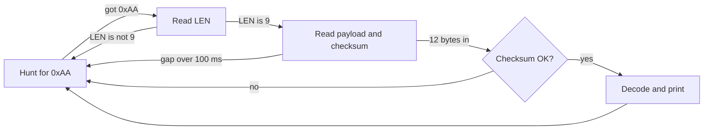
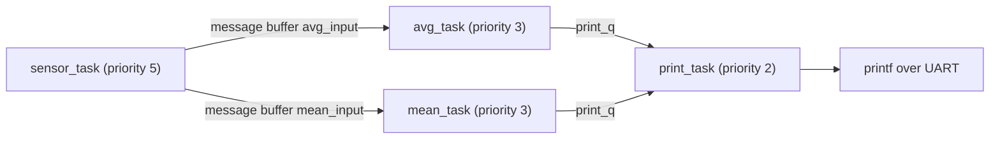

### Part 1: Bit Manipulation (`bughunt1.c`)

- **[[#BH1-1 Missing stdint include]]**
  - 🔴 **Broken:** Uses `uint8_t` / `uint32_t` without `#include <stdint.h>`.
  - ⚡ **Why:** Fixed-width types are C99 typedefs in `<stdint.h>`, not built-in keywords (`pico/stdlib.h` hides this on target, fails on host).
  - 🟢 **Fix:** Add `#include <stdint.h>`.
- **[[#BH1-2 Missing semicolon]]**
  - 🔴 **Broken:** `uint8_t count = 0` (no `;`) followed by `while (v)`.
  - ⚡ **Why:** Parser only fails when it hits `while`, reporting the error on the line *after* the missing semicolon.
  - 🟢 **Fix:** `uint8_t count = 0;` (always check the line above a syntax error).
- **[[#BH1-3 Signed shift infinite loop]]**
  - 🔴 **Broken:** `while (value) { count += value & 1; value >>= 1; }` where `value` is `int` (`-1`).
  - ⚡ **Why:** `-1` is `0xFFFFFFFF`; right-shifting a signed negative `int` is an **arithmetic shift** that copies the sign bit (`1`) into bit 31 forever.
  - 🟢 **Fix:** Cast to unsigned first: `uint32_t v = (uint32_t)value;` so `>>= 1` is a **logical shift** (fills top bit with `0`).
- **[[#BH1-4 Operator precedence in pin_is_clear]]**
  - 🔴 **Broken:** `return (mask & 1u << pin == 0);`
  - ⚡ **Why:** Precedence is `<<` then `==` then `&`; parses as `mask & ((1u << pin) == 0)` $\rightarrow$ `mask & 0` $\rightarrow$ always `0`.
  - 🟢 **Fix:** `return (mask & (1u << pin)) == 0;`
- **[[#BH1-5 Off-by-one in reverse_bits]]**
  - 🔴 **Broken:** `for (int i = 0; i <= 32; i++) r |= ((v >> i) & 1) << (31 - i);`
  - ⚡ **Why:** At `i == 32`, shifting by $\ge$ bit-width (`v >> 32`) and by a negative count (`<< -1`) are both **Undefined Behaviour**.
  - 🟢 **Fix:** `for (int i = 0; i < 32; i++)` (indices `0..31`).

---

### Part 2: Frame Codec & UART Link (`frame.c` & `bughunt2_pico.c`)

- **[[#BH2-1 sizeof instead of FRAME_PAYLOAD]]**
  - 🔴 **Broken:** `uint8_t len = sizeof(reading_t);` (gives `12` instead of `9`).
  - ⚡ **Why:** Compiler inserts **alignment padding** (1 byte after `status`, 2 bytes after `temp_c_x10`) so fields sit on 2- and 4-byte boundaries.
  - 🟢 **Fix:** `uint8_t len = FRAME_PAYLOAD;` (`9`).
- **[[#BH2-2 Struct copied straight onto the wire]]**
  - 🔴 **Broken:** `const uint8_t *p = (const uint8_t *)r; out[n++] = p[i];`
  - ⚡ **Why:** Sends alignment padding bytes (`0x00`) and sends multi-byte integers in **little-endian** memory order instead of big-endian wire order.
  - 🟢 **Fix:** Pack each field explicitly byte-by-byte (`r->sensor_id >> 8`, `r->sensor_id`, etc.).
- **[[#BH2-3 Off-by-one in the payload loop]]**
  - 🔴 **Broken:** `for (uint8_t i = 0; i < len - 1; i++)`
  - ⚡ **Why:** Stops one byte early, dropping the final byte of `timestamp_ms` from both the frame and checksum.
  - 🟢 **Fix:** `for (uint8_t i = 0; i < len; i++)`
- **[[#BH2-4 Shifting a uint8_t into the sign bit]]**
  - 🔴 **Broken:** `r->timestamp_ms = (payload[5] << 24) | ...` where `payload` is `uint8_t[]`.
  - ⚡ **Why:** `uint8_t` undergoes **integer promotion** to signed 32-bit `int`; if `payload[5] >= 0x80`, shifting left by 24 overflows the sign bit (UB).
  - 🟢 **Fix:** Cast before shifting: `((uint32_t)payload[5] << 24) | ((uint32_t)payload[6] << 16) | ...`
- **[[#BH2-5 Decoder trusts the length byte]]**
  - 🔴 **Broken:** `len = in[1]; for (uint8_t i = 0; i < len; i++) payload[i] = in[2 + i];`
  - ⚡ **Why:** Untrusted `len` up to `255` overflows `uint8_t payload[16]` on the stack.
  - 🟢 **Fix:** Validate before the loop: `if (len != FRAME_PAYLOAD || in_len != len + 3u) return false;`
- **[[#BH2-6 UART CRLF translation]]**
  - 🔴 **Broken:** `uart_set_translate_crlf(LINK_UART, true);` on a binary link.
  - ⚡ **Why:** Driver injects `0x0D` (`\r`) before every `0x0A` (`\n`) byte in the payload, stretching the frame to 13 bytes and breaking alignment.
  - 🟢 **Fix:** `uart_set_translate_crlf(LINK_UART, false);` (or use `uart_putc_raw()`).
- **[[#BH2-7 Receiver never hunts for the start byte]]**
  - 🔴 **Broken:** Collects any 12 bytes into `buf[]` without checking `buf[0] == FRAME_SOF` (`0xAA`).
  - ⚡ **Why:** One stray wire byte shifts the 12-byte window forever; the receiver can never resynchronise.
  - 🟢 **Fix:** Drop bytes when `n == 0 && byte != FRAME_SOF`, check `LEN`, and reset `n = 0` on an inter-byte timeout.

---

### Part 3: IR Wheel Encoder ISR (`bughunt3.c`)

- **[[#BH3-1 Missing volatile]]**
  - 🔴 **Broken:** `static uint32_t pulse_count = 0;` read in `while (pulse_count < TARGET_SLOTS)`.
  - ⚡ **Why:** At `-O3`, compiler proves nothing in `main` modifies `pulse_count`, hoists the read into a register once, and spins forever (`b.n .`).
  - 🟢 **Fix:** Mark all ISR-shared variables `volatile` (`static volatile uint32_t pulse_count = 0;`).
- **[[#BH3-2 ISR never disabled after the target]]**
  - 🔴 **Broken:** Prints final report in `main` while `encoder_isr` is still enabled.
  - ⚡ **Why:** The wheel keeps spinning and the ISR keeps overwriting `pulse_count` and `slot_width_us` mid-print (race condition).
  - 🟢 **Fix:** Disable the IRQ (`gpio_set_irq_enabled_with_callback(..., false, ...)`) immediately after the `while` loop exits.
- **[[#BH3-3 Debounce check uses addition]]**
  - 🔴 **Broken:** `if (now > last_debounce_us + DEBOUNCE_US)`
  - ⚡ **Why:** Near the 71.6-minute `time_us_32()` rollover, `last_debounce_us + DEBOUNCE_US` wraps around $2^{32}$ (or `now` wraps first, locking out edges for 71 minutes).
  - 🟢 **Fix:** Use wrap-safe unsigned subtraction: `if (now - last_debounce_us > DEBOUNCE_US)`.
- **[[#BH3-4 Debounce constant too long]]**
  - 🔴 **Broken:** `#define DEBOUNCE_US 50000u` (50 ms).
  - ⚡ **Why:** 50 ms is for mechanical buttons; on a 20-slot optical encoder it swallows real edges above **60 RPM**, reporting a plausible wrong speed.
  - 🟢 **Fix:** `#define DEBOUNCE_US 500u` (allows up to 6,000 RPM).
- **[[#BH3-5 Missing break in the switch]]**
  - 🔴 **Broken:** `case ENC_IDLE:` has no `break;` before `case ENC_SLOT:`.
  - ⚡ **Why:** Control falls through on the very first edge, setting `slot_width_us = now - now = 0` (0 RPM) and incrementing `pulse_count` on every edge.
  - 🟢 **Fix:** Add `break;` at the end of `case ENC_IDLE:`.
- **[[#BH3-6 printf inside the ISR]]**
  - 🔴 **Broken:** Calling `printf("edge...")` inside `encoder_isr`.
  - ⚡ **Why:** UART `printf` takes ~3 ms (hundreds of thousands of cycles), starving other interrupts, missing fast edges, and masking timing bugs (**Heisenbug**).
  - 🟢 **Fix:** Remove `printf` from the ISR; log to a buffer/queue and print in `main`.
- **[[#BH3-7 Only the falling edge enabled]]**
  - 🔴 **Broken:** `gpio_set_irq_enabled_with_callback(ENCODER_PIN, GPIO_IRQ_EDGE_FALL, true, &encoder_isr);`
  - ⚡ **Why:** State machine needs **both** edges (falling to start slot, rising to end slot); falling-only measures a full period instead of a slot and halves the count rate.
  - 🟢 **Fix:** Enable (and later disable) `GPIO_IRQ_EDGE_FALL | GPIO_IRQ_EDGE_RISE`.
- **[[#BH3-8 Torn reads and the final report]]**
  - 🔴 **Broken:** Reading `volatile uint64_t last_edge_us` in `main` while the ISR can still fire.
  - ⚡ **Why:** `volatile` does **not** give atomicity; a 64-bit load on a 32-bit Cortex-M0+ takes two 32-bit `ldr` instructions, which an ISR can split (**torn read**).
  - 🟢 **Fix:** Disable the IRQ first, or wrap the read in `save_and_disable_interrupts()` / `restore_interrupts()`.

---

### Part 4: Signal Chain — ADC, Filter, PWM (`algo.c` & `bughunt4.c`)

- **[[#BH4-1 Multiply stored in 16 bits]]**
  - 🔴 **Broken:** `uint16_t scaled = raw * VREF_MV; return scaled / ADC_MAX;`
  - ⚡ **Why:** `raw * 3300` reaches `13,513,500`, which truncates modulo $65,536$ when squeezed into `uint16_t scaled` before dividing.
  - 🟢 **Fix:** `return (uint16_t)(((uint32_t)raw * VREF_MV) / ADC_MAX);`
- **[[#BH4-2 Divide before multiply]]**
  - 🔴 **Broken:** `return (raw / ADC_MAX) * wrap;`
  - ⚡ **Why:** Integer division `raw / 4095` truncates to `0` for every `raw < 4095`, so duty is stuck at `0`.
  - 🟢 **Fix:** Multiply first, divide last: `return (uint16_t)(((uint32_t)raw * wrap) / ADC_MAX);`
- **[[#BH4-3 One filter state shared by every channel]]**
  - 🔴 **Broken:** `static uint32_t y = 0;` shared across all channels (`(void)ch;`).
  - ⚡ **Why:** Channel 0 and Channel 1 overwrite each other's filter memory, settling halfway between the two inputs.
  - 🟢 **Fix:** Use an array `static uint32_t y[NUM_CHANNELS] = {0};` indexed by `y[ch]`.
- **[[#BH4-4 Unsigned filter arithmetic and the hidden channel]]**
  - 🔴 **Broken:** `y += (x - y) >> ALPHA_SHIFT;` with `uint32_t x, y`.
  - ⚡ **Why:** When input drops (`x < y`), unsigned `x - y` underflows to ~`4.29e9`, making the filter jump up by ~268 million instead of falling.
  - 🟢 **Fix:** Cast to signed before subtracting: `int32_t diff = (int32_t)x - (int32_t)y[ch];`
- **[[#BH4-4b Filter stalls short of the target]]**
  - 🔴 **Broken:** `y[ch] += (diff >> ALPHA_SHIFT);`
  - ⚡ **Why:** Arithmetic right shift rounds toward $-\infty$: for `0 < diff < 16`, `diff >> 4` is `0` (stalls 15 short when rising), while `-15 >> 4` is `-1` (reaches target when falling).
  - 🟢 **Fix:** Round away from zero on positive steps: `(diff >= 0) ? (diff + 15) >> 4 : diff >> 4`.
- **[[#BH4-5 PWM wrap off by one]]**
  - 🔴 **Broken:** `return (uint16_t)(ALGO_SYS_CLK_HZ / clk_div / hz);` (`25000`).
  - ⚡ **Why:** Hardware counter counts `0..wrap` **inclusive** (`wrap + 1` ticks per period).
  - 🟢 **Fix:** Subtract 1: `return (uint16_t)(total_ticks - 1);` (`24999`).
- **[[#BH4-6 ADC read before input select]]**
  - 🔴 **Broken:** `uint16_t raw_a = adc_read(); adc_select_input(0);`
  - ⚡ **Why:** RP2040 has one ADC behind a multiplexer; `adc_read()` converts whatever input was selected *before* the call.
  - 🟢 **Fix:** Always call `adc_select_input(ch)` **before** `adc_read()`.
- **[[#BH4-7 printf format mismatch]]**
  - 🔴 **Broken:** `printf("... (%d V) ...", ..., v, ...)` where `v` is `float`.
  - ⚡ **Why:** `%d` expects a 32-bit `int`, but `float` promotes to a 64-bit `double`, printing garbage for `v` and corrupting every argument after it on the line.
  - 🟢 **Fix:** Use `%.2f` (caught by `-Wformat`).
- **[[#BH4-8 Unsigned delta in the controller]]**
  - 🔴 **Broken:** `uint32_t delta = TARGET_MV - mv; if (delta < 0) duty--; else duty++;`
  - ⚡ **Why:** Unsigned `delta` can never be `< 0`; when `mv > TARGET_MV`, `delta` wraps to a huge positive number and increases `duty` further (positive feedback runaway to 100%).
  - 🟢 **Fix:** `int32_t delta = (int32_t)TARGET_MV - (int32_t)mv;`

---

### Part 5: FreeRTOS Sensor Pipeline (`bughunt5.c` & `FreeRTOSConfig.h`)

- **[[#BH5-1 Assertions and failure hooks are switched off]]**
  - 🔴 **Broken:** `#define configASSERT(x)` is empty; stack-overflow and malloc-failed hooks are `0`.
  - ⚡ **Why:** Kernel invariant violations, heap exhaustion, and stack overflows fail silently and corrupt memory later.
  - 🟢 **Fix:** Define `configASSERT(x)` to disable interrupts and halt (`for(;;);`), set `configCHECK_FOR_STACK_OVERFLOW 2` and `configUSE_MALLOC_FAILED_HOOK 1`.
- **[[#BH5-2 Sending the size of a pointer]]**
  - 🔴 **Broken:** `xMessageBufferSend(mbuf, &sample, sizeof(&sample), 0);`
  - ⚡ **Why:** `sizeof(&sample)` is the pointer size (`4` bytes), not `sizeof(int16_t)` (`2` bytes). Receiver asks for 2 bytes, sees a 4-byte message won't fit, and returns `0` forever.
  - 🟢 **Fix:** Use `sizeof sample` (2 bytes) and `configASSERT(sent == sizeof sample)`.
- **[[#BH5-3 Relative one-tick delay]]**
  - 🔴 **Broken:** `vTaskDelay(1);` at the end of `sensor_task`.
  - ⚡ **Why:** `vTaskDelay` takes **ticks** (1 tick = 1 ms at 1 kHz, $100\times$ too fast) and is relative to *now*, so loop execution time causes cumulative timing **drift**.
  - 🟢 **Fix:** Use `vTaskDelayUntil(&next, pdMS_TO_TICKS(100));`.
- **[[#BH5-4 Two readers on one message buffer]]**
  - 🔴 **Broken:** Both `avg_task` and `mean_task` call `xMessageBufferReceive` on one shared `mbuf`.
  - ⚡ **Why:** A FreeRTOS message buffer is strictly **1 sender, 1 receiver**; two readers split samples between them and corrupt the single waiting-task slot.
  - 🟢 **Fix:** Create two separate message buffers (`avg_input` and `mean_input`) and send to both.
- **[[#BH5-5 Shared ring buffer]]**
  - 🔴 **Broken:** Global `ring[]` pushed by both `avg_task` and `mean_task` with an unused mutex.
  - ⚡ **Why:** Unprotected concurrent updates race on `head`/`fill`, and pushing twice per sample halves the moving-average window from 10 samples to 5.
  - 🟢 **Fix:** Move `ring[]` inside `avg_task` as a local array (eliminate shared state).
- **[[#BH5-6 Shared running-mean helper and a float accumulator]]**
  - 🔴 **Broken:** `static float acc = 0.0f; static int n = 0;` inside `running_mean()` called by two tasks.
  - ⚡ **Why:** `static` locals are shared across callers (non-reentrant race condition), and a `float` accumulator loses integer precision past $2^{24}$ (~55 minutes in).
  - 🟢 **Fix:** Keep local `int64_t sum` and `uint64_t count` inside `mean_task` only.
- **[[#BH5-7 Dividing by the constant window size]]**
  - 🔴 **Broken:** `avg = ring_sum() / RING_LEN;` (always divides by 10, in integer arithmetic).
  - ⚡ **Why:** For the first 9 samples (`fill < 10`), dividing by 10 under-reports the temperature (`2.5 C` instead of `25.0 C`), and integer division drops tenths.
  - 🟢 **Fix:** Divide by the actual sample count `fill` in float: `(float)sum / (float)fill / 10.0f`.
- **[[#BH5-8 Dropped messages and blocking in the wrong place]]**
  - 🔴 **Broken:** `xQueueSend(print_q, &m, 0);` with ignored return value, and calling `say()` from a software timer callback.
  - ⚡ **Why:** Timeout `0` silently drops messages when `print_q` is full, and software timer callbacks must **never** block.
  - 🟢 **Fix:** Use `portMAX_DELAY` + `configASSERT` in `say()`, and move the 1-second health print into `print_task`.
- **[[#BH5-9 print_task stack too small]]**
  - 🔴 **Broken:** `print_task` created with `configMINIMAL_STACK_SIZE` (256 words = 1 KB).
  - ⚡ **Why:** `printf` with `%f` uses heavy stack space, overflowing into adjacent heap memory.
  - 🟢 **Fix:** Increase `print_task` stack to `1024` words (4 KB), assert `xTaskCreate == pdPASS`, and monitor with `uxTaskGetStackHighWaterMark()`.

---

### Part 6: Telemetry Layer & PID (`bughunt6.c` & `pid.c`)

- **[[#BH6-1 Table one entry too small]]**
  - 🔴 **Broken:** `static uint8_t crc_table[255];` filled by `for (int i = 0; i < 256; i++)`.
  - ⚡ **Why:** `crc_table[255]` writes 1 byte past the end of the 255-element global array (UB / global buffer overflow).
  - 🟢 **Fix:** `static uint8_t crc_table[256];`
- **[[#BH6-2 CRC starts from garbage]]**
  - 🔴 **Broken:** `uint8_t crc;` (uninitialised local variable in `crc8`).
  - ⚡ **Why:** Starts CRC calculation from leftover stack garbage instead of `0x00`, producing random CRC failures across optimization levels.
  - 🟢 **Fix:** `uint8_t crc = 0x00u;`
- **[[#BH6-3 Wrong LFSR taps]]**
  - 🔴 **Broken:** `#define LFSR_TAPS 0xB000u` (missing bit 10 for tap 11).
  - ⚡ **Why:** Gives a short period of 1,533 instead of the maximal 16-bit period of `65,535`.
  - 🟢 **Fix:** `#define LFSR_TAPS 0xB400u` (`0x8000 | 0x2000 | 0x1000 | 0x0400`).
- **[[#BH6-4 Period loop gives up at 200]]**
  - 🔴 **Broken:** `while (lfsr_state != start && n < 200u);`
  - ⚡ **Why:** Stops counting at 200, hiding both the true 65,535 period and the broken 1,533 period.
  - 🟢 **Fix:** Raise the safety cap above 65,535: `n < 70000u`.
- **[[#BH6-5 parse_ts three bugs in one line]]**
  - 🔴 **Broken:** `return *(uint32_t *)&frame[2];`
  - ⚡ **Why:** (1) Unaligned 32-bit `ldr` at `&frame[2]` triggers a **HardFault** on Cortex-M0+, (2) little-endian load reverses big-endian wire bytes (`0x44332211`), (3) discards `const` and violates strict aliasing.
  - 🟢 **Fix:** Assemble byte-by-byte with `(uint32_t)` casts and shifts (`<< 24`, `<< 16`, `<< 8`).
- **[[#BH6-6 parse_frame trusts the length byte]]**
  - 🔴 **Broken:** `uint8_t len = frame[1]; if (crc8(&frame[2], len) != frame[2 + len])`
  - ⚡ **Why:** Hostile frame `{0xA5, 200, 0x00, 0x00}` causes `crc8` and `frame[2 + len]` to read ~200 bytes past the 4-byte buffer.
  - 🟢 **Fix:** Check `if (len < 6 || (uint16_t)len + 3u > frame_len) return false;` before using `len`.
- **[[#BH6-7 format_reading returns a local buffer]]**
  - 🔴 **Broken:** Declares `char buf[32];` inside `format_reading()` and `return buf;`.
  - ⚡ **Why:** Stack frame is destroyed on return, yielding a **dangling pointer** (GCC replaces it with `NULL` $\rightarrow$ prints `(null)`).
  - 🟢 **Fix:** Pass a caller-owned buffer in (re-entrant), or use `static char buf[32];` (single-caller only).
- **[[#BH6-8 label_for allocates one byte short]]**
  - 🔴 **Broken:** `char *out = malloc(strlen(name)); strcpy(out, name);`
  - ⚡ **Why:** `strlen()` excludes the null terminator `'\0'`, so `strcpy()` writes 1 byte past the heap allocation (aborts at `-O2`).
  - 🟢 **Fix:** `char *out = malloc(strlen(name) + 1);`
- **[[#BH6-9 Delay loop deleted by the optimiser]]**
  - 🔴 **Broken:** `for (uint32_t i = 0; i < 6000; i++);`
  - ⚡ **Why:** Loop has no observable side effect, so `-O3` deletes it completely (`bx lr`, 0 µs delay). Even with `volatile`, cycle count varies with build flags.
  - 🟢 **Fix:** Use a hardware timer (`busy_wait_us_32(500)` / `sleep_us(500)`), or `volatile uint32_t i` with enough iterations.
- **[[#BH6-10 Spin on a flag the compiler can't see change]]**
  - 🔴 **Broken:** `static bool conversion_done = false;` polled in `while (!conversion_done);`.
  - ⚡ **Why:** Same as BH3-1: without `volatile`, `-O3` hoists the read once and emits an infinite loop (`b.n spin`).
  - 🟢 **Fix:** `static volatile bool conversion_done = false;`
- **[[#BH6-11 Loop counter narrower than the length]]**
  - 🔴 **Broken:** `for (uint8_t i = 0; i < len; i++)` where `len` is `uint16_t` (`300`).
  - ⚡ **Why:** `uint8_t i` wraps from `255` back to `0` (`uxtb`), so `i < 300` is true forever (infinite loop).
  - 🟢 **Fix:** Match counter type to bound: `for (uint16_t i = 0; i < len; i++)`.
- **[[#BH6-12 crc8 never checks the table is ready]]**
  - 🔴 **Broken:** `crc_ready` is set in `crc_init()`, but `crc8()` never checks it.
  - ⚡ **Why:** Calling `crc8()` before `crc_init()` reads an all-zero table and returns `0x00` for every input.
  - 🟢 **Fix:** Add `if (!crc_ready) crc_init();` at the top of `crc8()`.
- **[[#BH6 pid.c (discrete PID controller simulation)]]**
  - 🔴 **Broken (Build & Warnings):** Missing `;` after `100` (**PID-1**), `prev_error` passed by value instead of `&prev_error` (**PID-2**), `%d` used to print `float control_signal` (**PID-3**), missing `}` on `for` loop (**PID-4**), missing `#include <unistd.h>` (**PID-5**), useless comparison `prev_error == current_value;` (**PID-9**).
  - 🔴 **Broken (Control Logic):** `error = current_value - setpoint` causes positive-feedback runaway (**PID-6**); missing `current_value += motor_response;` leaves the plant open-loop so it never converges (**PID-7**); `*prev_error = current_value` tracks position instead of error (**PID-8**); `usleep(time_step)` truncates `0.1` s to `0 µs` instead of multiplying by `1,000,000` (**PID-10**); integral and derivative omit `* dt` and `/ dt` (**PID-11**).

---

# Part 1 - Bug Hunt 1 (bit manipulation)

Five defects were planted and fixed in `bughunt1.c`. Each one is broken down below: what was wrong, why it broke, and the C/embedded idea it tests.

**The caller.** This is the test harness that exposes every bug in this part:

```c
check_int("count_bits(0x000000FF)", count_bits(0x000000FF), 8);
check_int("count_bits(-1)",         count_bits(-1),         32);

check_int("even_parity(0x000000FF)", even_parity(0x000000FFu), 1);

check_int("pin_is_clear(LED_MASK, 2)", pin_is_clear(LED_MASK, 2), 0);
check_int("pin_is_clear(LED_MASK, 3)", pin_is_clear(LED_MASK, 3), 1);
check_int("pin_is_clear(LED_MASK, 5)", pin_is_clear(LED_MASK, 5), 0);

check_u32("reverse_bits(0x12345678)", reverse_bits(0x12345678u), 0x1E6A2C48u);
check_u32("swap_nibbles(0x12345678)", swap_nibbles(0x12345678u), 0x21436587u);
```

---

## BH1-1 Missing stdint include

**Where:** top of file, before `count_bits`.

**What was wrong:** the file uses `uint8_t` and `uint32_t` everywhere but never included the header that defines them.

> [!bug] Broken
> ```c
> #include <stdio.h>
> #include <stdbool.h>
> /* no <stdint.h> here */
>
> uint8_t count_bits(int value)          // error: unknown type name 'uint8_t'
> {
>     uint32_t v = (uint32_t)value;      // error: unknown type name 'uint32_t'
>     ...
> }
>
> bool even_parity(uint32_t value)       // error: unknown type name 'uint32_t'
> {
>     uint8_t bits = count_bits(value);  // error: unknown type name 'uint8_t'
>     ...
> }
> ```

> [!success] Fixed
> ```c
> #include <stdio.h>
> #include <stdbool.h>
> #include <stdint.h>   // defines uint8_t, uint32_t, etc.
> ```

**Why it matters.** `uint8_t`, `uint32_t` and friends are not C keywords. They are typedefs from `<stdint.h>` (C99). No include, no idea what `uint32_t` means, and the compiler stops with an "unknown type name" error. It is a build-time failure, not a runtime bug.

> [!warning] Gotcha
> On the Pico build, `pico/stdlib.h` typically pulls in `<stdint.h>` for you. So the code can compile on the Pico and still fail on your laptop. Include what you use. Don't count on another header dragging it in.

**Concept: fixed-width integer types.** `int` and `long` change size between platforms and compilers. On embedded targets you almost always want to be explicit (`uint32_t` is exactly 32 bits, unsigned). For bitwise work the exact width decides whether the code is correct.

---

## BH1-2 Missing semicolon

**Where:** `uint8_t count = 0` inside `count_bits`.

**What was wrong:** no `;` after the declaration.

> [!bug] Broken
> ```c
> uint8_t count_bits(int value)
> {
>     uint32_t v = (uint32_t)value;
>
>     uint8_t count = 0          // <-- the real defect is here (no ;)
>
>     while (v) {                // <-- GCC reports the error here:
>         count += v & 1;        //     expected ',' or ';' before 'while'
>         v >>= 1;
>     }
>     return count;
> }
> ```

> [!success] Fixed
> ```c
>     uint8_t count = 0;
> ```

**Why it matters.** Every C statement needs a `;`. The compiler refuses to build, but it often points at the wrong line. The parser can't tell the declaration ended until it hits `while`, a token that cannot continue `uint8_t count = 0`. So the error lands on the line after the real mistake.

> [!question]- Week 1 Q4: GCC reports an error on line 32 but the actual defect is a missing semicolon on line 30. Why?
> **Answer: A.** The parser only fails once it reaches a token that cannot continue the statement.
>
> This is the snippet above. The missing `;` is on the `count = 0` line and GCC complains at the `while`. It is not a macro (B), the error is not genuinely on the later line (C), and GCC line numbers are not off by two (D).

**Concept:** when you see a syntax error, always look at the line above it too.

---

## BH1-3 Signed shift infinite loop

**Where:** `count_bits(int value)`, the line that turns `value` into `v` before the counting loop.

**What was wrong:** the loop does `v >>= 1` until `v` is `0`. If `v` is a **signed negative** `int`, the right shift is implementation-defined. On virtually every real compiler and CPU, including the Pico's ARM core, it is an **arithmetic shift**. The sign bit (1 for negatives) is copied into the new top bit instead of a `0`.

> [!bug] Broken (the version shown in the lab quiz)
> ```c
> uint8_t count_bits(int value)
> {
>     uint8_t count = 0;
>     while (value) {            // value is a signed int
>         count += value & 1;
>         value >>= 1;           // arithmetic shift: sign bit copied back in
>     }
>     return count;
> }
>
> // caller
> check_int("count_bits(-1)", count_bits(-1), 32);   // hangs, never prints
> ```

> [!success] Fixed
> ```c
> uint8_t count_bits(int value)
> {
>     uint32_t v = (uint32_t)value;   // same bits, now unsigned
>
>     uint8_t count = 0;
>     while (v) {
>         count += v & 1;
>         v >>= 1;                    // logical shift: top bit filled with 0
>     }
>     return count;
> }
> ```

**Walking through `count_bits(-1)`:**

- `-1` in 32-bit two's complement is `0xFFFFFFFF`. Every bit is already 1.
- A signed right shift copies the sign bit back into bit 31 every time.
- So the value stays `0xFFFFFFFF` forever. The `while` never sees `0`.
- It is an infinite loop, not a crash. On the Pico it hangs the board. On a laptop it pegs a CPU core until you kill it.

| Step | Broken (signed `int`) | Fixed (`uint32_t`) |
|---|---|---|
| start | `0xFFFFFFFF` | `0xFFFFFFFF` |
| after 1 shift | `0xFFFFFFFF` (sign copied) | `0x7FFFFFFF` |
| after 2 shifts | `0xFFFFFFFF` | `0x3FFFFFFF` |
| after 31 shifts | `0xFFFFFFFF` | `0x00000001` |
| after 32 shifts | `0xFFFFFFFF` (never 0) | `0x00000000`, loop ends, `count == 32` |

**Why the function still takes `int`.** The caller passes a plain `-1`, and `even_parity` passes a `uint32_t`. Both just hand over a bit pattern. `(uint32_t)value` converts the pattern without changing any bits, which is what we want.

> [!question]- Week 1 Q3: What happens when `count_bits()` is called with `value = -1`?
> **Answer: D.** Loops forever.
>
> Negative ints are two's complement, so `-1` is all 1s. `value >>= 1` on a signed negative keeps the sign by shifting a 1 in from the left. The value stays `-1` and the loop never ends. It does not return 32 (B) because it never returns at all. Fix from the quiz: copy the value into an unsigned variable first.

**The fix in one line:** `uint32_t v = (uint32_t)value;` Right-shifting an unsigned value is always a logical shift, so `v` eventually hits `0`.

| Shift type | Applies to | What fills the vacated top bit |
|---|---|---|
| Logical shift | unsigned types | always `0` |
| Arithmetic shift | signed types | copy of the sign bit (0 or 1) |

> [!tip] Rule of thumb
> Never right-shift a signed value if you rely on it reaching zero, or if you treat the bits as a raw pattern. Cast to unsigned first.

> [!note] Same family of bug
> Signed values sneaking into shifts shows up again in [[#BH2-4 Shifting a uint8_t into the sign bit]]. There the culprit is integer promotion instead of an `int` parameter, and Week 2 Q5 is built on it.

---

## BH1-4 Operator precedence in pin_is_clear

**Where:** `pin_is_clear`, originally `return (mask & 1u << pin == 0);`

**What was wrong:** it reads like "is `mask & (1u << pin)` equal to zero". C does not group it that way.

> [!bug] Broken
> ```c
> bool pin_is_clear(uint32_t mask, unsigned pin)
> {
>     return (mask & 1u << pin == 0);
>     // the compiler reads it as:
>     // return (mask & ((1u << pin) == 0));
> }
>
> // caller
> check_int("pin_is_clear(LED_MASK, 3)", pin_is_clear(LED_MASK, 3), 1);
> ```

> [!success] Fixed
> ```c
> bool pin_is_clear(uint32_t mask, unsigned pin)
> {
>     return (mask & (1u << pin)) == 0;
> }
> ```

**Precedence, highest to lowest:**

1. `<<` (shift)
2. `==` (equality)
3. `&` (bitwise AND)

So the compiler parses `mask & 1u << pin == 0` as `mask & ((1u << pin) == 0)`. `1u << pin` is a power of two, never `0`, so `(1u << pin) == 0` is always false. C evaluates false as the integer `0`. The whole thing collapses to `mask & 0`, which is always `0`. The function returns `false` for **every** pin. It is silently wrong, not a crash.

**Tracing the three test calls with the broken version** (`LED_MASK = 0x24 = 0b0010_0100`):

| Call | Expected | Broken returns | Result |
|---|---|---|---|
| `pin_is_clear(LED_MASK, 2)` | 0 | `0x24 & 0` = 0 | passes by accident |
| `pin_is_clear(LED_MASK, 3)` | 1 | `0x24 & 0` = 0 | **FAIL** |
| `pin_is_clear(LED_MASK, 5)` | 0 | `0x24 & 0` = 0 | passes by accident |

Two of the three tests pass for the wrong reason. Only the pin 3 test exposes it. A passing test does not prove the code is right.

**Worked example with the fixed code:**

- `pin_is_clear(0x24, 2)`: `1u << 2 = 0b0100`. `0x24 & 0b0100 = 0b0100`, non-zero, so bit 2 is set and the function returns `false`.
- `pin_is_clear(0x24, 3)`: `1u << 3 = 0b1000`. `0x24 & 0b1000 = 0`, so bit 3 is clear and the function returns `true`.

> [!question]- Week 1 Q2: How does the compiler parse `mask & 1u << pin == 0`?
> **Answer: C.** `(mask & ((1u << pin) == 0))`
>
> The quiz gives the same ladder as above: `<<` / `>>` first, then `==`, then `&`. Option D, `((mask & (1u << pin)) == 0)`, is what the programmer *meant*. That is why it is the tempting wrong answer. It is also the fixed code.

> [!question]- Week 1 Q1: What does `printf("%d\n", a > b);` print in C?
> **Answer: C.** `1` or `0`.
>
> Comparison operators in C produce an `int`, `1` for true and `0` for false. That is exactly why `(1u << pin) == 0` becomes the plain number `0` in the broken code, and why `mask & 0` wipes out the answer.

**Concept:** bitwise operators (`&`, `|`, `^`) bind more loosely than comparisons (`==`, `<`, `>`). That is the opposite of what maths notation trains you to expect. GCC flags this with `-Wall` (`-Wparentheses`). The safe habit: always parenthesize bitwise expressions that are mixed with comparisons.

---

## BH1-5 Off-by-one in reverse_bits

**Where:** `reverse_bits`, the `for` loop.

**What was wrong:** the loop was `for (int i = 0; i <= 32; i++)`, so `i` reached `32`.

> [!bug] Broken
> ```c
> uint32_t reverse_bits(uint32_t v)
> {
>     uint32_t r = 0;
>
>     for (int i = 0; i <= 32; i++)                // 33 iterations, i reaches 32
>         r |= ((v >> i) & 1) << (31 - i);
>         //      ^^^^^^^^        ^^^^^^^
>         //      i == 32: v >> 32       i == 32: << -1
>         //      (shift >= width: UB)   (negative shift: UB)
>
>     return r;
> }
>
> // caller
> check_u32("reverse_bits(0x12345678)", reverse_bits(0x12345678u), 0x1E6A2C48u);
> ```

> [!success] Fixed
> ```c
>     for (int i = 0; i < 32; i++)                 // i = 0..31, exactly 32 iterations
>         r |= ((v >> i) & 1) << (31 - i);
> ```

**How the loop body works for one bit.** Take `v = 0x00000001` and `i = 0`:

- `v >> 0` leaves `0x00000001`. `& 1` keeps the lowest bit, giving `1`.
- `<< (31 - 0)` moves it to bit 31, giving `0x80000000`.
- `r |= ...` sets that bit in `r`. Every other `i` mirrors its own bit to position `31 - i`.

**Why `i == 32` is a problem:**

- `v >> 32`: shifting a 32-bit value by its own width or more is **undefined behaviour**. It is not guaranteed to be `0`. Some targets take the shift count mod 32, so `v >> 32` can behave like `v >> 0`.
- `<< (31 - 32)` is `<< -1`. A negative shift count is also undefined behaviour.

**Why it is dangerous rather than obviously broken.** On x86 the shift instruction typically masks the count to 5 bits. The extra iteration then often re-ORs a bit that is already in place. That is how the broken loop can pass these exact tests on a laptop, then fail on the Pico's Cortex-M0+ or at a higher optimisation level. UB is allowed to do anything, including "work by accident".

> [!question]- Week 6 Q3: Undefined behaviour often appears only when optimisation is enabled. Why?
> **Answer: B.** The compiler may assume UB never happens and optimise on that assumption.
>
> This is the `reverse_bits` story. The optimiser is allowed to assume `i` never reaches a shift that is illegal. Code that looked fine at `-O0` can be rearranged or deleted at `-O2`. Passing on one build proves nothing.

**Concept:** check loop bounds against the real index range (`0` to `width - 1`). Treat "shift count >= width" and "negative shift count" as always undefined.

---

## BH1 Bonus - swap_nibbles is not broken

The comment says "this one may or may not be broken, check it". The lesson is to verify code instead of assuming a bug exists because it is under suspicion.

```c
uint32_t swap_nibbles(uint32_t v)
{
    return ((v & 0x0F0F0F0Fu) << 4) | ((v & 0xF0F0F0F0u) >> 4);
}

// caller
check_u32("swap_nibbles(0x12345678)", swap_nibbles(0x12345678u), 0x21436587u);
```

Walking through `v = 0x12345678`:

- `v & 0x0F0F0F0F` keeps the **low nibble** of each byte: `0x02040608`. Shifted left 4: `0x20406080`.
- `v & 0xF0F0F0F0` keeps the **high nibble** of each byte: `0x10305070`. Shifted right 4: `0x01030507`.
- OR them: `0x21436587`. Matches the expected value.

The types are unsigned and the masks carry the `u` suffix, so `>> 4` is a logical shift and no sign bits leak in. That is the lesson of [[#BH1-3 Signed shift infinite loop]] applied correctly.

> [!tip] Reusable pattern
> Mask, shift, OR. It swaps or reorders any fixed-size groups of bits (nibbles, bytes, and so on).

---

## BH1 Quiz questions not tied to a single bug

> [!question]- Week 1 Q7: Which of these does `gcc -Wall` report in `if(a=2048) a==0;`?
> **Answer: A.** Both, as two separate warnings.
>
> ```c
> if (a = 2048)   // warning: suggest parentheses around assignment used as truth value
>     a == 0;     // warning: statement with no effect
> ```
> The first is `=` where `==` was probably meant. The second is a comparison whose result is thrown away. Neither is a syntax error, so the code compiles. Only `-Wall` tells you something is off. Same lesson as [[#BH1-4 Operator precedence in pin_is_clear]]: valid C is not the same as correct C.

> [!question]- Week 1 Q5: Why does the original `blink` example do nothing on a Pico W?
> **Answer: C.** `PICO_DEFAULT_LED_PIN` is undefined for `pico_w`, so the code compiles out.
>
> The code builds fine. The preprocessor just removes the LED lines.

> [!question]- Week 1 Q6: With `int c = 5;`, what do `printf("%d\n", c++);` then `printf("%d\n", ++c);` print?
> **Answer: B.** `5` then `7`.
>
> `c++` uses the old value, then bumps it (prints 5, `c` becomes 6). `++c` bumps first, then uses it (`c` becomes 7, prints 7).

> [!question]- Week 4 Q5 (loosely related): What is `(uint16_t)(duty_cycle * 65536)` when `duty_cycle` is `1.0f`?
> **Answer: B.** `0`.
>
> `1.0f * 65536` is `65536`, which is `0x10000`. It does not fit in 16 bits, so the low 16 bits are all zero. Same family as `uint8_t count` and the fixed-width point in [[#BH1-1 Missing stdint include]]: know how many bits your type really has. (Strictly, a float-to-integer conversion that is out of range is itself undefined in C. The quiz answer is what you see in practice.)

---

# Part 2 - Bug Hunt 2 (frame codec and UART link)

Seven defects were planted. Five are in `frame.c` and two are in `bughunt2_pico.c`. The spec in `frame.h` is correct. The job is always to fix the code to match the spec, never the other way round.

> [!note] Numbering
> The comments inside the source files reuse the label "BUG #5" for more than one defect. This note uses one consistent numbering: BH2-1 to BH2-5 in `frame.c`, BH2-6 and BH2-7 in `bughunt2_pico.c`.

**Frame layout (per spec):**

```
+------+------+---------------------------+----------+
| 0xAA | LEN  | LEN bytes of payload      | CHECKSUM |
+------+------+---------------------------+----------+
```

Payload is big-endian: `sensor_id` (u16) + `status` (u8) + `temp_c_x10` (i16) + `timestamp_ms` (u32) = 2 + 1 + 2 + 4 = **9 bytes**. The checksum is the 8-bit sum of the payload bytes only. It does not cover `0xAA` or `LEN`.

**The golden test vectors** in `bughunt2_host.c`:

| Vector | Reading | What it stresses |
|---|---|---|
| A: normal | id `0x1234`, status 1, temp 253, ts `0x0A0B0C0D` | baseline. Also contains `0x0A`, which triggers [[#BH2-6 UART CRLF translation]] |
| B: high timestamp, negative temp | id 7, status 0, temp -55, ts `0x80112233` | top bit set in the timestamp MSB ([[#BH2-4 Shifting a uint8_t into the sign bit]]), negative `int16_t` |
| C: extremes | id `0xFFFF`, status `0xFF`, temp -32768, ts 0 | all-ones fields, smallest `int16_t` |

**The callers.** The encoder is called from the Pico's button handler and from the host harness. The decoder is called from `rx_poll`.

```c
// bughunt2_pico.c
static void send_reading(const reading_t *r)
{
    uint8_t frame[FRAME_MAX];
    uint8_t n = frame_encode(r, frame);     // BH2-1, 2, 3 live in here

    hexdump("tx", frame, n);

    for (uint8_t i = 0; i < n; i++)
        uart_putc(LINK_UART, frame[i]);     // BH2-6 bites here
}

// inside rx_poll, once 12 bytes have arrived
if (frame_decode(buf, n, &r))               // BH2-4 and BH2-5 live in here
    printf(...);
```

> [!tip] Debug workflow for this lab
> Hex-dump both sides and compare by eye. Run the host harness with `-Wall -Wextra` and with `-fsanitize=undefined`. Use `offsetof()` whenever the byte layout of a struct matters. The two Pico-only bugs (BH2-6, BH2-7) can only be seen by comparing the `tx` and `rx` dumps on the two boards.

---

## BH2-1 sizeof instead of FRAME_PAYLOAD

**Where:** `frame_encode`, the length byte.

**What was wrong:** the length was computed from `sizeof(reading_t)`, which is **12**. The spec says **9**.

> [!bug] Broken (reconstructed from the comments in `frame.c`)
> ```c
> uint8_t len = sizeof(reading_t);   // 12, not 9
> ```

> [!success] Fixed
> ```c
> uint8_t len = FRAME_PAYLOAD;       // 9, straight from the spec
> ```

**Why.** The compiler silently inserts padding so each member starts at an address that suits its size. A `uint16_t` needs a 2-byte boundary. A `uint32_t` needs a 4-byte boundary.

```c
typedef struct {
    uint16_t sensor_id;      // offsets 0-1
    uint8_t  status;         // offset 2
    int16_t  temp_c_x10;     // wants a 2-byte boundary, so 1 pad byte at offset 3, field at 4-5
    uint32_t timestamp_ms;   // wants a 4-byte boundary, so 2 pad bytes at 6-7, field at 8-11
} reading_t;
```

| Offset | 0 | 1 | 2 | 3 | 4 | 5 | 6 | 7 | 8 | 9 | 10 | 11 |
|---|---|---|---|---|---|---|---|---|---|---|---|---|
| Content | id | id | status | **pad** | temp | temp | **pad** | **pad** | ts | ts | ts | ts |

2 + 1 + 1(pad) + 2 + 2(pad) + 4 = **12 bytes**. This matches the `offsetof()` results in `bughunt2_host.c`: `sensor_id = 0`, `status = 2`, `temp_c_x10 = 4`, `timestamp_ms = 8`.

> [!question]- Week 2 Q9: `sizeof(reading_t)` is 12, but the wire format specifies 9 payload bytes. Why?
> **Answer: B.** The compiler inserts padding so each field is naturally aligned.
>
> This is the exact struct from this bug hunt. It is not a hidden type tag (A), `uint32_t` is not 8 bytes on ARM (C), and the spec is not wrong (D).

**Concept: struct padding.** `sizeof(struct)` is not the sum of its fields. It includes padding, and often trailing padding so arrays of the struct stay aligned. Never assume otherwise when the struct is going onto a wire, into a file, or across a network. None of those know about your compiler's alignment rules.

---

## BH2-2 Struct copied straight onto the wire

**Where:** `frame_encode`, how the payload bytes are produced.

**What was wrong:** the code reinterpreted the struct's memory as bytes and copied them out:

> [!bug] Broken (reconstructed from the comments in `frame.c`)
> ```c
> const uint8_t *p = (const uint8_t *)r;   // r points at a reading_t
> ...
> out[n++] = p[i];                         // raw struct memory goes on the wire
> ```

> [!success] Fixed
> ```c
> uint16_t temp = (uint16_t)r->temp_c_x10;
> uint8_t p[FRAME_PAYLOAD] = {
>     r->sensor_id >> 8,          // high byte first (big-endian)
>     r->sensor_id,               // low byte (truncated to uint8_t)
>
>     r->status,
>
>     temp >> 8,
>     temp,
>
>     r->timestamp_ms >> 24,
>     r->timestamp_ms >> 16,
>     r->timestamp_ms >> 8,
>     r->timestamp_ms
> };
> ```

**Broken two ways at once:**

1. **Padding leaks onto the wire.** The alignment gaps from [[#BH2-1 sizeof instead of FRAME_PAYLOAD]] come along for the ride as `00` bytes. The spec never asked for them and the receiver cannot interpret them.
2. **Endianness is wrong.** The RP2040 and a typical laptop are **little-endian**: the least significant byte sits first in memory. The spec wants **big-endian** on the wire. A raw copy keeps the machine's order, not the protocol's. So `sensor_id = 0x1234` goes out as `34 12`.

| | Byte order for `0x1234` |
|---|---|
| Little-endian (x86, RP2040 memory) | `34 12` |
| Big-endian ("network byte order", this spec) | `12 34` |

**What the bad encoder actually put on the wire for vector A** (this dump also contains [[#BH2-1 sizeof instead of FRAME_PAYLOAD]] and [[#BH2-3 Off-by-one in the payload loop]]):

```
expected: AA 09 12 34 01 00 FD 0A 0B 0C 0D 72
encoded : AA 0C 34 12 01 00 FD 00 00 00 0D 0C 0B 68
```

Reading the encoded line byte by byte:

1. `AA`: start of frame. Correct.
2. `0C`: LEN is 12. Should be 9 ([[#BH2-1 sizeof instead of FRAME_PAYLOAD]]).
3. `34 12`: `sensor_id` came out little-endian. Should be `12 34`.
4. `01`: status. Correct.
5. `00`: a padding byte between status and temp.
6. `FD 00`: `temp_c_x10` little-endian. Should be `00 FD`.
7. `00 00`: two more padding bytes.
8. `0D 0C 0B`: the timestamp, little-endian, and one byte short. Should be `0A 0B 0C 0D`.
9. `68`: the checksum is wrong because the bytes it summed were wrong. Should be `72`.

**The `temp` cast.** `temp_c_x10` is a signed `int16_t`, so the code copies it into a `uint16_t` before shifting. Truncation to `uint8_t` would still land on the right byte here, but the cast makes the intent explicit and avoids depending on a right shift of a negative number. Same signed-versus-unsigned lesson as [[#BH1-3 Signed shift infinite loop]].

> [!tip] The general rule
> Never memcpy or cast a struct onto a wire, file or socket. Write each field out explicitly, one byte at a time, most significant byte first. It is more typing, but it is correct on every compiler and every architecture. Week 2 Q9 (above, under BH2-1) is the quiz question for the padding half of this bug.

---

## BH2-3 Off-by-one in the payload loop

**Where:** `frame_encode`, the loop that copies payload bytes into the frame.

**What was wrong:** the loop bound was `len - 1`, so it stopped one byte early and the last payload byte never made it into the frame.

> [!bug] Broken (reconstructed from the comment in `frame.c` and the dump)
> ```c
> for (uint8_t i = 0; i < len - 1; i++) {   // stops one byte short
>     out[n++] = p[i];
>     sum += p[i];
> }
> ```

> [!success] Fixed
> ```c
> for (uint8_t i = 0; i < len; i++) {       // len is FRAME_PAYLOAD (9)
>     out[n++] = p[i];
>     sum += p[i];
> }
> ```

**The evidence is in the bad dump.** Look at [[#BH2-2 Struct copied straight onto the wire]] again:

```
encoded : AA 0C 34 12 01 00 FD 00 00 00 0D 0C 0B 68
```

LEN claims 12 payload bytes, but only 11 sit between LEN and the checksum. The struct's last byte, `0A` (the top byte of the timestamp), is missing. And the checksum `68` is exactly the sum of those 11 bytes (`34 + 12 + 01 + FD + 0D + 0C + 0B = 0x168`, truncated to `0x68`). The loop never read the 12th byte.

> [!warning] A correction to the older notes
> The earlier version of these notes said `len - 1` was there to skip padding, and that Bug 3 only existed because of Bug 1. The dump says otherwise. The padding is in the **middle** of the struct, not at the end, so `len - 1` does not skip any of it. It just drops the last real byte. Even after [[#BH2-1 sizeof instead of FRAME_PAYLOAD]] is fixed, `i < len - 1` would still lose the final timestamp byte. It is an independent off-by-one.

**Concept: bugs stack.** The bad dump has four separate defects in it (wrong LEN, padding, endianness, missing byte), and each one needs its own fix. Don't stop after the first fix makes the dump "look better". Diff the whole thing against the golden bytes again. It is the same off-by-one family as [[#BH1-5 Off-by-one in reverse_bits]], just in the other direction.

---

## BH2-4 Shifting a uint8_t into the sign bit

**Where:** `frame_decode`, rebuilding `timestamp_ms` from four payload bytes.

**What was wrong:** `payload[5] << 24`. `payload[i]` is a `uint8_t`. Before a shift runs, C **promotes** an operand narrower than `int` to `int`. On this platform that is a **signed** 32-bit int. If `payload[5]` has its top bit set (say `0x80`), shifting it left by 24 produces `0x80000000`. That does not fit in a signed `int`, so it is **undefined behaviour**.

> [!bug] Broken (reconstructed: the same line without the casts)
> ```c
> r->timestamp_ms = (payload[5] << 24) | (payload[6] << 16)
>                 | (payload[7] <<  8) |  payload[8];
> ```
> Vector B has timestamp `0x80112233`, so `payload[5]` is `0x80`. The sanitiser reports:
> ```
> frame.c:48:36: runtime error: left shift of 128 by 24 places
>                cannot be represented in type 'int'
> ```

> [!success] Fixed
> ```c
> r->timestamp_ms = ((uint32_t)payload[5] << 24) | ((uint32_t)payload[6] << 16)
>                 | ((uint32_t)payload[7] <<  8) |  ((uint32_t)payload[8]);
> ```

**Why this is nasty.** The code probably gives the right answer today, on this compiler, at this optimisation level. UB is allowed to "happen to work". That is the reason `-fsanitize=undefined` exists. Bugs like this are close to undiscoverable by just reading the source. The golden-vector test passes without the sanitiser, which is exactly why vector B was designed with a high timestamp byte.

**Why cast all four bytes.** On a 32-bit `int`, only `payload[5] << 24` can reach the sign bit. `payload[6] << 16`, `payload[7] << 8` and `payload[8]` are safe. Casting all four to `uint32_t` is the portable habit, and it is also safe on an architecture where `int` is only 16 bits.

> [!question]- Week 2 Q5: Why is `payload[5] << 24` undefined behaviour when `payload` is `uint8_t[]`?
> **Answer: D.** It promotes to signed `int`, so any byte > 0x80 shifts into the sign bit.
>
> This is this exact line. The quiz says "> 0x80", but `0x80` itself already does it (that is the `128` in the sanitiser message). It is not because `uint8_t` cannot be shifted (A), and the shift count (24) does not exceed `uint8_t`'s width in a way that matters (B), because the value is promoted to `int` first.

> [!note] Related
> The "UB only shows up under optimisation" point from Week 6 Q3 is covered under [[#BH1-5 Off-by-one in reverse_bits]]. It applies here too. The decoder and the signed-shift story in [[#BH1-3 Signed shift infinite loop]] are close cousins.

**Concept: integer promotion.** Any operand narrower than `int` (`uint8_t`, `int8_t`, `uint16_t`, `int16_t`) is promoted to `int` before most operators run, including `<<`. Cast to the unsigned **destination** type **before** shifting, not after.

---

## BH2-5 Decoder trusts the length byte

**Where:** `frame_decode`, `len = in[1];` followed by a loop that copies `len` bytes into a fixed-size local array.

**What was wrong:** `len` comes from the incoming bytes, so it can be anything from `0` to `255`. Corruption, noise or an attacker can set it. Nothing checked it against the real size of `payload[]` before using it as a loop bound.

> [!bug] Broken
> ```c
> uint8_t payload[FRAME_MAX];            // only 16 bytes
> ...
> len = in[1];                           // attacker-controlled
> for (uint8_t i = 0; i < len; i++)
>     payload[i] = in[2 + i];            // len = 200 writes 200 bytes into 16
> ```

> [!success] Fixed
> ```c
> len = in[1];
> if (len != FRAME_PAYLOAD || in_len != len + 3u) return false;
>
> for (uint8_t i = 0; i < len; i++)
>     payload[i] = in[2 + i];            // len is now guaranteed to be 9
> ```

If `len` were 200, the loop would write 200 bytes into a 16 byte array and run into neighbouring stack memory. That can include saved registers or the **return address**, a classic stack buffer overflow.

**Why both checks.**

- `len != FRAME_PAYLOAD` is the real protection. It caps `len` at the spec value, which is smaller than `payload[]`.
- `in_len != len + 3u` makes sure the bytes you were given really match the length claimed. On its own it is not enough, because whoever sends `len` can also send that many bytes.

This fix closes the hole. Making `payload[]` bigger would only raise the bar for the same bug.

> [!question]- Week 6 Q5: Which instrument finds "a variable is being corrupted, but I cannot find what writes to it"?
> **Answer: A.** A hardware data watchpoint on that address.
>
> This is what an overflow like the one above looks like in practice. The overflowing loop writes into some unrelated variable and you only notice later. A watchpoint is a silicon-level debug feature that halts the CPU the moment anything writes to a chosen address, so it points straight at the culprit.

**Concept:** never trust a length, size or index that came from outside your program. Validate it against your buffer's real capacity before using it. This is an exploitable vulnerability class, not a style nitpick.

---

## BH2-6 UART CRLF translation

**Where:** `link_init()`, `uart_set_translate_crlf(...)`. This bug only shows up on the real two-Pico link. The laptop harness cannot see it.

**What was wrong:** the Pico SDK's UART driver can watch outgoing bytes for a line feed (`\n`, `0x0A`) and insert a carriage return (`\r`, `0x0D`) in front of it. That is a convenience for **human-readable text** in a serial terminal. It was left on while sending a binary frame.

> [!bug] Broken
> ```c
> static void link_init(void)
> {
>     uart_init(LINK_UART, LINK_BAUD);
>     ...
>     uart_set_translate_crlf(LINK_UART, true);    // text convenience, on a binary link
> }
>
> // and the sender, which goes through that translation:
> for (uint8_t i = 0; i < n; i++)
>     uart_putc(LINK_UART, frame[i]);
> ```

> [!success] Fixed
> ```c
>     uart_set_translate_crlf(LINK_UART, false);   // send exactly the bytes given
> ```
> The SDK also has `uart_putc_raw()`, which skips the translation for a single call.

**What happens on the wire.** Vector A's timestamp is `0x0A0B0C0D`, so the payload contains `0x0A`. The translator sees it and slips a `0x0D` in before it:

```
tx  AA 09 12 34 01 00 FD 0A 0B 0C 0D 72           (12 bytes sent by the program)
wire AA 09 12 34 01 00 FD 0D 0A 0B 0C 0D 72       (13 bytes actually transmitted)
rx  AA 09 12 34 01 00 FD 0D 0A 0B 0C 0D           (receiver takes the first 12)
```

The receiver's 12 byte frame is 11 real bytes plus one injected `0D`. The real checksum `72` is left behind in the UART. The checksum no longer matches, so the frame is rejected.

> [!warning] It does not stop there
> That leftover `72` becomes the **first byte of the next frame**. A counting-only receiver is now off by one, forever. This is how [[#BH2-6 UART CRLF translation]] and [[#BH2-7 Receiver never hunts for the start byte]] feed each other.

> [!question]- Week 2 Q6: Connecting a Pico's UART TX pin directly to its own RX pin creates what, and why is it useful?
> **Answer: D.** A loopback. It lets you test the UART with one board.
>
> You could join GP8 to GP9 on a single board, press the button, and see the `tx` and `rx` dumps side by side. The extra `0D` shows up without needing a second Pico.

**Concept:** a helper that is right for text can silently corrupt binary. Know which conveniences your driver turns on by default (line-ending translation, buffering, encoding) and turn off the ones that assume "this is text".

---

## BH2-7 Receiver never hunts for the start byte

**Where:** `rx_poll()`, the byte-accumulation loop. Also hardware-only.

**What was wrong:** the receiver appended every incoming byte to `buf[]` and called it a frame once it had counted 12. It never checked that `buf[0]` was `0xAA`.

> [!bug] Broken (reconstructed: the loop without the SOF check)
> ```c
> while (uart_is_readable(LINK_UART)) {
>     buf[n++] = (uint8_t)uart_getc(LINK_UART);
>
>     if (n == 2 + FRAME_PAYLOAD + 1) {        // 12 bytes counted, so "a frame"
>         ...
>         n = 0;
>     }
> }
> ```

> [!success] Fixed (the lab fix, step one)
> ```c
> while (uart_is_readable(LINK_UART)) {
>     buf[n++] = (uint8_t)uart_getc(LINK_UART);
>     if (n == 1 && buf[0] != FRAME_SOF) {
>         n = 0;                               // not a real SOF, drop it and keep hunting
>     }
>     ...
> ```

**Why counting alone is catastrophic.** Say one stray byte (`72`) arrives on the wire, like the leftover from [[#BH2-6 UART CRLF translation]]:

| | Window the receiver collects | Result |
|---|---|---|
| Without the SOF check | `72 AA 09 12 34 01 00 FD 0A 0B 0C 0D` | rejected, header is wrong |
| | next window starts with that frame's `72`, and so on | every frame is off by one, **forever** |
| With the SOF check | `72` is dropped because it is not `0xAA` | the next `AA` starts a clean frame, so it **recovers** |

Nothing else is wrong with the link, but the receiver cannot notice the misalignment, so it never recovers.

**Limits of the lab fix.** It only checks the first byte. It does not validate the LEN byte, has no timeout for half-received frames, and when a frame fails the checksum it throws everything away, even if the next real `0xAA` was already inside it. The ideal answer fixes all of that.

> [!example]- The ideal answer from the lab file (reference)
> ```c
> static void rx_poll(void)
> {
>     static uint8_t buf[FRAME_MAX];
>     static uint8_t n = 0;
>     static uint32_t last_byte_us;
>
>     /* Discard an incomplete frame after an inter-byte gap. At 9600 baud,
>      * a complete 12-byte frame takes about 12.5 ms. */
>     if (n && (uint32_t)(time_us_32() - last_byte_us) > 100000u) n = 0;
>
>     while (uart_is_readable(LINK_UART)) {
>         uint8_t byte = (uint8_t)uart_getc(LINK_UART);
>         last_byte_us = time_us_32();
>         if (n == 0 && byte != FRAME_SOF) continue;
>         if (n == 1 && byte != FRAME_PAYLOAD) {
>             n = byte == FRAME_SOF ? 1 : 0;
>             continue;
>         }
>         buf[n++] = byte;
>
>         if (n == 2 + FRAME_PAYLOAD + 1) {
>             reading_t r;
>
>             hexdump("rx", buf, n);
>
>             if (frame_decode(buf, n, &r))
>                 printf("           id=0x%04X status=%u temp=%s%d.%d C t=%lu ms\n",
>                        r.sensor_id, r.status,
>                        r.temp_c_x10 < 0 ? "-" : "",
>                        (r.temp_c_x10 < 0 ? -r.temp_c_x10 : r.temp_c_x10) / 10,
>                        (r.temp_c_x10 < 0 ? -r.temp_c_x10 : r.temp_c_x10) % 10,
>                        (unsigned long)r.timestamp_ms);
>             else {
>                 printf("           BAD FRAME (checksum or header rejected)\n");
>                 /* Retain a possible next start already inside the failed
>                  * frame, rather than discarding it with the bad prefix. */
>                 uint8_t start = 1;
>                 while (start < n && buf[start] != FRAME_SOF) start++;
>                 uint8_t remaining = n - start;
>                 for (uint8_t i = 0; i < remaining; i++) buf[i] = buf[start + i];
>                 n = remaining;
>                 if (n >= 2 && buf[1] != FRAME_PAYLOAD) n = 0;
>                 continue;
>             }
>
>             n = 0;
>         }
>     }
> }
> ```
>
> What each piece does:
>
> - `n == 0 && byte != FRAME_SOF`: hunt. Throw bytes away until `0xAA` shows up.
> - `n == 1 && byte != FRAME_PAYLOAD`: the LEN byte must be 9. If not, start over. If that byte is itself `0xAA`, treat it as a fresh start.
> - The timeout at the top: a stalled half-frame is discarded after 100 ms.
> - The `BAD FRAME` branch: scan the failed frame for the next `0xAA` and keep everything from there, instead of dropping it.

**The state machine this builds:**



> [!question]- Week 2 Q4: At 115200 baud, 8N1, roughly how long does one character take on the wire?
> **Answer: B.** 86.8 µs.
>
> 8N1 is 10 bits per character (1 start + 8 data + 0 parity + 1 stop). Same maths gives the "12.5 ms" in the ideal answer's comment. At 9600 baud: 1 character is 10 / 9600 ≈ 1.04 ms, and a 12 byte frame is 120 bits / 9600 = **12.5 ms**. That is why a 100 ms inter-byte timeout is a safe margin, about 8 times a whole frame.

> [!question]- Week 3 Q9: A 32-bit microsecond timer (`time_us_32()`) wraps after approximately how long?
> **Answer: A.** 71 minutes.
>
> 2^32 µs is about 4295 s, roughly 71.6 minutes. The timeout line in the ideal answer is written as `(uint32_t)(time_us_32() - last_byte_us) > 100000u`. Unsigned subtraction still gives the right elapsed time across a wrap, so the timeout keeps working when the timer rolls over.

> [!question]- Week 3 Q5: What happens in `while (gpio_get(echo_pin) == 0);` if no echo ever arrives?
> **Answer: A.** It never terminates, and the program hangs with no error.
>
> Any wait that depends on the other side needs a way out. That is what the inter-byte timeout is for. Note `rx_poll` never blocks. It only calls `uart_getc` while `uart_is_readable` is true, so it takes what has arrived and returns.

> [!question]- Week 3 Q8: Which statement about polling intervals is correct?
> **Answer: C.** A longer interval increases lag but reduces CPU and power cost.
>
> The main loop calls `rx_poll()` every 10 ms. At 9600 baud that is about 10 bytes per poll, and `link_init` enables the UART FIFO (32 bytes deep on the RP2040), so a 12 byte frame is not lost between polls. A much longer interval would risk overrunning the FIFO.

**Concept:** a length-only or count-only framing scheme cannot detect or recover from desynchronisation. A robust receiver actively hunts for the start marker.

---

## BH2 Extras from the ideal answer

These are in the ideal answer but are not one of the seven planted bugs.

**1. Negative temperatures lose their sign.** The original print lines use `r.temp_c_x10 / 10` for the whole part. For `-5` (that is -0.5 C), `-5 / 10` is `0` in C, so it prints `0.5`. The ideal answer prints the sign separately with `r.temp_c_x10 < 0 ? "-" : ""` and uses the absolute value for both digits.

**2. `%u` with a `uint32_t`.** On `arm-none-eabi-gcc`, `uint32_t` is `unsigned long`, so `%u` triggers a format warning. The ideal answer prints `t=%lu` and casts: `(unsigned long)r.timestamp_ms`. This is the same habit as the `%08lX` with `(unsigned long)` casts in `bughunt1.c`.

> [!question]- Week 6 Q8 (loosely related): `absolute_time_diff_us()` returns what type, and how should it be printed?
> **Answer: B.** `int64_t`, with `PRId64` from `<inttypes.h>`.
>
> Same idea: match the format specifier to the real type, don't guess.

---

## BH2 Reflection - char signedness

Plain `char` is **unsigned** on the Pico's compiler (`arm-none-eabi-gcc`) and **signed** on a typical x86 GCC. If you store a received byte in a `char` and compare it to `0xAA`, the comparison can be true on the Pico and false on your laptop, from identical source.

Nothing in this hunt depends on it. But when the host harness and the hardware disagree and you cannot see why, this is the first thing to check. It is why "it passed on my laptop" is never the end of the argument. **Use `uint8_t` for bytes. Always.**

> [!question]- Week 2 Q10: Passing a plain `char` straight to `toupper()` is undefined behaviour for some inputs. On which build does the problem actually appear?
> **Answer: D.** On the x86 host, because `char` is signed there and unsigned on ARM.
>
> A byte above `0x7F` stored in a signed `char` becomes negative, which `toupper()` is not allowed to receive. On ARM, GCC defaults `char` to unsigned, so the same code never hits it. The bug is invisible on the target and only appears on the laptop, the reverse of the usual story.

---

# Part 3 - Bug Hunt 3 (IR wheel encoder ISR)

This hunt is different. Most of these bugs don't show up as wrong output. They show up as **timing-dependent behaviour** that changes with build flags, instrumentation or luck. The source comments number seven fixes (`bug 1` to `bug 7`). Two more defects sit around them, a 64-bit shared variable and the final report, and they are covered together in [[#BH3-8 Torn reads and the final report]].

> [!tip] Lab rule
> Build at **both** `-O0` (Debug) and `-O3` (Release) before you change anything. Two of these bugs only exist in one of the builds.

**What debounce means.** Electrical signals are messy. A signal can flicker up and down before it settles, and a fast microcontroller reads each flicker as a separate event. Debouncing is a software trick: register the first change, then deliberately ignore further changes for a short time (`DEBOUNCE_US`).

**The fixed code, with every bug marked.** This is the map for the whole part:

```c
#define DEBOUNCE_US   500u                           // BH3-4: was 50000u

static volatile uint32_t pulse_count      = 0;       // BH3-1: every ISR-shared variable is volatile
static volatile uint64_t last_edge_us     = 0;       // BH3-8: 64-bit on a 32-bit core
static volatile uint32_t last_debounce_us = 0;
static volatile uint32_t slot_start_us    = 0;
static volatile uint32_t slot_width_us    = 0;
static volatile enc_state_t state         = ENC_IDLE;

void encoder_isr(uint gpio, uint32_t events)
{
    uint32_t now = time_us_32();

    if (now - last_debounce_us > DEBOUNCE_US) {      // BH3-3: subtraction, not addition
        last_debounce_us = now;
        last_edge_us     = time_us_64();

        switch (state) {
            case ENC_IDLE:
                slot_start_us = now;
                state = ENC_SLOT;
                break;                               // BH3-5: this break was missing
            case ENC_SLOT:
                slot_width_us = now - slot_start_us;
                pulse_count++;
                state = ENC_IDLE;
                break;
        }
        // BH3-6: the printf that used to be here is gone
    }
}

int main(void)
{
    ...
    gpio_set_irq_enabled_with_callback(ENCODER_PIN,
        GPIO_IRQ_EDGE_FALL | GPIO_IRQ_EDGE_RISE,     // BH3-7: was FALL only
        true, &encoder_isr);

    while (pulse_count < TARGET_SLOTS)               // BH3-1: this loop hangs in Release
        tight_loop_contents();

    gpio_set_irq_enabled_with_callback(ENCODER_PIN,  // BH3-2: this whole call was missing
        GPIO_IRQ_EDGE_FALL | GPIO_IRQ_EDGE_RISE,     // BH3-7: must mirror the enable call
        false, &encoder_isr);

    uint64_t finished_at = last_edge_us;             // BH3-8
    ...
}
```

---

## BH3-1 Missing volatile

**Symptom:** works in Debug (`-O0`), hangs forever in Release (`-O3`). The lab tells you to find this one with a disassembler before touching the source.

**Where:** every variable the ISR writes and `main` reads: `pulse_count`, `last_edge_us`, `last_debounce_us`, `slot_start_us`, `slot_width_us` and `state`.

> [!bug] Broken
> ```c
> static uint32_t pulse_count = 0;       // no volatile
>
> // main
> while (pulse_count < TARGET_SLOTS)
>     tight_loop_contents();             // empty hint, changes nothing
> ```

> [!success] Fixed
> ```c
> static volatile uint32_t pulse_count = 0;
> ```

**What the compiler does at `-O3`.** Look at the loop as the compiler sees it. Nothing inside it writes `pulse_count`. `encoder_isr` is a separate function that is never called from `main`. The C abstract machine has no idea an interrupt can fire between any two instructions. So the compiler reasons: "`pulse_count` can't change here, so I'll read it once." It loads the value into a register once, sees it is `0` (less than 20), and concludes the condition is true forever:

```c
// roughly what -O3 turns the wait loop into
if (pulse_count < TARGET_SLOTS)    // read ONCE
    for (;;) { }                   // never looks at pulse_count again
```

In the disassembly that is a single instruction that branches to itself:

```
100003e4:  b.n   100003e4     <- branch to itself, forever
```

At `-O0` the compiler doesn't optimise hard enough to notice, so it reloads `pulse_count` from memory on every pass. The loop works by accident. This is not a CPU bug or a wiring bug. It is a **correct optimisation built on a false premise**, because nothing told the compiler an interrupt exists.

**The fix.** `volatile` is a contract: "this value can change at any time for reasons outside this code. Read it from memory on every access, and don't reorder or remove accesses to it." With it, `-O3` re-reads `pulse_count` every pass, just like `-O0` did.

> [!warning] What volatile does NOT promise
> It stops the compiler caching, reordering and deleting accesses. It says **nothing about atomicity**, and nothing about ordering relative to other variables. That matters for [[#BH3-8 Torn reads and the final report]].

> [!question]- Week 3 Q4: A `while (pulse_count < 20)` loop works at `-O0` and hangs at `-O3`. Why?
> **Answer: B.** The compiler proved nothing in the loop changes `pulse_count`, and hoisted the read out.
>
> This is exactly this loop. The quiz's note: no `volatile` keyword (bug 1, task A). It is not `-O3` reordering the ISR (A), disabling interrupts (C), or a counter overflowing at higher speed (D).

> [!question]- Week 6 Q2: How do you stop the compiler from deleting a benchmark loop?
> **Answer: B.** Make the result observable: write to a `volatile` variable.
>
> Same rule from the other direction. In a benchmark, `volatile` makes the compiler *keep* work it would otherwise delete. Here it makes the compiler *repeat* a read it would otherwise hoist. Both are about what the compiler considers observable.

> [!question]- Week 6 Q4: Why does this loop take almost no time at `-O2`? (`int result = i * 2;` inside a 1,000,000 iteration loop, `result` never used)
> **Answer: B.** `result` is unused, so the assignment, then the loop, then the call are all removed.
>
> Same family. The compiler is allowed to remove or rewrite anything that cannot change observable behaviour. When the program has an ISR it doesn't know about, "cannot change" can be wrong.

> [!question]- Week 3 Q5: What happens in `while (gpio_get(echo_pin) == 0);` if no echo ever arrives?
> **Answer: A.** It never terminates, and the program hangs with no error.
>
> A related point about this driver. Even with `volatile` fixed, `while (pulse_count < TARGET_SLOTS)` also waits forever if the wheel never turns. A wait that depends on the outside world needs a timeout. (Compare the inter-byte timeout in [[#BH2-7 Receiver never hunts for the start byte]].)

---

## BH3-2 ISR never disabled after the target

**Where:** right after the wait loop, before the report is printed.

> [!bug] Broken
> ```c
> while (pulse_count < TARGET_SLOTS)
>     tight_loop_contents();
>
> /* no disable call: the ISR is still live */
> printf("  slots counted : %lu\n",    (unsigned long)pulse_count);
> printf("  last width    : %lu us\n", (unsigned long)slot_width_us);
> ```

> [!success] Fixed
> ```c
> while (pulse_count < TARGET_SLOTS)
>     tight_loop_contents();
>
> gpio_set_irq_enabled_with_callback(ENCODER_PIN,
>     GPIO_IRQ_EDGE_FALL | GPIO_IRQ_EDGE_RISE, false, &encoder_isr);
>     // false was true, to enable the ISR, we disable it after its done
>
> uint64_t finished_at = last_edge_us;   // now nothing can write behind our back
> ```

**What goes wrong.** The wheel doesn't know `main` finished waiting. While `main` is busy printing, `encoder_isr` keeps firing. It keeps bumping `pulse_count` and keeps overwriting `slot_width_us`, `state`, `slot_start_us` and `last_edge_us`. The report then mixes values from **different edges**. Whether it shows "slot 20" or some later slot depends on how far the wheel turned between the loop exiting and each `printf` running. That is a race, and it changes from run to run.

**Concept:** an interrupt source that is still enabled is still a writer. "I've read what I needed" does not mean "nothing can write to it any more". For a stable snapshot, disable the source first, or copy the values out atomically.

---

## BH3-3 Debounce check uses addition

**Where:** the debounce gate in `encoder_isr`.

> [!bug] Broken
> ```c
> if (now > last_debounce_us + DEBOUNCE_US) {   // the sum can wrap past 2^32
> ```

> [!success] Fixed
> ```c
> if (now - last_debounce_us > DEBOUNCE_US) {   // unsigned subtraction is wrap-safe
> ```

**Why they look the same but aren't.** `time_us_32()` is a 32-bit counter. It wraps back to `0` after 2^32 µs, about **71 minutes** of uptime. Adding `DEBOUNCE_US` to `last_debounce_us` can push the sum past 2^32, where it wraps to a tiny number. Then the comparison is nonsense. Two cases with `DEBOUNCE_US = 500`:

| | `last_debounce_us` | `now` | True gap | Right answer | Addition form | Subtraction form |
|---|---|---|---|---|---|---|
| Case 1 | `0xFFFFFF00` | `0xFFFFFF80` | 128 µs | reject | sum wraps to `0xF4`, and `now > 0xF4` is true, so it **accepts** (wrong) | `0x80 > 500` is false, rejects (right) |
| Case 2 | `0xFFFFFE00` | `0x00000100` | 768 µs | accept | sum is `0xFFFFFFF4`, and `0x100 > 0xFFFFFFF4` is false, so it **rejects** (wrong) | `0x300 > 500` is true, accepts (right) |

Case 1 lets noise through right before the wrap. Case 2 is nastier. The edge is rejected, so `last_debounce_us` is **not updated**. Every later edge fails the same test until `now` climbs back up near `0xFFFFFFF4`. That is another ~71 minutes. The driver goes deaf, and it only happens once per wrap.

**Why subtraction works.** `now - last_debounce_us` is computed modulo 2^32, so it gives the true elapsed time even across the wrap, as long as the real gap is under 71 minutes.

> [!tip] Reproduce it in seconds, not 71 minutes
> Seed `last_debounce_us` near the wrap before enabling the interrupt (debug only):
> ```c
> last_debounce_us = 0xFFFFF000u;   // debug seed: "last edge" was just before the wrap
> ```
> With the addition form, `now` (a few million µs after boot) is nowhere near `0xFFFFF1F4`, so every edge is rejected straight away. With the subtraction form it behaves.

> [!question]- Week 3 Q9: A 32-bit microsecond timer (`time_us_32()`) wraps after approximately how long?
> **Answer: A.** 71 minutes.
>
> 2^32 µs is about 4295 s, roughly 71.6 minutes. That is the whole reason this bug hides: your test run ends long before the first wrap. The same wrap-safe subtraction pattern is used for the timeout in [[#BH2-7 Receiver never hunts for the start byte]].

**Concept:** `if ((uint32_t)(now - last) > threshold)` is the safe pattern for elapsed time on a wrapping counter. "Add the threshold, then compare" is a classic trap that only breaks near the rollover.

---

## BH3-4 Debounce constant too long

**Where:** `#define DEBOUNCE_US`, originally `50000u`, now `500u`.

**What was wrong.** 50,000 µs is 50 ms. That suits a **mechanical button**, where a finger and a springy switch bounce for a few milliseconds. It is far too long for an **optical wheel encoder**. The debounce window swallows real, fast, back-to-back edges as if they were noise.

Use the file's own formula, `rpm = 60,000,000 / (width_us * 20)`:

| `DEBOUNCE_US` | Shortest slot width it can ever report | Fastest speed it can ever report |
|---|---|---|
| 50000 (50 ms) | just over 50,000 µs | about **60 rpm** |
| 500 (0.5 ms) | just over 500 µs | about **6,000 rpm** |

Accepted edges are always more than `DEBOUNCE_US` apart, so no measured width can be shorter than that. With 50 ms the reported speed can **never exceed about 60 rpm**, however fast the wheel spins. Spin it at 3,000 rpm and it still says "59 rpm". That is a plausible-looking wrong number, which is more dangerous than a crash.

**Concept:** a debounce constant is not a universal safety margin. Size it for the noise you are actually filtering and check it against the fastest legitimate signal. The lab's own question: *what wheel speed makes a real slot shorter than the debounce window, and what does the driver report above that speed, an error or a plausible wrong number?*

---

## BH3-5 Missing break in the switch

**Where:** the `ENC_IDLE` case in `encoder_isr`.

> [!bug] Broken
> ```c
> switch (state) {
>     case ENC_IDLE:
>         slot_start_us = now;
>         state = ENC_SLOT;
>                                  // no break: falls into the next case
>     case ENC_SLOT:
>         slot_width_us = now - slot_start_us;
>         pulse_count++;
>         state = ENC_IDLE;
>         break;
> }
> ```

> [!success] Fixed
> ```c
>     case ENC_IDLE:
>         slot_start_us = now;
>         state = ENC_SLOT;
>         break;                   // stop here
> ```

**What one edge does with the missing `break`:**

| Step (single edge, `state == ENC_IDLE`) | Result |
|---|---|
| `slot_start_us = now` | start time recorded |
| `state = ENC_SLOT` | |
| falls through, `slot_width_us = now - slot_start_us` | `now - now` = **0** |
| `pulse_count++` | counted on the first edge |
| `state = ENC_IDLE` | back where it started |

The two-state design needs **two separate edges** for one measurement: one to start, a later one to finish and compute the width. Fallthrough turns every edge into a complete zero-width slot. `pulse_count` runs at twice the real rate, and the width is always `0`. In the report, `rpm_from_width(0)` hits its `width_us == 0` guard and prints **0 rpm**.

It compiles cleanly and runs. It just does something you didn't intend. That is why the state looks stuck: it ends every call back in `ENC_IDLE`.

> [!question]- Week 3 Q10: `ENC_IDLE` never appears to work in this switch. Why?
> **Answer: B.** There is no `break` after the first case, so control falls through into the second.
>
> The quiz code is the broken snippet above. It is not that `state` needs `volatile` (A), the case order (C), or `ENC_IDLE` being 0 and evaluating false (D).

**Concept:** `switch` falls through unless you `break`. Treat any `case` with no `break`, `return` or explicit `/* fallthrough */` comment as suspicious.

---

## BH3-6 printf inside the ISR

**Where:** the (now commented out) `printf` at the end of `encoder_isr`.

> [!bug] Broken
> ```c
>         ...
>         printf("  edge: count=%lu width=%lu us\n",
>                (unsigned long)pulse_count, (unsigned long)slot_width_us);
>     }
> }
> ```

**Why it's tempting, and why it's wrong.** Printing every edge feels like free visibility. But `printf` over UART at 115200 baud is slow. One character takes about 87 µs on the wire (see Week 2 Q4 in [[#BH2-7 Receiver never hunts for the start byte]]), so a 35 character line is about 3 ms. That is hundreds of thousands of CPU cycles. The UART's TX FIFO only holds 32 bytes, so a long or repeated print soon makes the ISR wait on the wire. An ISR should take microseconds. While it is stuck waiting for the UART, the next real edge is stuck waiting for the ISR. `printf` is also not designed to be called from interrupt context, since `main` and the ISR could both be inside it at once.

> [!question]- Week 3 Q6: Why must an ISR be kept short?
> **Answer: A.** It runs at high priority and typically masks other interrupts, so everything else waits.
>
> Not power (B), not a hardware time limit (C), and ISRs can contain loops (D). The cost is that everything else waits, including the next edge.

> [!question]- Week 3 Q7: Blocking for an echo from a 2 m object costs roughly how much CPU time at 125 MHz?
> **Answer: A.** About 11.7 ms, roughly 1.4 million instructions.
>
> Good scale check. A few milliseconds of blocking `printf` in an ISR is the same kind of cost, repeated on every edge.

**The Heisenbug experiment.** The lab has you remove the `printf`, change nothing else, and rerun. Does a different symptom appear or get worse? If yes, that is not a coincidence. The `printf`'s delay was **throttling how often the ISR could run**, which hid a different timing-sensitive bug. Adding an instrument (a print, a breakpoint, a debugger) can change the timing that causes the bug. "It went away after I added a print" is not the same as "I fixed it."

> [!example] The pattern to use instead (not in the lab file)
> Log raw values in the ISR, print them from `main`:
> ```c
> static volatile uint32_t log_head = 0;
> static uint32_t log_width[64];
>
> // in the ISR: store, don't print
> if (log_head < 64) log_width[log_head++] = slot_width_us;
>
> // in main: drain and print outside the interrupt
> static uint32_t log_tail = 0;
> while (log_tail < log_head)
>     printf("width=%lu\n", (unsigned long)log_width[log_tail++]);
> ```
> Keep the time-critical path deterministic and move the slow work elsewhere.

---

## BH3-7 Only the falling edge enabled

**Where:** the call that arms the interrupt in `main`, and the matching call that disarms it.

> [!bug] Broken
> ```c
> gpio_set_irq_enabled_with_callback(ENCODER_PIN,
>     GPIO_IRQ_EDGE_FALL,               // only one of the two edges
>     true, &encoder_isr);
> ```

> [!success] Fixed
> ```c
> gpio_set_irq_enabled_with_callback(
>     ENCODER_PIN,                             // which pin
>     GPIO_IRQ_EDGE_FALL | GPIO_IRQ_EDGE_RISE, // which events: both edges
>     true,                                    // true = enable, false = disable
>     &encoder_isr);                           // function pointer the SDK calls on an edge
> ```
> The call that **disables** it at the end of `main` must list the same two events. Disabling only `GPIO_IRQ_EDGE_FALL` would leave the rising edge armed.

**Why it matters.** The state machine toggles on every accepted edge: `ENC_IDLE` to `ENC_SLOT` to `ENC_IDLE`, and `pulse_count++` only happens in `ENC_SLOT`. Assuming one falling and one rising edge per slot:

| Edges seen | What the state machine does | `pulse_count` | Width measured |
|---|---|---|---|
| Both (fixed) | falling starts, rising ends | **one per slot** | falling to rising: the slot itself |
| Falling only (broken) | falling starts, the *next falling* ends | **one per two slots** | falling to falling: a whole period |

With falling-only, reaching `TARGET_SLOTS` takes twice as many physical slots, and the width is measuring the wrong thing. The code's assumption ("the next edge I see is the *other* one") no longer matches what the hardware delivers.

> [!question]- Week 3 Q2: In `gpio_set_irq_enabled_with_callback(2, GPIO_IRQ_EDGE_FALL, true, &gpio_callback)`, what is the fourth argument?
> **Answer: A.** A pointer to a function, so the SDK can call your code later.
>
> That is the `&encoder_isr` in the annotated call above. It is not an ISR name resolved at run time (B) and not a variable holding a result (D).

> [!question]- Week 3 Q1: Why can a level-triggered interrupt (`GPIO_IRQ_LEVEL_LOW`) hang the system when an edge-triggered one does not?
> **Answer: B.** The condition persists, so the interrupt re-fires continuously and starves the main program.
>
> Why this driver uses edges: a wheel slot can block the sensor for milliseconds. A level trigger would fire the ISR, finish in about a microsecond, see the pin still low, and fire again, forever. An edge fires once per transition. (The code in the quiz's explanation is the same disable call as [[#BH3-2 ISR never disabled after the target]], with `false` as the third argument.)

**Concept:** check that the set of events you are told about matches the set your logic assumes. A two-state machine quietly assumes how many and which event types drive its transitions. Keep enable and disable calls symmetric.

---

## BH3-8 Torn reads and the final report

> [!warning] Read this one with care
> The source file has **no inline comment** for this defect. The lab's hint table lists a shared-state defect around `last_edge_us` and a defect in "the final report in `main`", described as invisible until you think about the wheel's second revolution at speed. What follows is my reading of how they fit together, not a copy of an answer key.

**Where:** `last_edge_us` is a `volatile uint64_t`, and `main` copies it into `finished_at` for the report.

```c
static volatile uint64_t last_edge_us = 0;

// ISR
last_edge_us = time_us_64();            // two 32-bit stores on a 32-bit core

// main
uint64_t finished_at = last_edge_us;    // two 32-bit loads
```

**The problem.** The RP2040's Cortex-M0+ moves at most 32 bits per load or store. A `uint64_t` access is **two separate transactions**, low word then high word. If the ISR fires between the two loads in `main`, `main` gets half of the old value and half of the new one. That is a **torn read**: a number the timer never held at any instant.

| Step | `main` (reader) | ISR (writer) | What `main` ends up with |
|---|---|---|---|
| 1 | loads the low word: `0xFFFFFFFF` | | |
| 2 | | writes the new value `0x00000001_00000000` | |
| 3 | loads the high word: `0x00000001` | | `0x00000001_FFFFFFFF`, about 71 minutes too high |

`volatile` does **not** help. It forces the two loads to happen. It says nothing about an interrupt landing between them.

**Why it is hard to see.** A torn timestamp is only visibly wrong when the **high word changes** between the loads. For a µs timer that is once every ~71.6 minutes. The rest of the time the race exists but the two halves agree, so it is harmless. That is why it never shows up in a short test.

**Why the final report matters.** If [[#BH3-2 ISR never disabled after the target]] is not fixed, the report reads `pulse_count`, `slot_width_us` and `finished_at` one after another while the ISR keeps writing. They can each come from a different edge. The file is safe only because of **ordering**: the ISR is disabled first, then the 64-bit value is read. That is a fragile accident, not a real protection.

> [!example] If you must read a multi-word value while the ISR is live (not in the lab file)
> ```c
> #include "hardware/sync.h"
>
> uint32_t save = save_and_disable_interrupts();   // brief critical section
> uint64_t finished_at = last_edge_us;
> restore_interrupts(save);
> ```
> Or keep the shared value to 32 bits so a single load is atomic.

**Concept:** `volatile` gives visibility, not atomicity. This is the Lecture 3 §31 torn read ("16-bit reads on 8-bit buses") one size up: a 64-bit value on a 32-bit core.

---

# Part 4 - Bug Hunt 4 (signal chain: ADC, filter, PWM)

Eight defects. Five live in `algo.c` and show up on your laptop in under a second, with no hardware. Three live in `bughunt4.c` and need the Pico. The specification in `algo.h` is correct. Fix the code to match it.

> [!note] Numbering
> The source comments number the fixes `bug 1` to `bug 8`. `bug 4` covers two things at once (the discarded channel and the unsigned subtraction), so the filter gets an extra heading, [[#BH4-4b Filter stalls short of the target]], for a ninth problem I found when running your fixed `algo.c` against the harness.

## BH4 Setup and specification

**The hardware loop.** The Pico generates a 20 Hz, 50% PWM square wave on GP0. A jumper wire feeds it into the ADC on GP26. A timer callback samples every 25 ms, filters both ADC channels, converts the result to millivolts, and nudges the PWM duty toward a 1650 mV target.

> [!question]- Week 4 Q3: Sampling a 20 Hz signal every 25 ms means sampling at what rate, relative to Nyquist?
> **Answer: C.** Exactly at the Nyquist rate: 40 Hz, precisely 2x the fundamental.
> 1/0.025 = 40Hz. Frequency = 1/T, T in seconds
> Samples are half a period apart, so with a 50% square wave they tend to alternate between the high and low levels. That is why the chain filters the raw readings instead of trusting a single one.

**The specification** (from `algo.h`):

| Function | Must do | Checks in the harness |
|---|---|---|
| `adc_to_mv(raw)` | 12-bit reading to millivolts against 3.3 V. Truncation is fine, losing the top of the range is not | `0 -> 0`, `1024 -> 825`, `2048 -> 1650`, `4095 -> 3300` |
| `duty_from_adc(raw, wrap)` | map 0..4095 linearly onto 0..wrap | `(0,999) -> 0`, `(1024,999) -> 249`, `(2048,999) -> 499`, `(4095,999) -> 999` |
| `iir_step(ch, x)` | `y[ch] += (x - y[ch]) / 16`, one state per channel, converges from **both** directions, never overshoots or wraps | step response up and down, then two channels fed 1000 and 2000 must settle on exactly those |
| `pwm_wrap_for_hz(hz, clk_div)` | wrap for a period of exactly `1/hz` s at 125 MHz. Counter runs `0..wrap` **inclusive** | `(20, 250.0) -> 24999`, `(50, 100.0) -> 24999` |

> [!tip] The step-response trick
> The harness feeds the filter a synthetic input whose correct output you already know and compares. The lab calls it the fastest debugging tool in the module. It is also why the harness tests the filter **falling** as well as rising. One direction can look perfect while the other is broken ([[#BH4-4 Unsigned filter arithmetic and the hidden channel]]).

> [!example]- What the harness printed before any fix (reconstructed)
> I rebuilt the original `algo.c` from the old-code comments in your file and the Week 4 quiz, then ran the harness. Treat it as a reconstruction. The real run may differ in small ways.
> ```
> adc_to_mv(1024)   got 9    expect 825   FAIL
> adc_to_mv(2048)   got 2    expect 1650  FAIL
> adc_to_mv(4095)   got 3    expect 3300  FAIL
> duty_from_adc(1024, 999) got 0   expect 249  FAIL
> duty_from_adc(2048, 999) got 0   expect 499  FAIL
> pwm_wrap_for_hz(20 Hz, 250.0)  got 25000  expect 24999  FAIL
> pwm_wrap_for_hz(50 Hz, 100.0)  got 25000  expect 24999  FAIL
> step response - rising 0 -> 3000
>      187   1087   1699   2115   2396   2588 ...        (looks fine)
> step response - falling 3000 -> 500
>   268438233 1561219340 2438932590 3034842096 ...      (nonsense)
> channel 0 settles at  got 4294164986  expect 1000  FAIL
> channel 1 settles at  got 4294215255  expect 2000  FAIL
> HUNT INCOMPLETE  (10 failures)
> ```

---

## BH4-1 Multiply stored in 16 bits

**Where:** `adc_to_mv` in `algo.c`.

> [!bug] Broken (from the old-code comment)
> ```c
> uint16_t adc_to_mv(uint16_t raw)
> {
>     uint16_t scaled = raw * VREF_MV;    // 16-bit intermediate
>     return scaled / ADC_MAX;
> }
> ```

> [!success] Fixed
> ```c
> uint16_t adc_to_mv(uint16_t raw)
> {
>     return (uint16_t)(((uint32_t)raw * VREF_MV) / ADC_MAX);
> }
> ```

**Where the bits are actually lost.** `VREF_MV` is `3300u`, an unsigned `int`, so `raw * VREF_MV` is computed in 32 bits and is fine. The damage happens on the **store**: `scaled` is a `uint16_t`, so only the low 16 bits survive. That is the value modulo 65536.

| `raw` | `raw * 3300` | stored in 16 bits | `/ 4095` | Expected |
|---|---|---|---|---|
| 19 | 62,700 | 62,700 | 15 | 15 |
| 20 | 66,000 | **464** | 0 | 16 |
| 1024 | 3,379,200 | **36,864** | 9 | 825 |
| 2048 | 6,758,400 | **8,192** | 2 | 1650 |
| 4095 | 13,513,500 | **13,084** | 3 | 3300 |

It is correct up to `raw = 19`, which is exactly why 65535 / 3300 is the limit. Above that the answer is garbage that still looks like a small, plausible number.

**The fix.** Keep the intermediate in 32 bits and narrow to 16 bits **once, at the end**, when the value is back in range (at most 3300). The explicit `(uint32_t)raw` isn't strictly needed here, since `3300u` already forces 32-bit maths on the Pico. It states the intent, and it keeps the code right on a platform where `int` is 16 bits.

**Why multiply first.** `raw * 3300 / 4095` gives `3300` at `raw = 4095`. Dividing first would lose the top of the range, which the spec forbids. See [[#BH4-2 Divide before multiply]].

> [!note] Same family
> Narrowing to a type that is too small is the same idea as the `uint16_t` cast of `65536` that comes out as `0` (Week 4 Q5, in [[#BH1 Quiz questions not tied to a single bug]]), and the fixed-width types point in [[#BH1-1 Missing stdint include]].

**Concept:** the width of the **intermediate** result matters as much as the width of the inputs and the output. Look for every place a wide value is squeezed into a narrow variable.

---

## BH4-2 Divide before multiply

**Where:** `duty_from_adc` in `algo.c`.

> [!bug] Broken (the line the Week 4 quiz gives)
> ```c
> uint16_t duty_from_adc(uint16_t raw, uint16_t wrap)
> {
>     return (raw / ADC_MAX) * wrap;    // divides first
> }
> ```

> [!success] Fixed
> ```c
> uint16_t duty_from_adc(uint16_t raw, uint16_t wrap)
> {
>     return (uint16_t)(((uint32_t)raw * wrap) / ADC_MAX);   // multiply first, divide last
> }
> ```

**What goes wrong.** `raw / ADC_MAX` is **integer division**. For every `raw` below 4095 it is `0`, and `0 * wrap` is `0`. The duty is stuck at zero until the ADC reads full scale.

| Call | Expected | Broken | Result |
|---|---|---|---|
| `duty_from_adc(0, 999)` | 0 | `0 * 999` = 0 | passes by accident |
| `duty_from_adc(1024, 999)` | 249 | `0 * 999` = 0 | **FAIL** |
| `duty_from_adc(2048, 999)` | 499 | `0 * 999` = 0 | **FAIL** |
| `duty_from_adc(4095, 999)` | 999 | `1 * 999` = 999 | passes by accident |

Two of four tests pass for the wrong reason, the same trap as [[#BH1-4 Operator precedence in pin_is_clear]]. With the fix, `2048 * 999 / 4095` is `499.6`, which truncates to 499.

> [!question]- Week 4 Q4: `duty_from_adc(2048, 999)` should be 499. Why does `return (raw / ADC_MAX) * wrap;` return 0?
> **Answer: C.** `raw / ADC_MAX` is integer division and is 0 for every `raw` below 4095.
>
> It is not a precedence problem (A), and `wrap` is not too small (D). The quiz's fix: multiply first, then divide.

> [!warning] A correction to the comment in your `algo.c`
> The comment on this bug blames a `uint16_t` **overflow** of `raw * wrap`, and shows `(raw * wrap) / ADC_MAX` as the old code. That line doesn't overflow. `uint16_t` operands are promoted to `int` before the multiply, and `4095 * 999 = 4,090,905` is nowhere near the `int` limit of 2,147,483,647. Even `wrap = 65535` gives only 268,365,825. The quiz says the planted line was `(raw / ADC_MAX) * wrap`, and that matches the symptoms in the table. I haven't seen the original file, so check it against yours. The `(uint32_t)` cast is a harmless habit, not the fix. The **order** of the operations is the fix.

**Concept:** integer maths is order-sensitive. Multiply first, divide last, and make sure the widest intermediate fits in its type.

---

## BH4-3 One filter state shared by every channel

**Where:** the state in `algo.c` and the way `iir_step` uses it.

> [!bug] Broken
> ```c
> static uint32_t y = 0;                 // ONE variable for every channel
>
> uint32_t iir_step(unsigned ch, uint32_t x)
> {
>     (void)ch;                          // channel number thrown away
>     y += (x - y) >> ALPHA_SHIFT;
>     return y;
> }
> ```

> [!success] Fixed
> ```c
> static uint32_t y[NUM_CHANNELS] = {0}; // one state per channel
>
> void iir_reset(void)
> {
>     for (unsigned ch = 0; ch < NUM_CHANNELS; ch++)
>         y[ch] = 0;
> }
> ```
> `iir_step` then reads and writes `y[ch]`. The full function is in [[#BH4-4 Unsigned filter arithmetic and the hidden channel]].

**Why a filter needs state at all.** `y += (x - y) / 16` needs last time's `y` to compute this time's. A `static` local survives between calls, so it is the memory. Both channels share one variable, so they overwrite each other's memory.

**What the harness sees.** The test feeds channel 0 a constant 1000 and channel 1 a constant 2000, alternating. With one shared `y`, each call pulls it a sixteenth of the way toward whichever input spoke last:

| | Settles at | Should be |
|---|---|---|
| channel 0 | ~1473 | 1000 |
| channel 1 | ~1505 | 2000 |

Both readings end up near the **middle** of the two inputs, and they barely differ from each other. (This table uses the signed arithmetic from [[#BH4-4 Unsigned filter arithmetic and the hidden channel]]. With the original unsigned subtraction in place it is worse.)

**Concept:** state per instance, not per function. Anything that has to remember something about *one particular* channel, sensor or motor needs its own slot.

---

## BH4-4 Unsigned filter arithmetic and the hidden channel

**Where:** `iir_step` in `algo.c`. Two problems in one function.

> [!bug] Broken
> ```c
> uint32_t iir_step(unsigned ch, uint32_t x)
> {
>     (void)ch;                          // (1) hides the unused-parameter warning
>     y += (x - y) >> ALPHA_SHIFT;       // (2) unsigned subtraction
>     return y;
> }
> ```

> [!success] Fixed (your version)
> ```c
> uint32_t iir_step(unsigned ch, uint32_t x)
> {
>     if (ch >= NUM_CHANNELS)
>         return 0;                      // reject an invalid channel
>
>     int32_t diff = (int32_t)x - (int32_t)y[ch];
>     y[ch] += (diff >> ALPHA_SHIFT);
>     return (uint32_t)y[ch];
> }
> ```

**Problem 1: `(void)ch;` hides the clue to [[#BH4-3 One filter state shared by every channel]].** Take the cast out and `gcc -Wall -Wextra` says: `warning: unused parameter 'ch' [-Wunused-parameter]`. That warning was **pointing at the shared-state bug**: a function that takes a channel number and never uses it. `(void)ch;` exists to silence that warning. Silencing a warning without understanding it deletes the clue.

**Problem 2: unsigned subtraction when `x < y`.** Take `y = 3000` and a new input of `x = 500`:

```
x - y as uint32_t = 500 - 3000 = 4,294,964,796   (0xFFFFF63C)   wrapped, not -2500
>> 4            = 268,435,299
y += that        = 268,438,299                                  the filter jumps UP by ~268 million
```

When the input drops, the "difference" wraps to a huge positive number, and the filter shoots up instead of falling. Rising looks perfect because `x > y` makes the unsigned subtraction correct. That is why the rising step response is the same before and after the fix, and why the harness checks the falling direction too.

**The fix.** Do the subtraction in a **signed** type: `(int32_t)x - (int32_t)y[ch]`. A negative `diff` is now genuinely negative, and `diff >> ALPHA_SHIFT` shifts it down.

> [!note] Signed right shift
> Right-shifting a negative `int32_t` is the **arithmetic shift** from [[#BH1-3 Signed shift infinite loop]]. The sign bit is copied in. That is what we want here (`-2500 >> 4` is `-157`), but it has a rounding side effect covered in [[#BH4-4b Filter stalls short of the target]].

**The bounds check.** `if (ch >= NUM_CHANNELS) return 0;` stops a bad `ch` from indexing past `y[]`. Same rule as [[#BH2-5 Decoder trusts the length byte]]: validate an index that comes from the caller before using it.

> [!question]- Week 6 Q7: Why is integer division also expensive on the RP2040?
> **Answer: C.** ARMv6-M has no divide instruction, so `/` becomes a library call.
>
> A shift is one cheap instruction, so a filter written as `>> 4` instead of `/ 16` avoids that cost.
>
> That is why `ALPHA_SHIFT` is a shift count. The spec writes `/ 16`, and the code writes `>> 4`. They are the same for positive numbers and **not** the same for negative ones, which matters in the next section.

**Concept:** a type should match the quantity. Time since the last edge is never negative, so unsigned subtraction is right for it ([[#BH3-3 Debounce check uses addition]]). The *difference between two measurements* can go either way, so it needs a signed type.

---

## BH4-4b Filter stalls short of the target

> [!warning] A ninth problem, found by running your fixed code
> Your fixed `algo.c` **still fails two harness checks.** I compiled it and ran `bughunt4_host.c`:
> ```
> channel 0 settles at   got 985    expect 1000   FAIL
> channel 1 settles at   got 1985   expect 2000   FAIL
> HUNT INCOMPLETE  (2 failures)
> ```
> Everything else passes. The cause is in the arithmetic that [[#BH4-4 Unsigned filter arithmetic and the hidden channel]] introduced.

**Why.** An arithmetic right shift **rounds toward negative infinity**. The step the filter takes is `diff >> 4`:

| `diff` (target minus `y`) | `diff >> 4` | What happens |
|---|---|---|
| 16 | 1 | still moves |
| 15 | **0** | **stuck**, 15 short |
| 1 | **0** | stuck |
| 0 | 0 | arrived |
| -1 | **-1** | still moves |
| -15 | **-1** | still moves |
| -16 | -1 | still moves |

Rising, the filter stops as soon as it is within 15 of the target, so it settles at 985 instead of 1000. Falling, the floor rounding keeps pushing by at least 1, so it reaches the target exactly. The result is **asymmetric**. The spec says it must converge on `x` from **both** directions.

> [!success] Fixed: round away from zero
> ```c
> int32_t diff = (int32_t)x - (int32_t)y[ch];
> int32_t step = (diff >= 0)
>              ? (diff + (int32_t)((1u << ALPHA_SHIFT) - 1u)) >> ALPHA_SHIFT   // round up
>              :  diff >> ALPHA_SHIFT;                                          // floor already rounds away
> y[ch] += (uint32_t)step;
> return y[ch];
> ```
> I ran this against the harness and it prints `SIGNAL CHAIN MATCHES THE SPECIFICATION (0 failures)`. Both channels settle on exactly 1000 and 2000.

**Why it can't overshoot.** For any positive `diff`, the step is `ceil(diff / 16)`, which is never larger than `diff`. For any negative `diff`, `floor(diff / 16)` is never further than `diff`. The filter always moves by at least 1 and never past the target.

Another approach is to keep `y` scaled up by 16, so the fractional part isn't thrown away. I only ran the rounding fix above.

**Concept:** truncation has a direction. `>>` on a signed value floors, `/` on a signed value truncates toward zero, and positive values behave differently from negative ones. A filter that can't reach its target is a deadband, and an exact-value test is what exposes it.

---

## BH4-5 PWM wrap off by one

**Where:** `pwm_wrap_for_hz` in `algo.c`.

> [!bug] Broken (from the old-code comment)
> ```c
> return (uint16_t)(ALGO_SYS_CLK_HZ / clk_div / hz);    // 125,000,000 / 250 / 20 = 25000
> ```

> [!success] Fixed
> ```c
> uint32_t total_ticks = (uint32_t)((float)ALGO_SYS_CLK_HZ / (clk_div * (float)hz));
> return (uint16_t)(total_ticks - 1);                   // counter runs 0..wrap INCLUSIVE
> ```

**The formula.** The PWM counter counts from `0` up to and **including** `wrap`. That is `wrap + 1` counts per period:

```
f_pwm = f_sys / (clk_div * (wrap + 1))
```

Solving for `wrap` gives `wrap = f_sys / (clk_div * hz) - 1`. For 20 Hz at `clk_div = 250`: `125,000,000 / 250 / 20 = 25,000` ticks per period, so `wrap = 24,999`.

The broken version returns 25,000. The period is then 25,001 ticks, and the output frequency is `125e6 / (250 * 25001)` = **19.9992 Hz**. It's a tiny error, which is why this one survives a casual look. Still, a frequency counter on GP0 will show it, and at low wrap values the error gets large quickly.

> [!question]- Week 4 Q1: Which formula gives the PWM frequency of a Pico slice?
> **Answer: B.** `f = f_sys / (clkdiv * (wrap + 1))`
>
> This is the formula in `algo.h`'s spec and the reason for the `- 1`.

> [!question]- Week 4 Q2: `uint32_t divider = clock_freq / (freq * 65536);` with `clock_freq = 125e6` and `freq = 100.0f`. What is stored?
> **Answer: C.** `19`. The float result `19.073` is truncated when it is stored in an integer.
>
> The same cast-truncates-toward-zero behaviour is in the `(uint32_t)` around `total_ticks`.

> [!warning] Not planted, but worth knowing
> `wrap` is a `uint16_t`. If `total_ticks` is more than 65,536, `(uint16_t)(total_ticks - 1)` silently truncates. At 1 Hz with `clk_div = 250` you need 500,000 ticks, and `499,999` truncates to `41,247`. The function gives a plausible number that is wrong. Pick `clk_div` so the result fits, or check before you cast. Also, the float division is exact for the lab values (125,000,000 and 5,000 are both exactly representable), but in general a float result like `24999.9999` would truncate and give a wrap that is 1 too low.

**Concept:** the PWM counter counts **inclusive**, so ticks per period is `wrap + 1`. When a spec says "inclusive", count the end points.

---

## BH4-6 ADC read before input select

**Where:** `sample_cb` in `bughunt4.c`. Hardware-only.

> [!bug] Broken
> ```c
> uint16_t raw_a = adc_read();     // reads whatever input is selected RIGHT NOW
> adc_select_input(0);             // selects input 0 AFTER the read
> ```

> [!success] Fixed
> ```c
> adc_select_input(0);
> uint16_t raw_a = adc_read();     // reads input 0 (GP26)
>
> adc_select_input(1);
> uint16_t raw_b = adc_read();     // reads input 1 (GP27)
> ```

**Why.** The RP2040 has **one** ADC converter and a multiplexer in front of it. `adc_select_input(n)` points the multiplexer at input `n`. `adc_read()` converts **whatever is selected at that moment**. Read first and select second, and each read returns the channel selected on the *previous* pass (the power-on default the first time). Channel A's numbers come from the wrong pin, so they lag, or show the wrong signal entirely.

| ADC input | GPIO pin | In this lab |
|---|---|---|
| 0 | GP26 | jumpered from the PWM on GP0 |
| 1 | GP27 | floating, or on the IR line sensor |

**How to see it on hardware.** Channel A should follow the PWM square wave and swing between near 0 and near 4095. Channel B is floating and should look like noise. If A looks like noise, the reads are one channel out of step.

**Concept:** with a shared peripheral, **configure first, then use**. Any API that has a "current selection" (ADC input, I2C address, SPI chip select) is stateful. The order of calls is part of the logic.

---

## BH4-7 printf format mismatch

**Where:** the `printf` in `sample_cb`.

> [!bug] Broken (from the old-code comment)
> ```c
> float v = mv / 1000.0f;
> printf("A raw=%4u filt=%4u  %4u mV (%d V) ...", raw_a, ..., mv, v, ...);
> //                                   ^^ %d expects an int, gets a float
> ```

> [!success] Fixed
> ```c
> printf("A raw=%4u filt=%4u  %4u mV (%.2f V)   B raw=%4u filt=%4u   duty=%u/%u\n",
>        raw_a, (unsigned)filt_a, mv, v, raw_b, (unsigned)filt_b, duty, wrap);
> ```

> [!warning] A correction to the comment in your `bughunt4.c`
> The comment says `%d` "expected a double". It doesn't. **`%d` expects an `int`. `%f` expects a `double`.** GCC reports it exactly that way: `format '%d' expects argument of type 'int', but argument 2 has type 'double' [-Wformat=]`. (A `float` passed to `printf` is automatically promoted to `double`, so `%f` is correct for a `float` variable.) The fix is `%.2f`, as you have it.

**Why it is worse than one wrong number.** `printf` reads its arguments from a fixed layout based on the format string. A `double` takes **two** 32-bit slots on a 32-bit ARM and typically needs 8-byte alignment, while `%d` reads one slot. So every argument **after** the bad one (`raw_b`, `filt_b`, `duty`, `wrap`) is read from the wrong place and prints garbage too. A wrong format specifier corrupts the rest of the line, not only its own column. On a 64-bit PC, doubles usually travel in separate registers, so the same mistake can look milder there.

> [!question]- Week 6 Q8: `absolute_time_diff_us()` returns what type, and how should it be printed?
> **Answer: B.** `int64_t`, with `PRId64` from `<inttypes.h>`.
>
> Same principle as here: the format specifier must match the **real** type of the argument.

> [!question]- Week 6 Q6: Why is floating-point arithmetic disproportionately expensive on the RP2040?
> **Answer: B.** The Cortex-M0+ has no FPU, so every float operation runs as software.
>
> `float v = mv / 1000.0f;` and the `%f` printing are software-float work. It is affordable every 25 ms, but not in a tight loop or an ISR.

**Concept:** read `-Wall` warnings. `-Wformat` catches this class of bug at compile time.

---

## BH4-8 Unsigned delta in the controller

**Where:** `sample_cb` in `bughunt4.c`.

> [!bug] Broken
> ```c
> uint32_t delta = TARGET_MV - mv;        // TARGET_MV is 1650u
>
> if (delta < 0) {                        // can NEVER be true for an unsigned value
>     if (duty > 0) duty--;
> } else {
>     if (duty < wrap) duty++;
> }
> ```

> [!success] Fixed
> ```c
> int32_t delta = (int32_t)TARGET_MV - (int32_t)mv;
> ```

**What goes wrong.** When `mv` is above the target, `1650 - mv` is negative. In an unsigned type it wraps to a huge positive number:

| `mv` | True `1650 - mv` | Unsigned `delta` | Branch taken | Should be |
|---|---|---|---|---|
| 1500 | 150 | 150 | `duty++` | `duty++` |
| 1800 | -150 | **4,294,967,146** | `duty++` | `duty--` |

`delta < 0` is never true for an unsigned value, so the code can **only** ever take the `else` branch. Whenever the output is above target it pushes the duty even higher. That is positive feedback, a runaway. The duty climbs to `wrap` and stays there, and the output rails at 100%. GCC even warns: `comparison of unsigned expression in '< 0' is always false [-Wtype-limits]`.

> [!note] The same lesson as the filter
> This is the same signedness mistake as [[#BH4-4 Unsigned filter arithmetic and the hidden channel]]. In [[#BH3-3 Debounce check uses addition]] unsigned subtraction was exactly right, because elapsed time can't be negative. Here the quantity can legitimately be negative, so it needs a signed type.

**Concept:** if a value can go negative, give it a signed type, and don't write comparisons against `0` on unsigned variables. `-Wextra` tells you when you have.

---

## BH4 Extras from reading the code

These aren't among the eight planted defects.

> [!warning] printf inside a timer callback
> `add_repeating_timer_ms` callbacks run from **interrupt context** on the default alarm pool. `sample_cb` calls `printf` (including a `%f`) from it every 25 ms. A line of roughly 80 characters is several milliseconds on the wire at 115200 baud. It is tolerable at 40 Hz, but it is the same habit as [[#BH3-6 printf inside the ISR]]. Log from the callback, print from `main`.

> [!note] Hold at the target
> The `else` branch also runs when `delta == 0`, so at exactly the target the duty nudges up one step, then the next sample nudges it down. It dithers by one count. Using `delta > 0` to increase and `delta < 0` to decrease, and doing nothing at zero, would hold it still.

---

# Part 5 - Bug Hunt 5 (FreeRTOS sensor pipeline)

Nine defects. Eight are in `bughunt5.c` and one is in `FreeRTOSConfig.h`. The code compiles, links and runs for a while. That is the problem. Most of these bugs are **concurrency and resource** bugs, so they don't fail at once. They fail when a buffer fills, a counter grows or a stack is used deeper than usual.

> [!note] Numbering
> The source comments number the fixes `bug 1` to `bug 9`, and this part uses the same numbers. `bug 1` in your files covers three related settings in two places (the assertion macro, the stack-overflow check and the malloc-failed hook), so they all live under [[#BH5-1 Assertions and failure hooks are switched off]].

## BH5 Setup and architecture

Four tasks, one rule: **no `printf` outside `print_task`.**



| Task | Job |
|---|---|
| `sensor_task` | reads the RP2040 temperature sensor every 100 ms and sends each sample (as tenths of a degree) to both consumers |
| `avg_task` | moving average over the last `RING_LEN` (10) samples |
| `mean_task` | running mean since boot |
| `print_task` | the **only** task that calls `printf`. Also prints a stack health line once a second |

**Where each bug lives:**

| Bug | Where | One-line summary |
|---|---|---|
| [[#BH5-1 Assertions and failure hooks are switched off\|BH5-1]] | `FreeRTOSConfig.h`, hooks in `bughunt5.c` | the kernel's safety checks are compiled out |
| [[#BH5-2 Sending the size of a pointer\|BH5-2]] | `sensor_task` | `sizeof(&sample)` is 4, the sample is 2 |
| [[#BH5-3 Relative one-tick delay\|BH5-3]] | `sensor_task` | `vTaskDelay(1)` instead of a 100 ms periodic delay |
| [[#BH5-4 Two readers on one message buffer\|BH5-4]] | shared state | one message buffer, two receivers |
| [[#BH5-5 Shared ring buffer\|BH5-5]] | shared state | one ring buffer touched by two tasks |
| [[#BH5-6 Shared running-mean helper and a float accumulator\|BH5-6]] | `running_mean` | a `static` accumulator shared by two tasks, in a `float` |
| [[#BH5-7 Dividing by the constant window size\|BH5-7]] | `avg_task` | divides by 10 even when fewer samples exist |
| [[#BH5-8 Dropped messages and blocking in the wrong place\|BH5-8]] | `say()` | zero timeout, return value ignored |
| [[#BH5-9 print_task stack too small\|BH5-9]] | `main` | stack too small for `printf` with `%f` |

> [!question]- Week 5 Q9: What is the main advantage of a gatekeeper task over a mutex for a shared `printf`?
> **Answer: C.** Senders never block on the resource, so no priority inversion or deadlock is possible on it.
>
> `print_task` is the gatekeeper. Everyone else just puts a message on `print_q`. That is the whole reason for the "only `print_task` may `printf`" rule.

> [!question]- Week 5 Q5: In FreeRTOS, which task runs?
> **Answer: B.** The highest-priority task that is Ready, immediately.
>
> The priorities (5, 3, 3, 2) only work because every task spends almost all its time **Blocked**, waiting for data or a delay. It matters later in [[#BH5-2 Sending the size of a pointer]].

> [!question]- Week 5 Q6: A task in the Blocked state consumes how much CPU time?
> **Answer: B.** None at all.
>
> This is what makes a blocking design cheap, and a busy loop that should have been a blocking call expensive.

---

## BH5-1 Assertions and failure hooks are switched off

**Where:** `FreeRTOSConfig.h` (the one planted defect in that file), plus the two hook functions in `bughunt5.c`.

> [!bug] Broken (reconstructed from the comments)
> ```c
> #define configASSERT(x)                        // empty: every kernel check discarded
> #define configCHECK_FOR_STACK_OVERFLOW  0
> #define configUSE_MALLOC_FAILED_HOOK    0
> ```

> [!success] Fixed
> ```c
> #define configASSERT(x) if ((x) == 0) { taskDISABLE_INTERRUPTS(); for (;;); }
> #define configCHECK_FOR_STACK_OVERFLOW  2
> #define configUSE_MALLOC_FAILED_HOOK    1
> ```
> and in `bughunt5.c`:
> ```c
> void vApplicationStackOverflowHook(TaskHandle_t task, char *name)
> {
>     (void)task; (void)name;
>     taskDISABLE_INTERRUPTS();
>     for (;;) {}
> }
>
> void vApplicationMallocFailedHook(void)
> {
>     taskDISABLE_INTERRUPTS();
>     for (;;) {}
> }
> ```

**What it means.** FreeRTOS checks its own invariants through `configASSERT(...)`. With the macro empty, every one of those checks vanishes without a trace. So does every `configASSERT(...)` you write in your own code. The program keeps running in a state it should never reach.

The fixed macro does the standard thing. If the condition is false, it **stops the world**: interrupts off, infinite loop. Attach a debugger and you are sitting on top of the failing check, instead of finding corrupted output an hour later.

**The two related settings:**

- `configCHECK_FOR_STACK_OVERFLOW 2` fills each new stack with a known pattern, and at every context switch checks that the last few words of the stack still hold it. If not, the kernel calls `vApplicationStackOverflowHook`. It only checks **at switch time**, so an overflow can already have done damage before it fires. It reports the overflow. It doesn't prevent it.
- `configUSE_MALLOC_FAILED_HOOK 1` calls `vApplicationMallocFailedHook` when the heap runs out. Without it, `xTaskCreate` quietly returns a failure code that nobody reads.

Both settings need their hook function to exist, or the link fails.

> [!tip] Why this is the first one to fix
> The lab's own hint says switching it on is how you find several of the others. In this file, `configASSERT` catches the wrong-size send ([[#BH5-2 Sending the size of a pointer]]), the two-reader message buffer ([[#BH5-4 Two readers on one message buffer]]), dropped messages ([[#BH5-8 Dropped messages and blocking in the wrong place]]) and failed task creation ([[#BH5-9 print_task stack too small]]).

**Concept:** make failures loud. A system that halts at the first broken invariant is far easier to debug than one that carries on with bad state. The compiler can't do this for you, because the checks only exist if you turn them on.

---

## BH5-2 Sending the size of a pointer

**Where:** `sensor_task`, the message buffer send.

> [!bug] Broken (from the old-code comment)
> ```c
> int16_t sample = ...;
> xMessageBufferSend(mbuf, &sample, sizeof(&sample), 0);   // sizeof a POINTER: 4 bytes
> ```

> [!success] Fixed
> ```c
> size_t sent = xMessageBufferSend(avg_input, &sample, sizeof sample, 0);   // 2 bytes
> configASSERT(sent == sizeof sample); // a runtime check to verify if copied into buffer successfully
> // sample is still int16_t, but this time we get sizeof sample directly instead of &sample which gives us 2 bytes
> ```

**What goes wrong.** `sample` is an `int16_t`, which is 2 bytes. `&sample` is a pointer, which is 4 bytes on this 32-bit core. `sizeof(&sample)` is **4**. The send copies the sample plus 2 bytes of whatever sits next to it on the stack.

Message buffers keep **message boundaries**. That is the point of them. The receiver asks for at most `sizeof sample` = 2 bytes, but the next message in the buffer is 4 bytes long. It doesn't fit, so the receive returns **0** and the message stays in the buffer.

| Step | What happens |
|---|---|
| sender | puts a 4-byte message in the buffer |
| receiver | calls receive with room for 2 bytes, gets `0` (message does not fit, not removed) |
| next receive | the same oversized message is still at the head, so `0` again, forever |
| sender | keeps sending until the buffer is full (about 32 of these 4-byte messages in 256 bytes) |
| `xMessageBufferSend(..., 0)` | then returns `0` too, and nobody checks |

As far as I know, a receive that finds an oversized message returns immediately instead of blocking. If the original code ignored the return value, both consumers would spin in a tight loop on garbage. They run at priority 3, above `print_task` at priority 2. By the Week 5 Q5 rule in [[#BH5 Setup and architecture]], `print_task` then never gets the CPU. The program is alive and prints nothing.

**The fix** is `sizeof sample`, and asserting that the bytes sent equal the bytes asked. The same pattern is on the receive side, where the `received == sizeof sample` check turns a silent `0` into a stop.

> [!note] Same family of bug
> `sizeof` that doesn't measure what you meant: [[#BH2-1 sizeof instead of FRAME_PAYLOAD]]. There it counted padding. Here it measures the pointer instead of the thing it points to. Writing `sizeof sample` (the variable) instead of `sizeof(int16_t)` also keeps the size right if the variable's type ever changes.

**Concept:** check what a function returns. `xMessageBufferSend` tells you how many bytes it really sent, and `xMessageBufferReceive` tells you how many it got. Ignoring those return values is how this bug stays quiet.

---

## BH5-3 Relative one-tick delay

**Where:** the end of the `sensor_task` loop.

> [!bug] Broken
> ```c
> for (;;) {
>     ... read and send ...
>     vTaskDelay(1);                 // 1 tick, relative to NOW
> }
> ```

> [!success] Fixed
> ```c
> TickType_t next = xTaskGetTickCount();          // once, BEFORE the loop
>
> for (;;) {
>     ... read and send ...
>     vTaskDelayUntil(&next, pdMS_TO_TICKS(SAMPLE_PERIOD_MS));
> }
> ```

**Two separate problems in one line.**

1. **Wrong unit.** `vTaskDelay` takes **ticks**, not milliseconds. `configTICK_RATE_HZ` is 1000, so 1 tick is 1 ms. The sensor was sampling roughly every millisecond instead of every 100 ms, a hundred times too fast. That floods both message buffers and the print queue. `pdMS_TO_TICKS(100)` converts to the right number of ticks (100, at this tick rate).
2. **Drift.** `vTaskDelay(n)` means "wait n ticks from now". The loop's own work time is added on top, so the period is `delay + work`. If the work takes 2 ms, a 100 ms delay is really 102 ms, and after an hour the sample clock is off by about 71 seconds. `vTaskDelayUntil(&next, period)` works from an **absolute** wake time kept in `next`, so the period stays exact on average.
   
drift vs jitter:
drift occurs such as cycle 1 runs at 0ms, finishes at 2ms, then sleeps for 100ms, next run at 102ms, continuously drifting away from 100,200,300 set time

jitter: cycle 1 runs at 0ms, finishes at 2ms, wakes up on 100ms. at 200ms, suppose a higher priority interrupt runs for 3ms, our initial task becomes ready at 200ms but cannot run until 203ms due to the preemption, that is jitter.

> [!question]- Week 5 Q7: What unit does `vTaskDelay()` take?
> **Answer: C.** Ticks.
>
> Not milliseconds. The tick rate comes from `configTICK_RATE_HZ`. Here the two happen to match, which is easy to mistake for milliseconds.

> [!question]- Week 5 Q10: `xTaskDelayUntil()` fixes which problem, and which does it leave?
> **Answer: B.** Fixes drift. Leaves jitter.
>
> The average period is exact, but any single wake-up can still be late if a higher-priority task or interrupt is running at that moment. For a 100 ms temperature sample that is fine. For a tight control loop it might not be.

> [!note] Tick counter wrap
> `TickType_t` is 32 bits here (`configUSE_16_BIT_TICKS 0`), so at 1 kHz it wraps after about 49.7 days. `vTaskDelayUntil` handles that wrap for you. The 1-second check in `print_task` does it the safe way, with unsigned subtraction `(TickType_t)(now - last_health)`, the same pattern as [[#BH3-3 Debounce check uses addition]].

**Concept:** know the unit your API takes, and use an absolute schedule for periodic work. Relative delays always drift.

---

## BH5-4 Two readers on one message buffer

**Where:** the shared buffer between the sensor task and the two consumers.

> [!bug] Broken (from the old-code comment)
> ```c
> static MessageBufferHandle_t mbuf;         // ONE buffer
>
> // sensor_task:  xMessageBufferSend(mbuf, ...);
> // avg_task:     xMessageBufferReceive(mbuf, ...);   // reader 1
> // mean_task:    xMessageBufferReceive(mbuf, ...);   // reader 2
> ```

> [!success] Fixed
> ```c
> static MessageBufferHandle_t avg_input, mean_input;   // one buffer per consumer
>
> avg_input  = xMessageBufferCreate(MBUF_BYTES);
> mean_input = xMessageBufferCreate(MBUF_BYTES);
>
> // sensor_task sends the same sample to both:
> xMessageBufferSend(avg_input,  &sample, sizeof sample, 0);
> xMessageBufferSend(mean_input, &sample, sizeof sample, 0);
> ```

**The rule.** A FreeRTOS message buffer is for **exactly one sender and exactly one receiver**. The implementation stores a single "task waiting to receive" slot and doesn't lock for several readers.

**What breaks with two readers:**

- **Samples get split.** Each message is removed by whichever task asks first. Each consumer sees only some of the samples, not all.
- **Wake-ups get lost.** Two tasks blocked on the same buffer fight over the one waiting slot. One of them can be left blocked while data is sitting in the buffer. As far as I know, the kernel's stream buffer code has an assertion for exactly this, which fires only if `configASSERT` is real ([[#BH5-1 Assertions and failure hooks are switched off]]).

> [!question]- Week 5 Q8: How many tasks may send to, and receive from, a FreeRTOS message buffer?
> **Answer: C.** Exactly one sender and exactly one receiver.
>
> One sender (`sensor_task`) is fine. Two receivers is not.

**Options if you need the same data in several places** (pick by what you need):

| Option | Delivers | Cost |
|---|---|---|
| One message buffer per consumer (this fix) | every sample to every consumer | the sensor sends twice |
| One queue, several receivers | each sample to **one** consumer only | wrong here, since both need every sample |
| One queue plus a broadcaster task | every sample to every consumer | an extra task and a copy |

**Concept:** read the ownership rules of any IPC primitive. "Single producer, single consumer" is a design constraint, not a suggestion.

---

## BH5-5 Shared ring buffer

**Where:** the global ring buffer and its helper functions.

> [!bug] Broken (reconstructed from the comments)
> ```c
> static SemaphoreHandle_t ring_mutex;          // declared, never taken
> static int16_t ring[RING_LEN];
> static uint8_t head, tail, fill;
> // static void    ring_push(int16_t v);       // called by BOTH tasks
> // static int32_t ring_sum(void);
>
> // avg_task:   ring_push(sample);  avg = ring_sum() / RING_LEN;
> // mean_task:  ring_push(sample);               // it never needed a window at all
> ```

> [!success] Fixed
> ```c
> static void avg_task(void *unused)
> {
>     int16_t ring[RING_LEN] = {0};     // local: only this task can see it
>     unsigned head = 0, fill = 0;
>     int32_t sum = 0;
>     ...
>     sum -= ring[head];
>     ring[head] = sample;
>     sum += sample;
>     head = (head + 1) % RING_LEN;
>     if (fill < RING_LEN) fill++;
> }
> ```

**What goes wrong.** Two problems stack on top of each other:

1. `mean_task` shouldn't be touching the window at all. Each sample is pushed **twice**, once per task, so a window of 10 slots only spans 5 real samples. The "moving average" is really a 5-sample average.
2. Nothing protects it. A push is several steps (write the slot, move the index, update the count and sum). If the other task runs between those steps, the window is in an inconsistent state, and you get a wrong sum that may never recover.

**The fix removes the sharing.** The ring becomes a **local variable** of `avg_task`. A variable only one task can see needs no lock. The same pattern runs through this hunt: the safest shared state is no shared state.

> [!question]- Week 5 Q3: Why use a mutex rather than a binary semaphore to protect a shared resource?
> **Answer: D.** Mutexes have an owner and support priority inheritance.
>
> Related, not this fix. If the ring really had to be shared, you would protect it with a **mutex**, and the original `ring_mutex` was declared for that. Nobody took it.

> [!question]- Week 5 Q4: In unbounded priority inversion, what is the high-priority task actually waiting for?
> **Answer: A.** A medium-priority task that does not use the resource at all.
>
> The danger of sharing through a lock. Priority inheritance is the cure, and it is why Q3's answer is a mutex. Removing the sharing avoids the whole problem.

> [!note] Same family
> Several contexts touching the same data, with the compiler and the scheduler free to interleave them: [[#BH3-1 Missing volatile]] and [[#BH3-8 Torn reads and the final report]]. Here the "contexts" are tasks instead of an ISR.

**Concept:** ownership. Give each piece of mutable state exactly one owner. Pass copies through queues and buffers instead of sharing memory.

---

## BH5-6 Shared running-mean helper and a float accumulator

**Where:** `running_mean`, called by both `avg_task` and `mean_task`.

> [!bug] Broken (from the old-code comment)
> ```c
> static float running_mean(int16_t v)
> {
>     static float acc = 0.0f;     // ONE accumulator for every caller
>     static int   n   = 0;
>     acc += v;
>     n++;
>     return acc / n;
> }
> ```

> [!success] Fixed
> ```c
> static void mean_task(void *unused)
> {
>     int64_t  sum   = 0;          // local, owned by this task
>     uint64_t count = 0;
>     ...
>     sum += sample;
>     count++;
>     say("running mean", (float)((double)sum / (double)count / 10.0));
> }
> ```
> `avg_task` no longer calls it at all.

**Two bugs in one function.**

**1. A hidden shared variable.** `static` locals live in one place for **every** caller, so this function isn't re-entrant. Both tasks feed the same `acc` and `n`. Each sample is counted twice. Worse, `acc += v; n++;` is not atomic. If the other task runs between the two lines, the division uses an `acc` and an `n` that don't match. Same family as [[#BH5-5 Shared ring buffer]].

**2. A `float` accumulator that runs out of precision.** A `float` has a 24-bit mantissa. Above 2^24 = 16,777,216 it can no longer hold every integer, and adding a small value starts to round. The sum here grows without bound. With two callers feeding it at 10 Hz and samples around 253, it crosses 2^24 after about **55 minutes**. That lines up with the lab's title, "It failed once, an hour in". I simulated that pattern in C:

| Run time | Float mean | Exact mean |
|---|---|---|
| 1 h | 25.298 C | 25.300 C |
| 2 h | 25.292 C | 25.300 C |
| 6 h | 25.388 C | 25.300 C |
| 12 h | 25.485 C | 25.300 C |
| 24 h | 25.543 C | 25.300 C |

The sample values were made up (a pattern around 253), so the exact error will differ on yours. The point is the **shape**. It looks fine for the first hour and then slowly drifts further from the truth.

**The fix.** An `int64_t` sum is exact and can't realistically overflow: at 32,767 per sample and 10 Hz it would take about 890,000 years. The `configASSERT` overflow checks in `mean_task` are cheap insurance that will never fire. The division is done once, in `double`, then converted to `float` for printing.

**Concept:** exact data wants integer arithmetic. A floating-point accumulator is fine for a short average and wrong for a number that only ever gets bigger.

---

## BH5-7 Dividing by the constant window size

**Where:** the average in `avg_task`.

> [!bug] Broken (from the old-code comment)
> ```c
> int32_t avg = ring_sum() / RING_LEN;         // always divides by 10
> say(..., avg / 10.0f);
> ```

> [!success] Fixed
> ```c
> say("moving average", (float)sum / (float)fill / 10.0f);   // divide by how many samples exist
> ```

**What goes wrong.** `RING_LEN` is 10, but the window isn't full until the tenth sample. Until then the ring holds only `fill` real samples (the other slots are zero), and dividing by 10 makes the result too low. With a constant 25.0 C input (`250` in tenths):

| `fill` | Sum | Broken (`sum / 10`, then `/ 10.0f`) | Fixed (`sum / fill / 10.0f`) |
|---|---|---|---|
| 1 | 250 | **2.5 C** | 25.0 C |
| 2 | 500 | **5.0 C** | 25.0 C |
| 5 | 1250 | **12.5 C** | 25.0 C |
| 9 | 2250 | **22.5 C** | 25.0 C |
| 10 | 2500 | 25.0 C | 25.0 C |

It's correct once the window is full, which is why it can slip past a test that only looks at steady state. The first second of output is wrong.

The old code also had a smaller second problem. `ring_sum() / RING_LEN` is an **integer** division, so it drops the fractional tenth. The fix divides in floating point.

**Concept:** warm-up behaviour. Any windowed or filtered value has a start-up phase where the window isn't full. Divide by the number of samples you actually have. This is the same kind of edge-of-range mistake as [[#BH4-4b Filter stalls short of the target]]. It's right in the middle and wrong at the edges.

---

## BH5-8 Dropped messages and blocking in the wrong place

**Where:** `say()`, the helper every task uses to hand a message to `print_task`.

> [!bug] Broken (from the old-code comment)
> ```c
> xQueueSend(print_q, &m, 0);        // timeout 0, return value ignored
> ```

> [!success] Fixed
> ```c
> static void say(const char *name, float value)
> {
>     print_msg_t message = {name, value};
>     BaseType_t result = xQueueSend(print_q, &message, portMAX_DELAY);
>     configASSERT(result == pdPASS);
> }
> ```

**What goes wrong.** With a timeout of `0`, `xQueueSend` returns immediately. If `print_q` is full (it holds 8 messages), the message is **thrown away**, and it returns `errQUEUE_FULL`, which nothing reads. The pipeline silently loses output. It's worse when an earlier bug is flooding the queue ([[#BH5-3 Relative one-tick delay]]).

**The fix** blocks until there is room (`portMAX_DELAY`) and asserts on the result. A producer that has to wait is called **backpressure**: the slow stage slows everything upstream instead of losing data.

**But it is a policy choice.** Pick the one that fits the job:

| Policy | What happens when `print_task` falls behind | Good for |
|---|---|---|
| Block (this fix) | producers wait, nothing is lost. Eventually an upstream buffer fills and an assert stops the program | data you can't lose |
| Drop and count | send with timeout 0, and increment a "dropped" counter. Report it | live monitoring, where the newest data matters more |
| Overwrite oldest | use `xQueueOverwrite` on a length-1 queue | "latest value" displays |

**Called from a task only.** `xQueueSend` is the task-context version. The ISR-safe call is `xQueueSendFromISR`.

> [!question]- Week 5 Q1: Which is legal inside an ISR?
> **Answer: C.** `xQueueSendFromISR(q, &v, &woken)`
>
> An ISR can't block, so it can't call `xQueueSend` with a timeout, take a semaphore with a delay, or `vTaskDelay`. And as in [[#BH3-6 printf inside the ISR]], it shouldn't `printf` either. `say()` is safe because only tasks call it.

**The software timer moves into `print_task`.** Your comment says the once-a-second stack report used to live in a software timer callback. A timer callback runs in the **timer service task**, and it must never block. Calling a blocking `say()` from it can stall every timer in the system. So the report moved into `print_task`:

```c
TickType_t last_health = xTaskGetTickCount();

for (;;) {
    print_msg_t message;
    if (xQueueReceive(print_q, &message, pdMS_TO_TICKS(100)) == pdPASS)
        printf("%s: %.1f C\n", message.name, (double)message.value);

    TickType_t now = xTaskGetTickCount();
    if ((TickType_t)(now - last_health) >= pdMS_TO_TICKS(1000)) {
        printf("stack minimum free (words): ...");
        last_health = now;
    }
}
```

The 100 ms receive timeout means the health check runs at least every 100 ms even when no messages arrive.

**Concept:** every send can fail, and a `0` timeout is a decision to lose data. Decide what the system should do when it is overloaded, then write that down in code.

---

## BH5-9 print_task stack too small

**Where:** `main`, the `xTaskCreate` calls.

> [!bug] Broken (from the old-code comment)
> ```c
> xTaskCreate(sensor_task, "sensor", configMINIMAL_STACK_SIZE,     NULL, 5, NULL);
> xTaskCreate(avg_task,    "avg",    configMINIMAL_STACK_SIZE * 2, NULL, 3, NULL);
> xTaskCreate(mean_task,   "mean",   configMINIMAL_STACK_SIZE * 2, NULL, 3, NULL);
> xTaskCreate(print_task,  "print",  configMINIMAL_STACK_SIZE,     NULL, 2, NULL);   // too small
> ```

> [!success] Fixed
> ```c
> BaseType_t result;
> result = xTaskCreate(sensor_task, "sensor", 512,  NULL, 5, &sensor_handle);
> configASSERT(result == pdPASS);
> result = xTaskCreate(avg_task,    "avg",    512,  NULL, 3, &avg_handle);
> configASSERT(result == pdPASS);
> result = xTaskCreate(mean_task,   "mean",   512,  NULL, 3, &mean_handle);
> configASSERT(result == pdPASS);
> result = xTaskCreate(print_task,  "print",  1024, NULL, 2, &print_handle);
> configASSERT(result == pdPASS);
> ```

**Stack sizes are in words, not bytes.** `configMINIMAL_STACK_SIZE` is 256 **words**, which is 1,024 bytes on a 32-bit core. That is small for a task that calls `printf` with `%.1f`. Formatting code, especially floating point, uses a lot of stack. The exact amount depends on the library, but it can run to a kilobyte or more.

> [!question]- Week 5 Q2: `configMINIMAL_STACK_SIZE` is measured in what?
> **Answer: A.** Words.
>
> 256 words x 4 bytes = 1,024 bytes. Asking for "512" gives 2 KB, and "1024" gives 4 KB.

**Why it was silent.** Each task's stack is a block of heap memory. Run off the end of it and you write into whatever the heap put next: another task's stack, a task control block, a queue. Nothing crashes at that moment. The program is just wrong later, in a place that looks unrelated. That is the "an hour in" kind of failure.

> [!question]- Week 6 Q5: Which instrument finds "a variable is being corrupted, but I cannot find what writes to it"?
> **Answer: A.** A hardware data watchpoint on that address.
>
> A stack overflow is a classic cause of that symptom. It is the same tool used for the overflow in [[#BH2-5 Decoder trusts the length byte]].

**How to find and size it properly** (all three together):

1. Turn on `configCHECK_FOR_STACK_OVERFLOW 2` and the hook ([[#BH5-1 Assertions and failure hooks are switched off]]).
2. Measure with `uxTaskGetStackHighWaterMark()`. It returns the **minimum free words** a task has ever had, which is exactly what `print_task`'s once-a-second report prints. That is why the fix saves the task handles.
3. Size each stack from the measured high-water mark plus a safety margin, not from a guess.

**The `xTaskCreate` return value.** If the heap can't supply the stack, `xTaskCreate` returns an error code instead of a task, and the system simply starts without it. The fix asserts `pdPASS` on each call. Here the four stacks total about 10 KB against a 128 KB heap, so it shouldn't fail. The check is what tells you when it does.

**Concept:** stacks are a fixed budget you size yourself, and the compiler can't check it for you. Measure it.

---

## BH5 Extras from reading the code

These aren't among the nine planted defects.

> [!note] A pointer through a queue
> `print_msg_t` holds a `const char *name`. A queue copies the **struct**, which means it copies the pointer, not the text it points to. That is safe here because the names are string literals, which live for the whole program. A pointer to a local `char` array would dangle by the time `print_task` read it.

> [!note] An unused timer service task
> `configUSE_TIMERS 1` creates the timer service task with a 1024-word stack, and `timers.h` is still included. Now that the health report lives in `print_task`, nothing uses it. Setting `configUSE_TIMERS` to `0` would give the 4 KB back. The lab doesn't require it.

> [!note] Halting is a debugging policy
> `taskDISABLE_INTERRUPTS(); for (;;);` is ideal while you are debugging. In a product you'd usually log the failure and reset instead. Pick one deliberately.

---

# Part 6 - Bug Hunt 6 (telemetry layer: CRC, LFSR, parser)

Twelve defects in `bughunt6.c`. The lab title says it all: **only the disassembly tells the truth.** The same source gives different results at `-O0`, `-O2` and `-O3`, and some bugs don't exist on your laptop at all, because a Cortex-M0+ is stricter than an x86 PC. The brief and the file give no hints, so these notes lean on evidence: compiler warnings, sanitiser output and real Cortex-M0+ disassembly.

> [!note] Numbering and method
> The source comments number the fixes `bug 1` to `bug 12`, and this part uses the same numbers. `bug 5` is really **three** defects in one line. I rebuilt the original buggy file by undoing your fixes, then ran the laptop harness at `-O0`, `-O2` and `-O3`, ran it under AddressSanitizer, and compiled for `-mcpu=cortex-m0plus -mthumb` to read the assembly. The cycle counts in [[#BH6-9 Delay loop deleted by the optimiser]] are arithmetic from that disassembly. They are **not** a measurement. Measure on the Pico.

## BH6 Setup and specification

| Function | Must do |
|---|---|
| `crc8(data, len)` | CRC-8/ATM: polynomial `0x07`, init `0x00`, no reflection, no final XOR. `crc8("123456789", 9) == 0xF4` |
| `lfsr_next()` | 16-bit LFSR, taps at bits 16, 14, 13, 11 (mask `0xB400`), seed `0xACE1`. Period must be **65535**, never reaching zero |
| `parse_frame(frame, len, out)` | frame is `[0xA5][len][payload...][crc8 over payload]`. Payload: bytes 0..3 timestamp (big-endian), bytes 4..5 value (big-endian) |
| `format_reading(v)` | return a printable string |

**What the laptop harness printed before any fix** (reconstructed, run on x86):

| Check | `-O0` | `-O2` / `-O3` |
|---|---|---|
| `crc8("123456789")` | `0xF4` (ok, by luck) | `0xF4` (ok) |
| `lfsr_period()` | **200**, expected 65535 | **200** |
| `parse_frame` timestamp | **`0x44332211`**, expected `0x11223344` | **"rejected a valid frame"** |
| hostile frame (`len = 200`) | no visible failure | no visible failure |
| `format_reading` | **`(null)`** | **`(null)`** |
| `label_for` | looks fine | **`*** buffer overflow detected ***`, program aborts** |
| `calibration_delay` | a number (meaningless on a laptop) | not reached |
| `checksum_all(big, 300)` | **hangs forever** | not reached |

Under `-fsanitize=address,undefined` at `-O0`, the **first** report is a `global-buffer-overflow` in `crc_init`, on a variable that looks fine. Fixing in order and rerunning is the only way through this one.

**What each tool caught** (at `-O2` with `-Wall -Wextra`, my build):

| Tool or warning | Finds |
|---|---|
| `function returns address of local variable` | [[#BH6-7 format_reading returns a local buffer]] |
| `iteration 255 invokes undefined behavior` | [[#BH6-1 Table one entry too small]] |
| `'crc' may be used uninitialized` | [[#BH6-2 CRC starts from garbage]] |
| `writing one too many bytes ... depends on 'strlen'` | [[#BH6-8 label_for allocates one byte short]] |
| glibc `*** buffer overflow detected ***` at `-O2`, not at `-O0` | [[#BH6-8 label_for allocates one byte short]] |
| AddressSanitizer | [[#BH6-1 Table one entry too small]], and the rest of the memory bugs once the first is fixed |
| Cortex-M0+ disassembly | [[#BH6-5 parse_ts three bugs in one line]], [[#BH6-9 Delay loop deleted by the optimiser]], [[#BH6-10 Spin on a flag the compiler can't see change]], [[#BH6-11 Loop counter narrower than the length]] |
| Debugger on the Pico | [[#BH6-5 parse_ts three bugs in one line]] (the HardFault) |

---

## BH6-1 Table one entry too small

**Where:** `crc_table` and `crc_init`.

> [!bug] Broken
> ```c
> static uint8_t crc_table[255];            // 255 entries: indices 0..254
>
> void crc_init(void)
> {
>     for (int i = 0; i < 256; i++) {       // loop writes indices 0..255
>         ...
>         crc_table[i] = c;                 // i == 255 is ONE PAST THE END
>     }
> }
> ```

> [!success] Fixed
> ```c
> static uint8_t crc_table[256];
> ```

**Evidence.** GCC at `-O2`: `iteration 255 invokes undefined behavior [-Waggressive-loop-optimizations]`. AddressSanitizer:

```
ERROR: AddressSanitizer: global-buffer-overflow ... WRITE of size 1
  #0 in crc_init bughunt6.c:63
0x...9f is located 0 bytes after global variable 'crc_table' of size 255
```

**Why the reference vector still passes.** A CRC table has one entry per possible byte value: 256 of them. Entry 255 is the one that went missing. CRC-8 only looks up `crc_table[255]` when `crc ^ data` happens to equal `255`. For `"123456789"` the lookup indices are `49, 165, 65, 244, 247, 253, 202, 64, 254`. **None is 255**, so the test never touches the broken entry. On the laptop the stray write landed in unused space, 33 bytes before the next variable. On the Pico the linker places things differently, so the byte can land on something real.

> [!question]- Week 6 Q9: A table-driven CRC-8 replaces eight iterations per byte with one. What does it cost?
> **Answer: B.** 256 bytes of table storage.
>
> Exactly 256, one entry per byte value. That is the number the declaration got wrong.

**Concept:** an array of `N` elements has indices `0` to `N - 1`. The loop bound and the declaration have to agree. See [[#BH1-5 Off-by-one in reverse_bits]] for the same off-by-one from the loop side.

---

## BH6-2 CRC starts from garbage

**Where:** `crc8`.

> [!bug] Broken
> ```c
> uint8_t crc;                      // indeterminate value
>
> for (uint8_t i = 0; i < len; i++)
>     crc = crc_table[crc ^ data[i]];
> ```

> [!success] Fixed
> ```c
> uint8_t crc = 0x00u;              // the spec says init 0x00
> ```

**What goes wrong.** A local variable with no initialiser holds **whatever was left on the stack**. The spec says init `0x00`. The first lookup is `crc_table[garbage ^ data[0]]`, so the whole checksum is wrong, and it is wrong differently depending on what ran before.

**Why the harness calls `crc8` twice.** The second call sees different leftover stack from the first. In my `-O0` run both calls happened to see `0`, so the reference vector passed by luck. At `-O2` GCC warns `'crc' may be used uninitialized`. When `crc8` was inlined into `parse_frame`, my build **rejected a valid frame**, which is a CRC mismatch.

**Concept:** reading an uninitialised local is undefined behaviour. "It passed once" is not evidence. Always initialise, and read the `-Wmaybe-uninitialized` warning.

---

## BH6-3 Wrong LFSR taps

**Where:** `#define LFSR_TAPS`.

> [!bug] Broken
> ```c
> #define LFSR_TAPS   0xB000u        // missing the tap at bit 11
> ```

> [!success] Fixed
> ```c
> #define LFSR_TAPS   0xB400u
> ```

**Deriving the mask.** Taps are numbered from 1 in the spec, but bits are numbered from 0 in C. Taps at 16, 14, 13, 11 are bits **15, 13, 12, 10**:

```
bit 15 = 0x8000
bit 13 = 0x2000
bit 12 = 0x1000
bit 10 = 0x0400
         ------
         0xB400
```

> [!warning] A correction to the comment in your `bughunt6.c`
> The comment adds `0x0400 + 0x2000 + 0x4000 + 0x8000` and says that is `0xB400`. It isn't. That sum is `0xE400`. The third term should be `0x1000` (bit 12), not `0x4000` (bit 14). The fixed `#define` is right. Only the arithmetic in the comment is wrong. I checked all three masks by running the LFSR from seed `0xACE1`:

| Taps                         | Period (steps to return to the seed)           |
| ---------------------------- | ---------------------------------------------- |
| `0xB400` (correct)           | **65,535**, from 16 bit register, 2^16 = 65535 |
| `0xB000` (the bug)           | 1,533                                          |
| `0xE400` (the comment's sum) | 8,191                                          |

A wrong mask doesn't crash. It just quietly gives a shorter, more predictable sequence. For a test-pattern generator that is a silent failure.

> [!note] Why you can't see this one at first
> [[#BH6-4 Period loop gives up at 200]] stops the count at 200, which is less than 1,533. So while that bug is in place, the wrong taps look like "period 200" too. Fix the cap first and the true period of 1,533 shows up, which points straight at the mask.

> [!note] Fibonacci or Galois
> The spec calls it a Fibonacci LFSR. The code (shift right, then XOR a mask when the low bit was 1) is the **Galois** form. Both give a 65,535 period with this polynomial. The mask `0xB400` is the one that matches the code.

---

## BH6-4 Period loop gives up at 200

**Where:** `lfsr_period`.

> [!bug] Broken (from the old-code comment)
> ```c
> do {
>     lfsr_next();
>     n++;
> } while (lfsr_state != start && n < 200u);     // quits at 200
> ```

> [!success] Fixed
> ```c
> } while (lfsr_state != start && n < 70000u);
> ```

**What goes wrong.** The full period is 65,535. A cap of 200 ends the loop long before the state could come back to the seed, so the function reports **200** whether or not the sequence is correct (see the harness table above).

**Why have a cap at all?** If the taps are wrong, the state may never return to the seed, and the loop would run forever. A cap is a safety net. It must be **above** the longest valid answer (65,535) and still finite. 70,000 does both.

**Concept:** a safety cap that is too tight turns a loop into a constant. Pick bounds from the spec, not from a guess.

---

## BH6-5 parse_ts three bugs in one line

**Where:** `parse_ts`.

> [!bug] Broken
> ```c
> uint32_t parse_ts(const uint8_t *frame)
> {
>     return *(uint32_t *)&frame[2];      // three defects here
> }
> ```

> [!success] Fixed
> ```c
> uint32_t parse_ts(const uint8_t *frame)
> {
>     return ((uint32_t)frame[2] << 24) |
>            ((uint32_t)frame[3] << 16) |
>            ((uint32_t)frame[4] << 8)  |
>            ((uint32_t)frame[5]);
> }
> ```

**Defect 1: unaligned access.** `&frame[2]` is two bytes past the start of the array. If the array starts on a 4-byte boundary, that is only 2-byte aligned. A 32-bit load needs a 4-byte-aligned address. The compiler trusted the cast and emitted one word load. This is the Cortex-M0+ code GCC produced at `-O3`:

```
adds  r0, #2          ; r0 = &frame[2]
ldr   r0, [r0, #0]    ; ONE 32-bit load from that address
bx    lr
```

An x86 laptop quietly handles unaligned loads. An ARMv6-M core like the Cortex-M0+ **faults** (a HardFault). Whether `frame[2]` is word-aligned depends on where the compiler placed the array, so the code is wrong whichever way it lands.

**Defect 2: wrong byte order.** The frame carries the timestamp **big-endian** (`11 22 33 44`). The RP2040 is little-endian, so a raw 32-bit load reads it as `0x44332211`. My laptop run showed exactly that: `1144201745`, which is `0x44332211`. This is the same lesson as [[#BH2-2 Struct copied straight onto the wire]].

in bh2-2, we are packing a uint32_t into a uint8_t, therefore we right shift >> the MSB into the lowest index first.

// BH2-2: Extracting bytes from a 32-bit integer (big-endian: MSB first) 
r->timestamp_ms >> 24, // 0x11223344 >> 24 = 0x00000011 -> stored as 0x11 (1st byte) 
r->timestamp_ms >> 16, // 0x11223344 >> 16 = 0x00001122 -> truncated to 0x22 (2nd byte) 
r->timestamp_ms >> 8, // 0x11223344 >> 8 = 0x00112233 -> truncated to 0x33 (3rd byte) 
r->timestamp_ms // 0x11223344 = 0x11223344 -> truncated to 0x44 (4th byte)
so timestamp_ms here would look like, byte0 = 0x11, byte1= 0x22, byte2 = 0x33, byte4 = 0x44. 

// BH6-5: Rebuilding a 32-bit integer from big-endian wire bytes
frame[2-5] looks likes 0x11 0x22 0x33 0x44
we are returning a uint32_t, we want format the uint32 to look like 0x11223344
((uint32_t)frame[2] << 24) |   // 0x00000011 << 24 = 0x11000000 (top byte)
((uint32_t)frame[3] << 16) |   // 0x00000022 << 16 = 0x00220000
((uint32_t)frame[4] << 8)  |   // 0x00000033 << 8  = 0x00003300
((uint32_t)frame[5]);          // 0x00000044       = 0x00000044 (bottom byte)
// Combined with OR (|): 0x11000000 | 0x00220000 | 0x00003300 | 0x00000044 = 0x11223344

in bh6-5, we are unpacking, so when we read frame, it is 0x44332211 since it is in little endian, we want to read it as big endian, so we do the bit shifting

**Defect 3: const and aliasing.** The parameter is `const uint8_t *`. The cast to `uint32_t *` throws the `const` away, and reading bytes through a `uint32_t` lvalue breaks C's strict aliasing rules. The compiler is allowed to assume it can't happen.

**The fix** builds the value one byte at a time, in the order the frame defines. Each byte is cast to `uint32_t` **before** the shift, for the reason in [[#BH2-4 Shifting a uint8_t into the sign bit]]. On the M0+, GCC compiles it to four `ldrb` byte loads, which are always legal, and even spots the pattern and finishes with a `rev` (byte reverse).

**Other ways to do it** (pick by taste):

| Option | Alignment-safe | Order-safe | Note |
|---|---|---|---|
| Shift and OR the bytes (this fix) | yes | yes, explicit | portable, clear, and the compiler optimises it well |
| `memcpy(&v, p, 4)` then `__builtin_bswap32(v)` | yes | only after the swap | compact, but ties you to GCC's builtin |
| Cast to `uint32_t *` | **no** | **no** | what the bug did |

> [!tip] If it faults, read it, don't power-cycle
> The lab says to run this one under the debugger. As far as I recall, the Pico SDK's default HardFault handler is a breakpoint, so the debugger stops there. On a Cortex-M0+ there are **no fault status registers**, so the stacked program counter is your main clue. Exception entry pushes `r0, r1, r2, r3, r12, lr, pc, xpsr` onto the stack in that order, so the faulting `pc` is the 7th word, at `sp + 0x18`. In GDB: `x/8wx $sp`, take the 7th value, then `info line *<that address>`. Which stack was in use depends on the `EXC_RETURN` value in `lr`. In this bare-metal program it is the main stack. [[#BH6 Extras from reading the code]] explains why `bughunt6_pico.c` calls `stdio_flush()` just before the faulting call.

> [!note] Same family
> Never cast a byte buffer to a wider type. Assemble the value yourself. The same rule applies on the wire ([[#BH2-2 Struct copied straight onto the wire]]).

---

## BH6-6 parse_frame trusts the length byte

**Where:** `parse_frame`.

> [!bug] Broken
> ```c
> if (frame_len < 3)         return false;
> if (frame[0] != FRAME_SOF) return false;
>
> uint8_t len = frame[1];                          // attacker-controlled
> if (crc8(&frame[2], len) != frame[2 + len])      // trusts len completely
>     return false;
> ```

> [!success] Fixed
> ```c
> uint8_t len = frame[1];
> if (len < 6 || (uint16_t)len + 3u > frame_len)
>     return false;
>
> if (crc8(&frame[2], len) != frame[2 + len])
>     return false;
> ```

**What goes wrong.** The harness feeds a hostile frame: `{0xA5, 200, 0x00, 0x00}`, only 4 bytes long, with a length byte that claims 200. The broken code believes it and runs `crc8` over 200 bytes starting at `frame[2]`, then reads `frame[202]`. That is almost **200 bytes past the end** of a 4-byte array, an out-of-bounds read. It doesn't crash on the laptop. It just reads whatever is on the stack, which is why the harness can't flag it by output alone. A sanitiser would.

**What the fix checks.** A complete frame is `2 + len + 1` bytes (`0xA5`, the length byte, `len` payload bytes, the CRC), so the frame must be at least `len + 3` bytes long. `(uint16_t)len + 3u` avoids any overflow of the sum. `len < 6` ensures the 6 payload bytes `parse_frame` then reads (timestamp and value) are really there.

| Choice for the payload length | Effect |
|---|---|
| `len < 6` rejected (this fix) | accepts longer payloads with extra bytes after the value |
| `len != 6` | stricter. Accepts only the exact layout in the spec |

**Concept:** same lesson as [[#BH2-5 Decoder trusts the length byte]]. A length that came from outside your program has to be checked against the size you really have before you use it.

---

## BH6-7 format_reading returns a local buffer

**Where:** `format_reading`.

> [!bug] Broken
> ```c
> char *format_reading(const reading_t *r)
> {
>     char buf[32];                    // lives on this function's stack frame
>     snprintf(buf, sizeof buf, "t=%lu v=%u", ...);
>     return buf;                      // pointer to memory that is gone after the return
> }
> ```

> [!success] Fixed
> ```c
>     static char buf[32];             // lives for the whole program
> ```

**What goes wrong.** `buf` exists only while the function runs. After `return`, its stack space is reused by the next call, and the caller holds a **dangling pointer**. GCC even warns: `function returns address of local variable [-Wreturn-local-addr]`. In my builds GCC went further and replaced the return value with **NULL**, which is why the harness line reads `returned: "(null)"`. Both `bughunt6_host.c` and `bughunt6_pico.c` print `(null)` for a NULL pointer instead of crashing. On another compiler or version you would get a real dangling pointer instead, and garbage or a crash that depends on what ran next.

**The fix has a cost.** A `static` buffer lives forever, but it is **one** buffer shared by every call. A second call overwrites the first result, and two tasks calling it at once corrupt each other. Same family as the static accumulator in [[#BH5-6 Shared running-mean helper and a float accumulator]]. Pick by what you need:

| Option | Safe across calls | Safe across tasks | Cost |
|---|---|---|---|
| `static` buffer (this fix) | no, each call overwrites the last | no | none. Simplest |
| Caller passes a buffer: `format_reading(r, buf, size)` | yes | yes | the caller must allocate it |
| `malloc` the string | yes | yes | the caller must `free` it (like [[#BH6-8 label_for allocates one byte short]]) |

> [!question]- Week 6 Q3: Undefined behaviour often appears only when optimisation is enabled. Why?
> **Answer: B.** The compiler may assume UB never happens and optimise on that assumption.
>
> Returning the address of a local is the textbook case. The compiler is free to decide what the result is. It did not always do the same thing on every build, so "it worked when I tested it" proves nothing. See also [[#BH1-5 Off-by-one in reverse_bits]].

---

## BH6-8 label_for allocates one byte short

**Where:** `label_for`.

> [!bug] Broken
> ```c
> char *out = malloc(strlen(name));     // room for the characters only
> strcpy(out, name);                    // also writes the terminating '\0'
> ```

> [!success] Fixed
> ```c
> char *out = malloc(strlen(name) + 1); // +1 for the '\0'
> strcpy(out, name);
> ```

**What goes wrong.** `strlen("temperature")` is 11 and does not count the terminating `'\0'`. `strcpy` copies 12 bytes into an 11-byte block, a one-byte **heap buffer overflow**. The extra byte lands on the allocator's bookkeeping or the next block, and the damage shows up later, somewhere unrelated.

**Why it only sometimes shows up.** At `-O0` my harness printed `"temperature"` and carried on. At `-O2` glibc's fortified `strcpy` caught it and aborted with `*** buffer overflow detected ***`. GCC also warned `writing one too many bytes into a region of a size that depends on 'strlen'`. Without the warning or the sanitiser, this is the "works until it doesn't" kind of bug.

**While you're there** (not in the lab's scope):

- `malloc` can return `NULL`. Check it before `strcpy`.
- The caller owns the result and has to `free` it. The harness doesn't, so it leaks.
- `strdup(name)` does the allocation, the `+ 1` and the copy in one call.

> [!question]- Week 6 Q5: Which instrument finds "a variable is being corrupted, but I cannot find what writes to it"?
> **Answer: A.** A hardware data watchpoint on that address.
>
> A heap overflow, like this one or the table in [[#BH6-1 Table one entry too small]], corrupts something unrelated. A watchpoint on the corrupted address halts the CPU at the exact write.

---

## BH6-9 Delay loop deleted by the optimiser

**Where:** `calibration_delay`. The datasheet needs at least **500 µs**.

> [!bug] Broken
> ```c
> void calibration_delay(void)
> {
>     for (uint32_t i = 0; i < 6000; i++)     // no side effects at all
>         ;
> }
> ```

> [!success] Fixed (the lab fix, step one)
> ```c
>     for (volatile uint32_t i = 0; i < 6000; i++)
>         ;
> ```

**What the compiler does.** This is the Cortex-M0+ code for the **original** function:

```
-O3:   bx  lr                      <- the entire function is one return. The loop is GONE

-O0:   movs r3, #0                 <- the loop is kept; `i` lives in memory
       str  r3, [r7, #4]
   L:  ldr  r3, [r7, #4]
       adds r3, #1
       str  r3, [r7, #4]
       ldr  r3, [r7, #4]
       ldr  r2, =0x176f            <- 5999: the loop runs while i <= 5999
       cmp  r3, r2
       bls  L
```

At `-O3` the compiler proves the loop has no effect on anything the program can observe, so it deletes it. A "500 µs delay" takes about **0 µs**. At `-O0` the compiler doesn't optimise, so the loop is kept. That is the whole lab's point: the same source, two different programs.

**`volatile` stops the deletion.** Every access to a `volatile` variable counts as observable, so the compiler must keep each load and store.

> [!warning] But is the delay long enough? Check the cycles
> A kept loop still has to be **500 µs or more**. Counting Cortex-M0+ cycles from the disassembly (a load or store is 2 cycles, an `adds` or `cmp` is 1, a taken branch is 2), assuming the SDK's default 125 MHz clock and no flash wait states:
>
> | Build | Cycles per iteration | 6,000 iterations at 125 MHz |
> |---|---|---|
> | `-O0` with `volatile` | 12 | about **576 µs** |
> | `-O3` with `volatile` | 10 | about **480 µs**, below the 500 µs minimum |
>
> That is arithmetic, not a measurement, and the real number depends on the clock and flash caching. But it shows the volatile loop's duration still depends on the optimisation level. Measure it on the Pico at `-O0` and at `-O3`, as the lab asks, and compare.

**Options for a delay that is actually reliable:**

| Option | Duration depends on | Note |
|---|---|---|
| `volatile` counter, more iterations (7,500 gives about 600 µs at `-O3` and 720 µs at `-O0`) | optimisation level, clock, flash caching | still a guess, just a bigger one |
| `busy_wait_us_32(500)` (Pico SDK) | the hardware timer | immune to optimisation and clock changes. Needs the SDK, so it needs `#ifdef PICO_ON_DEVICE` for the laptop build |
| `sleep_us(500)` (Pico SDK) | the hardware timer | same, and lets the core idle when it can |

For a datasheet minimum, use a **timer**, not a counted loop. "At least 500 µs" is a time requirement, and only a time source guarantees it.

> [!question]- Week 6 Q4: Why does this loop take almost no time at `-O2`? (`result` is computed but never used)
> **Answer: B.** `result` is unused, so the assignment, then the loop, then the call are all removed.
>
> The same shape as `calibration_delay`. Q2's answer (make the result observable, with a `volatile` write) is the `volatile` fix here. Both are covered in [[#BH3-1 Missing volatile]].

---

## BH6-10 Spin on a flag the compiler can't see change

**Where:** `conversion_done` and `wait_for_conversion`.

> [!bug] Broken
> ```c
> static bool conversion_done = false;       // no volatile
>
> void acquisition_isr(void)       { conversion_done = true; }
>
> void wait_for_conversion(void)
> {
>     while (!conversion_done)
>         ;
>     conversion_done = false;
> }
> ```

> [!success] Fixed
> ```c
> static volatile bool conversion_done = false;
> ```

**Evidence.** The Cortex-M0+ code for `wait_for_conversion` at `-O3`:

```
non-volatile:   ldrb r2, [r3, #0]      ; read the flag ONCE
                cmp  r2, #0
                bne  proceed
        spin:   b.n  spin              ; branch to itself: waits forever, never looks again

volatile:       spin: ldrb r3, [r1, r2]   ; re-read the flag EVERY pass
                      cmp  r3, #0
                      beq  spin
```

Without `volatile`, the compiler sees no code in the loop that can change the flag, so it reads it once and, if it was `false`, spins on a branch-to-self. The ISR is the thing that sets it, and the compiler doesn't know the ISR exists. This is the same bug and the same `b.n` instruction as [[#BH3-1 Missing volatile]].

> [!question]- Week 3 Q4: A `while (pulse_count < 20)` loop works at `-O0` and hangs at `-O3`. Why?
> **Answer: B.** The compiler proved nothing in the loop changes `pulse_count`, and hoisted the read out.
>
> Same cause, different variable. The `-O0` build re-reads the flag each pass (it reloads it from memory), which is why it works there.

**Two more things worth noticing:**

- **A lost event.** `conversion_done = false;` runs after the loop. If the ISR fires between the loop exiting and that line, the completion is erased and the next wait never ends. A counter, a semaphore, or clearing the flag **before** starting the conversion avoids it.
- **No way out.** If the ISR never fires, the loop never exits. A wait on the outside world needs a timeout (compare Week 3 Q5 in [[#BH3-1 Missing volatile]]).

---

## BH6-11 Loop counter narrower than the length

**Where:** `checksum_all`.

> [!bug] Broken
> ```c
> uint32_t checksum_all(const uint8_t *data, uint16_t len)
> {
>     uint32_t sum = 0;
>     for (uint8_t i = 0; i < len; i++)      // i is 8 bits, len is 16 bits
>         sum += data[i];
>     return sum;
> }
> ```

> [!success] Fixed
> ```c
>     for (uint16_t i = 0; i < len; i++)
> ```

**What goes wrong.** `i` counts `0, 1, ... 255`, then wraps back to `0`. With `len = 300` the condition `i < 300` is **always true**, because an 8-bit `i` can never reach 300. An infinite loop. In my `-O0` laptop run the harness printed `summing 300 bytes of value 1, expecting 300...` and then hung until I killed it.

This is the Cortex-M0+ code at `-O3`:

```
adds r3, #1       ; i++
uxtb r3, r3       ; truncate i to 8 bits, every iteration
cmp  r3, r1       ; compare with len (up to 65535)
bcc  loop
```

The `uxtb` is the `uint8_t` showing up in the instruction stream.

**Why the tests miss it.** For any `len` up to 255 the loop works perfectly. Only a buffer longer than 255 triggers it, so a test with a short buffer passes. That is why the harness uses 300.

**Concept:** a loop counter must be at least as wide as the bound it is compared with. A narrow counter is a silent infinite loop. Same family as [[#BH4-1 Multiply stored in 16 bits]]: a narrow type that can't hold the value.

---

## BH6-12 crc8 never checks the table is ready

**Where:** `crc8` and `crc_ready`.

> [!bug] Broken
> ```c
> static bool crc_ready = false;
>
> void crc_init(void)  { ... crc_ready = true; }
>
> uint8_t crc8(const uint8_t *data, uint8_t len)
> {
>     uint8_t crc = 0x00u;                 // crc_ready is never read
>     for (...) crc = crc_table[crc ^ data[i]];
>     return crc;
> }
> ```

> [!success] Fixed
> ```c
> uint8_t crc8(const uint8_t *data, uint8_t len)
> {
>     if (!crc_ready)
>         crc_init();                      // build the table on first use
>     ...
> }
> ```

**What goes wrong.** `crc_ready` is set but nothing ever reads it, which is a hint that something is missing. The harness and `bughunt6_pico.c` both call `crc_init()` first, so the bug can't be seen from there. If any other code calls `crc8` before `crc_init`, the table is all zeros. Every lookup returns `0`, so **every CRC comes out as 0**, and any frame whose CRC byte is `0` would pass the check.

| Option | Cost |
|---|---|
| Lazy init (this fix) | a branch on every call. Not safe if two tasks can call `crc8` first at the same time |
| Require `crc_init()` at startup | free, but easy to forget |
| `static const uint8_t crc_table[256] = {...}` computed offline | no init function at all. The table lives in flash, not RAM |

**Concept:** if a flag says "ready", something has to check it. A flag that is only ever written is a bug waiting for a caller who skips the setup step.

---

## BH6 pid.c (discrete PID controller simulation)

Eleven defects were planted and fixed in `pid.c` (`bug 1` to `bug 11`). Unlike `bughunt6.c`, this is a standalone host program that simulates a closed-loop PID controller driving a motor toward `setpoint = 100.0` over 100 steps (`dt = 0.1` s).

The bugs split cleanly into three layers: **build-breakers** (syntax and type errors), **compiler warnings** (format specifiers, dead statements, implicit declarations), and **control-systems logic bugs** (sign inversion, open-loop plant, wrong state tracking, and missing $\Delta t$ scaling).

**The fixed file at a glance:**

```c
#include <stdio.h>
#include <stdlib.h>
#include <math.h>
#include <unistd.h>     // PID-5: needed for usleep()

float Kp = 2.0;
float Ki = 0.2;
float Kd = 0.02;

float compute_pid(float setpoint, float current_value,
                  float *integral, float *prev_error, float dt)
{
    float error = setpoint - current_value;                 // PID-6: was current_value - setpoint

    *integral += error * dt;                                // PID-11: was missing * dt
    float derivative = (error - *prev_error) / dt;          // PID-11: was missing / dt
    float control_signal = Kp * error + Ki * (*integral) + Kd * derivative;

    *prev_error = error;                                    // PID-8: was *prev_error = current_value
    return control_signal;
}

int main()
{
    float setpoint = 100.0;
    float current_value = 0.0;
    float integral = 0.0;
    float prev_error = 0.0;

    float time_step = 0.1;
    int num_iterations = 100;                               // PID-1: missing semicolon

    for (int i = 0; i < num_iterations; i++) {
        float control_signal = compute_pid(setpoint, current_value,
                                           &integral, &prev_error, time_step); // PID-2: &prev_error
        float motor_response = control_signal * 0.05;

        current_value += motor_response;                    // PID-7: plant feedback was missing

        printf("Iteration %d: Control Signal = %f, Current Position = %f\n",
               i, control_signal, current_value);           // PID-3: was %d for control_signal

        // PID-9: deleted dead statement `prev_error == current_value;`

        usleep((useconds_t)(time_step * 1000000));          // PID-10: convert s to us
    }                                                       // PID-4: missing closing brace
    return 0;
}
```

---

### Layer 1: Syntax, Header & Type Errors (PID-1, PID-2, PID-4, PID-5)

These four stop the file from compiling cleanly.

| Bug | Broken | Fixed | Why it fails & related bug |
|---|---|---|---|
| **PID-1** (`bug 1`) | `int num_iterations = 100` | `int num_iterations = 100;` | Missing `;`. GCC reports the syntax error on the `for` line below it, where the parser first hits a token that cannot continue the declaration (same as [[#BH1-2 Missing semicolon]] and Week 1 Q4). |
| **PID-2** (`bug 2`) | `compute_pid(..., &integral, prev_error)` | `compute_pid(..., &integral, &prev_error, time_step)` | `compute_pid` expects `float *prev_error` so it can update the caller's state across iterations. Passing `prev_error` by value is a compile-time type error (`incompatible type for argument 4`). Also adds `time_step` (`dt`) for [[#Layer 3: Control Loop & Discrete Maths Bugs (PID-6, PID-7, PID-8, PID-10, PID-11)\|PID-11]]. |
| **PID-4** (`bug 4`) | Missing `}` at the end of the `for` loop | Add `}` before `return 0;` | Unclosed compound statement; the parser reaches end-of-file expecting `}`. |
| **PID-5** (`bug 5`) | No `<unistd.h>` | `#include <unistd.h>` | `usleep()` is declared in `<unistd.h>`. In C99 and later, calling an undeclared function is an implicit-declaration warning/error (same principle as [[#BH1-1 Missing stdint include]]). |

> [!question]- Week 6 Q10: What is wrong with `compute_pid(setpoint, current_value, &integral, prev_error);` where the parameter is `float *prev_error`?
> **Answer: C.** `prev_error` is passed by value where a pointer is expected, a type error.
>
> `integral` and `prev_error` are persistent states owned by `main` that `compute_pid` must modify in place. Both require the address-of operator (`&integral`, `&prev_error`).

---

### Layer 2: Compiler Warnings that Flag Real Bugs (PID-3, PID-9)

Both of these compile without errors, and both are immediately caught by `gcc -Wall`.

**PID-3 (`bug 3`): Wrong `printf` format specifier (`%d` for a `float`).**

> [!bug] Broken
> ```c
> printf("Iteration %d: Control Signal = %d, Current Position = %f\n",
>        i, control_signal, current_value);
> ```

> [!success] Fixed
> ```c
> printf("Iteration %d: Control Signal = %f, Current Position = %f\n",
>        i, control_signal, current_value);
> ```

`control_signal` is a `float` (promoted to `double` when passed to `printf`), not an `int`. Using `%d` prints garbage for the control signal and shifts how `printf` reads `current_value` after it. Exact same bug as [[#BH4-7 printf format mismatch]], caught by `-Wformat`.

**PID-9 (`bug 9`): Statement with no effect (`==` instead of `=`, and unneeded).**

> [!bug] Broken
> ```c
> prev_error == current_value;
> ```

> [!success] Fixed
> Delete the line completely (`compute_pid` already updates `*prev_error`).

Two things are wrong here:
1. `==` is a comparison whose boolean result (`0` or `1`) is immediately discarded. `gcc -Wall` flags `warning: statement with no effect [-Wunused-value]`—the exact warning tested in Week 1 Q7 (under [[#BH1 Quiz questions not tied to a single bug]]).
2. Even if it had been an assignment (`=`), overwriting `prev_error` with `current_value` in `main` would corrupt the derivative term on the next iteration (see PID-8 below).

---

### Layer 3: Control Loop & Discrete Maths Bugs (PID-6, PID-7, PID-8, PID-10, PID-11)

Once the program compiles and prints cleanly, it still fails to control the motor until these five logic bugs are fixed.

#### PID-6 (`bug 6`): Inverted error sign (positive feedback runaway)

> [!bug] Broken
> ```c
> float error = current_value - setpoint;   // 0.0 - 100.0 = -100.0
> ```

> [!success] Fixed
> ```c
> float error = setpoint - current_value;   // 100.0 - 0.0 = +100.0
> ```

**Why it matters.** When `current_value` (`0.0`) is below `setpoint` (`100.0`), the controller needs a **positive** control signal to drive the position up toward `100.0`. Subtracting `current_value - setpoint` gives `-100.0`, which drives the motor backwards into negative numbers forever. The further it goes, the larger the negative error grows—classic **positive feedback** (same runaway symptom as [[#BH4-8 Unsigned delta in the controller]], caused here by reversed operands rather than unsigned wrap).

---

#### PID-7 (`bug 7`): Open-loop plant (`current_value` never updated)

> [!bug] Broken
> ```c
> float motor_response = control_signal * 0.05;
> /* current_value is never updated! */
> ```

> [!success] Fixed
> ```c
> float motor_response = control_signal * 0.05;
> current_value += motor_response;
> ```

**Why it matters.** Without `current_value += motor_response;`, the simulated motor never moves. `current_value` stays at `0.0` on every iteration, `error` stays at `100.0` forever, the integral term winds up infinitely, and the loop is completely **open-loop**.

> [!question]- Week 6 Q1: `pid.c` never converges even after the syntax errors are fixed. Which omission is most responsible?
> **Answer: C.** `current_value += motor_response;` is missing, so the plant never responds.
>
> A feedback controller cannot converge if there is no feedback path from the actuator (`motor_response`) back to the measured process variable (`current_value`).

---

#### PID-8 (`bug 8`): `*prev_error` stores `current_value` instead of `error`

> [!bug] Broken
> ```c
> *prev_error = current_value;
> ```

> [!success] Fixed
> ```c
> *prev_error = error;
> ```

**Why it matters.** The derivative term measures the rate of change of the **error**: $\frac{e(t) - e(t - \Delta t)}{\Delta t}$. Storing `current_value` in `*prev_error` means `error - *prev_error` subtracts *position* from *error*—two different quantities with opposite signs as the motor approaches the setpoint. As `current_value` approaches `100` and `error` approaches `0`, `error - *prev_error` becomes `0 - 100 = -100` instead of `0`, injecting a bogus derivative kick even when the motor is sitting still at the target.

---

#### PID-10 (`bug 10`): Wrong time unit passed to `usleep()`

> [!bug] Broken
> ```c
> usleep(time_step);                        // 0.1 truncated to integer 0 us!
> ```

> [!success] Fixed
> ```c
> usleep((useconds_t)(time_step * 1000000)); // 0.1 s * 1,000,000 = 100,000 us (100 ms)
> ```

**Why it matters.** Two bugs in one call:
1. **Unit mismatch:** `time_step` is in **seconds** (`0.1`), whereas `usleep()` takes **microseconds** (`useconds_t`, an unsigned integer). Same unit-mismatch lesson as `vTaskDelay()` taking ticks instead of milliseconds in [[#BH5-3 Relative one-tick delay]].
2. **Float-to-integer truncation:** Passing `0.1f` directly to a function expecting an integer truncates `0.1` toward zero to **`0`** (same truncation rule as Week 4 Q2 in [[#BH4-5 PWM wrap off by one]]). The loop slept for `0 µs` instead of `100,000 µs`.

---

#### PID-11 (`bug 11`): Missing `dt` in discrete integral and derivative

> [!bug] Broken
> ```c
> *integral += error;
> float derivative = error - *prev_error;
> ```

> [!success] Fixed
> ```c
> *integral += error * dt;
> float derivative = (error - *prev_error) / dt;
> ```

**Why it matters.** In discrete-time control with sample period $\Delta t$ (`dt`):
- **Discrete integral:** $I_k = I_{k-1} + e_k \cdot \Delta t$ (area under the error curve). Leaving out `* dt` makes the integral gain 10 times too large when `dt = 0.1`, and causes the controller's behaviour to change whenever you change the loop's sample rate.
- **Discrete derivative:** $D_k = \frac{e_k - e_{k-1}}{\Delta t}$ (slope of the error curve). Leaving out `/ dt` makes the derivative term 10 times too small when `dt = 0.1`.

Passing `time_step` into `compute_pid(..., float dt)` ties the maths to the real time step.

**Tracing the convergence (fixed vs broken):**

| Iteration | Broken (PID-6, 7, 8, 11 present) | Fixed (`pid.c` as uploaded) |
|---|---|---|
| `i = 0` | `error = -100`, `current_value` stuck at `0.00` | `Control Signal = 204.20`, `Current Position = 10.21` |
| `i = 10` | `current_value` still `0.00`, integral winding negative | `Current Position = 68.58` (climbing smoothly) |
| `i = 40` | `current_value` still `0.00` | `Current Position = 100.38` (slight overshoot, settling) |
| `i = 99` | `current_value` still `0.00` | `Control Signal = 0.00`, `Current Position = 100.00` (converged) |

---

## BH6 Extras from reading the code

> [!note] stdio_flush before the risky call
> `bughunt6_pico.c` prints `calling parse_frame...` and then calls `stdio_flush()` **before** `parse_frame`. That is deliberate. If the call HardFaults, the text is already out of the UART buffer, so the last line you see tells you exactly where it died.

> [!note] crc8 length type
> `crc8` takes `uint8_t len`, so it can't checksum more than 255 bytes in one call. That is fine for this protocol (the payload is 6 bytes). It is the same width-limit pattern as [[#BH6-11 Loop counter narrower than the length]].

> [!note] One fix at a time
> Several bugs here hide each other: the period cap hides the wrong taps, the first sanitiser error hides everything after it, and a hung `checksum_all` stops the harness before it reaches anything else. Fix one, rebuild at all three optimisation levels, and rerun.


---

# Part 7 - Exam Rapid-Fire & Practice Drills

This section groups the patterns across all six bug hunts into a symptom-first lookup guide, adds the remaining concepts from the lab quiz bank, and gives you active-recall practice for Fill-in-the-Blank, Multi-Select, and Short Answer questions.

---

## 7.1 The "Spot & Fix" Diagnostic Matrix

When the quiz gives you unfamiliar code, look for these **code smells** or **runtime symptoms** first.

### Bitwise, Types & Arithmetic Pitfalls

| Code Smell / Symptom | Root Cause | The Fix | Where it Appears |
|---|---|---|---|
| `mask & 1u << pin == 0` always evaluates to `0` (`false`) | `==` has higher precedence than `&`, so it parses as `mask & ((1u << pin) == 0)` | Wrap the bitwise operation in parentheses: `(mask & (1u << pin)) == 0` | [[#BH1-4 Operator precedence in pin_is_clear]] |
| `while (val) { val >>= 1; }` hangs forever on negative numbers (e.g. `-1`) | Right-shifting a signed negative `int` performs an **arithmetic shift**, filling the top bit with `1` (`0xFFFFFFFF` forever) | Cast to an unsigned type before shifting: `uint32_t v = (uint32_t)val;` | [[#BH1-3 Signed shift infinite loop]] |
| `payload[5] << 24` triggers Undefined Behaviour when `payload[5] >= 0x80` | Narrow types (`uint8_t`, `uint16_t`) promote to signed `int` before shifting; shifting into bit 31 overflows signed `int` | Cast to unsigned destination width before shifting: `(uint32_t)payload[5] << 24` | [[#BH2-4 Shifting a uint8_t into the sign bit]] |
| `for (int i = 0; i <= 32; i++)` with `v >> i` or `1 << (31 - i)` | Shifting by `>=` type width (`v >> 32`) or by a negative count (`<< -1`) is Undefined Behaviour | Fix loop bound to `i < 32` (`0` to `width - 1`) | [[#BH1-5 Off-by-one in reverse_bits]] |
| `(raw / ADC_MAX) * wrap` always returns `0` except at full scale | Integer division truncates fractional results to `0` before the multiply happens | Multiply first in a wide type, divide last: `((uint32_t)raw * wrap) / ADC_MAX` | [[#BH4-2 Divide before multiply]] |
| `uint16_t scaled = raw * 3300u;` produces small, wrong numbers for `raw >= 20` | Product exceeds `65535` and truncates modulo $2^{16}$ when stored into `uint16_t` | Keep intermediate in `uint32_t`, cast to `uint16_t` only after dividing | [[#BH4-1 Multiply stored in 16 bits]] |
| Filter or controller shoots up to ~`4.29e9` or rails at 100% when input drops below target | Unsigned subtraction (`uint32_t`) wraps around modulo $2^{32}$ when the result should be negative (`delta < 0` is impossible) | Cast operands to signed `int32_t` before subtracting: `(int32_t)x - (int32_t)y` | [[#BH4-4 Unsigned filter arithmetic and the hidden channel]], [[#BH4-8 Unsigned delta in the controller]] |
| IIR filter using `diff >> 4` stalls 15 counts below target when rising | Arithmetic right-shift rounds toward $-\infty$ (`15 >> 4 == 0`), creating a deadband for positive steps | Round away from zero before shifting, or keep state scaled up | [[#BH4-4b Filter stalls short of the target]] |
| Running sum in `float` slowly drifts after ~1 hour of samples | `float` has only a 24-bit mantissa ($16,777,216$); adding small integers to a large sum loses low bits | Accumulate in `int64_t` (or `int32_t`), convert to `double`/`float` only when dividing for display | [[#BH5-6 Shared running-mean helper and a float accumulator]] |
| `for (uint8_t i = 0; i < len; i++)` hangs when `len = 300` | Loop counter `uint8_t` wraps from `255` to `0` and never reaches `uint16_t len` | Match counter width to bound width: `for (uint16_t i = 0; i < len; i++)` | [[#BH6-11 Loop counter narrower than the length]] |

### Memory, Structs, Pointers & Buffers

| Code Smell / Symptom | Root Cause | The Fix | Where it Appears |
|---|---|---|---|
| `sizeof(struct)` is larger than the sum of its fields (`12` vs `9`) | Compiler inserts alignment padding between fields so `uint16_t`/`uint32_t` sit on natural boundaries | Use the protocol constant (`FRAME_PAYLOAD`) instead of `sizeof` for wire lengths | [[#BH2-1 sizeof instead of FRAME_PAYLOAD]] |
| Casting struct pointer `(uint8_t *)r` onto wire scrambles multi-byte fields and adds `0x00` gaps | RP2040/x86 are little-endian (wire is big-endian) and raw struct memory includes alignment padding | Serialise field-by-field explicitly using shifts (`val >> 8`, `val & 0xFF`) | [[#BH2-2 Struct copied straight onto the wire]] |
| `*(uint32_t *)&frame[2]` HardFaults on Cortex-M0+ and reverses byte order | ARMv6-M faults on unaligned 32-bit word loads (`&frame[2]` is only 2-byte aligned) and loads little-endian | Assemble byte-by-byte with `uint32_t` casts and shifts (`ldrb` is always alignment-safe) | [[#BH6-5 parse_ts three bugs in one line]] |
| Function returns `char buf[32];` declared inside the function (`(null)` or garbage) | Local array lives on the stack frame and becomes a dangling pointer as soon as the function returns | Caller passes in buffer + size (best/re-entrant), or use `static char buf[32]` (single-caller only) | [[#BH6-7 format_reading returns a local buffer]] |
| `malloc(strlen(s))` followed by `strcpy(out, s)` corrupts heap / aborts at `-O2` | `strlen()` excludes the null terminator `'\0'`, so `strcpy()` writes 1 byte past the allocation | Allocate `strlen(s) + 1` bytes | [[#BH6-8 label_for allocates one byte short]] |
| `static uint8_t table[255];` filled by `for (i = 0; i < 256; i++)` | Array indices run `0..254`; writing `table[255]` is a 1-byte global buffer overflow | Size array to match count: `table[256]` | [[#BH6-1 Table one entry too small]] |
| `len = frame[1];` used directly to copy into `payload[16]` or run `crc8` | Untrusted wire length causes stack buffer overflow (write) or out-of-bounds read | Validate `len` against both protocol spec and `frame_len` (`len + 3u <= frame_len`) before loop | [[#BH2-5 Decoder trusts the length byte]], [[#BH6-6 parse_frame trusts the length byte]] |
| `sizeof(&sample)` passed as byte count to buffer send | `&sample` is a pointer (4 bytes on 32-bit ARM), not the `int16_t` variable (2 bytes) | Use `sizeof sample` or `sizeof(int16_t)` | [[#BH5-2 Sending the size of a pointer]] |

### Timing, Peripherals, Interrupts & Optimiser (`-O0` vs `-O3`)

| Code Smell / Symptom | Root Cause | The Fix | Where it Appears |
|---|---|---|---|
| `while (flag < 20)` or `while (!done)` works at `-O0` but hangs forever at `-O2`/`-O3` (`b.n .`) | Compiler sees nothing inside the loop modifying the variable, so it hoists the read outside the loop | Qualify every variable shared between ISR and main code as `volatile` | [[#BH3-1 Missing volatile]], [[#BH6-10 Spin on a flag the compiler can't see change]] |
| Empty delay loop `for (uint32_t i = 0; i < 6000; i++);` takes 0 µs at `-O3` | Loop has no observable side effect, so the optimiser deletes it completely (`bx lr`) | Use a hardware timer (`busy_wait_us_32(500)` / `sleep_us(500)`), or mark loop counter `volatile` | [[#BH6-9 Delay loop deleted by the optimiser]] |
| `if (now > last + DEBOUNCE_US)` fails or locks up for 71 minutes near $2^{32}$ µs timer rollover | `last + DEBOUNCE_US` overflows 32 bits and wraps to a small number near the 71.6-minute mark | Use wrap-safe unsigned subtraction: `if ((uint32_t)(now - last) > DEBOUNCE_US)` | [[#BH3-3 Debounce check uses addition]] |
| Reading a `volatile uint64_t` in `main` while an ISR updates it occasionally jumps by ~71 minutes | Cortex-M0+ is 32-bit; a 64-bit read takes two `ldr` instructions and can be split by the ISR (**torn read**) | Guard the read with `save_and_disable_interrupts()` / `restore_interrupts()`, or disable the IRQ first | [[#BH3-8 Torn reads and the final report]] |
| Calling `printf()` inside an ISR causes missed edges, or hides another timing bug (**Heisenbug**) | `printf` over UART takes milliseconds (hundreds of thousands of cycles), blocking other interrupts | Store raw values/timestamps into a buffer or queue (`xQueueSendFromISR`) in the ISR; print in `main` or a gatekeeper task | [[#BH3-6 printf inside the ISR]] |
| Binary UART frame gets an extra `0x0D` byte whenever payload contains `0x0A`, shifting all later frames | SDK's `uart_set_translate_crlf` is enabled, turning `\n` (`0x0A`) into `\r\n` (`0x0D 0x0A`) | Call `uart_set_translate_crlf(UART_ID, false)` or use `uart_putc_raw()` | [[#BH2-6 UART CRLF translation]] |
| One stray UART byte permanently misaligns every frame after it | Receiver only counts 12 bytes without hunting for `FRAME_SOF` (`0xAA`) or timing out stalled frames | Check `buf[0] == FRAME_SOF` before collecting, verify `LEN`, and reset on inter-byte timeout | [[#BH2-7 Receiver never hunts for the start byte]] |
| Multi-channel ADC readings are shifted by one channel or read noise | `adc_read()` is called *before* `adc_select_input(ch)`, so it converts whichever pin was selected previously | Always call `adc_select_input(ch)` immediately **before** `adc_read()` | [[#BH4-6 ADC read before input select]] |
| PWM frequency is slightly too slow (`25000` instead of `24999`) | PWM counter runs `0..wrap` **inclusive** (`wrap + 1` ticks per period) | Subtract 1: `wrap = (f_sys / (clkdiv * hz)) - 1` | [[#BH4-5 PWM wrap off by one]] |

---

## 7.2 Concurrency & Shared-Data Decision Guide

When asked *"How should these two parts of the program share data or synchronise?"*, first check **who** the two sides are (ISR vs Task, or Task vs Task) and **what** you are trying to do:

| Scenario | Correct Mechanism | Why / Key Rules |
|---|---|---|
| **Compiler visibility only:** 1 writer (ISR) and 1 reader (`main`), value fits in a single 32-bit word (`uint32_t`, `bool`) | `volatile` keyword | Forces the compiler to reload from memory on every read instead of caching in a register. **Does NOT provide atomicity** for multi-word (`uint64_t`/struct) or read-modify-write (`count++` from both sides). |
| **Task / Main $\leftrightarrow$ ISR shared multi-word state:** reading a `uint64_t` or multi-field struct written by an ISR | Brief critical section (`save_and_disable_interrupts()` / `restore_interrupts()`) | You **cannot** take a mutex inside an ISR. Temporarily masking interrupts for a few instructions guarantees the ISR cannot fire halfway through a multi-word read/write (prevents torn reads). |
| **ISR $\rightarrow$ Task data transfer:** passing readings or events out of an ISR to a worker task | FreeRTOS Queue (`xQueueSendFromISR`) or Stream/Message Buffer (`xMessageBufferSendFromISR`) | Decouples fast hardware servicing from slow processing. Never block in an ISR; use the `...FromISR` API with `&xHigherPriorityTaskWoken`. |
| **ISR $\rightarrow$ Task event signalling:** waking a task when an interrupt occurs (no data payload) | Binary Semaphore (`xSemaphoreGiveFromISR` / `xSemaphoreTake`) or Direct Task Notification | A binary semaphore has no concept of ownership—the ISR "gives" it and the task "takes" it. |
| **Task $\leftrightarrow$ Task shared memory or hardware peripheral:** two tasks must update the same struct or bus | **Mutex** (`xSemaphoreCreateMutex`) — or better, eliminate sharing via locals/queues | Unlike binary semaphores, a **mutex has an owner** and supports **priority inheritance** (if a high-priority task blocks on the mutex, the low-priority holder is temporarily boosted to high priority so medium-priority tasks cannot preempt it). |
| **Many Tasks $\rightarrow$ Single slow peripheral (e.g. `printf` / UART / I2C log):** avoiding lock contention | **Gatekeeper Task** + Queue (`print_q` $\rightarrow$ `print_task`) | Tasks push messages to a queue and never touch the hardware directly. Eliminates priority inversion and deadlock on the peripheral. |
| **1 Producer Task $\rightarrow$ 1 Consumer Task variable-length bytes** | FreeRTOS **Message Buffer** | Strictly **single-producer, single-consumer** (1 sender, 1 receiver). If 2 tasks need the data, use 2 separate message buffers. |

> [!warning] Deadlock vs. Unbounded Priority Inversion (Know the difference for Short Answers)
> - **Unbounded Priority Inversion (Week 5 Q3, Q4):** Low-priority Task $L$ holds a lock. High-priority Task $H$ tries to take the lock and blocks. Medium-priority Task $M$ (which does *not* use the lock at all) preempts $L$ and runs for as long as it wants. $H$ is now indirectly waiting on $M$. **Fix:** Use a **Mutex** (which enables priority inheritance, boosting $L$ to $H$'s priority until it releases the mutex) or a **Gatekeeper task**.
> - **Deadlock:** Task $A$ holds Lock 1 and waits for Lock 2; Task $B$ holds Lock 2 and waits for Lock 1 (or a single task tries to take a non-recursive mutex it already holds). Neither task can ever proceed. **Fix:** Always acquire multiple locks in the exact same global order, use finite timeouts instead of `portMAX_DELAY` when holding multiple locks, or replace shared locks with message-passing queues (gatekeeper pattern).

---

## 7.3 The Missing Lab Quiz Concepts (Not in Bug Hunts 1–6)

These 6 questions from `labquiz_formatted.md` test hardware wiring, GPIO defaults, re-entrancy, and sensor timing that did not appear in the six bug hunts.

> [!question]- Week 2 Q1: A button is wired with a pull-up resistor. What does `gpio_get()` return while it is pressed?
> **Answer: C.** `0`, because pressing connects the pin to ground.
>
> **Active-low logic:** A pull-up resistor holds the GPIO pin at logic high (`1`, 3.3 V) when the button is open (unpressed). Pressing the button closes the switch to ground (0 V), pulling the pin low (`0`). Watch for bugs where code writes `if (gpio_get(BTN_PIN) == 1)` expecting `1` to mean "pressed" on a pull-up circuit!

> [!question]- Week 2 Q2: `picow_blink_button.c` works even if you delete `gpio_init(BTN_PIN)`. Why is it there anyway?
> **Answer: C.** Without it the code depends on RP2040 reset defaults rather than stating intent.
>
> Relying on hardware power-on defaults makes code fragile if another function used the pin earlier or if the code is ported. Always explicitly initialise pins (`gpio_init`, `gpio_set_dir`, pull-up/down).

> [!question]- Week 2 Q7: Why can you not put an oscilloscope on the Pico W's on-board LED?
> **Answer: C.** It is driven by the CYW43 wireless chip over SPI, not by an RP2040 GPIO pin.
>
> On the original Pico, the on-board LED is wired directly to RP2040 `GP25` (`PICO_DEFAULT_LED_PIN`, see Week 1 Q5). On the Pico W, `GP25` is used for the SPI link to the CYW43439 Wi-Fi/BLE chip, and the LED is attached to a GPIO pin on the CYW43 chip itself (`WL_GPIO0`).

> [!question]- Week 2 Q3: Why does the command parser forbid `strtok()`?
> **Answer: A.** It keeps its position in a hidden `static`, so it breaks with two links or an interrupt.
>
> `strtok()` stores a hidden `static char *` pointer to remember where it left off in the string. Just like the `static float acc` in [[#BH5-6 Shared running-mean helper and a float accumulator]], this makes `strtok()` **non-reentrant** and **not thread/ISR-safe**. If two UART links or two FreeRTOS tasks call `strtok()` interleaved, one overwrites the other's saved pointer. (The re-entrant alternative is `strtok_r()`, or writing an explicit parser that keeps its pointer in a caller-owned variable.)

> [!question]- Week 2 Q8: The parser's test harness asserts `argv[0] == line`. What is that checking?
> **Answer: B.** That the line was tokenised in place, not copied.
>
> An **in-place tokeniser** walks through the existing `char line[]` buffer, replaces spaces/delimiters with `' \0'`, and stores pointers (`argv[i]`) pointing directly into `line[]`. Since the first token starts at the beginning of `line`, `argv[0]` holds the exact same memory address as `line`. No `malloc` or extra string buffer is needed.

> [!question]- Week 3 Q3: Why is the ultrasonic round-trip time divided by two?
> **Answer: B.** Because the sound travels to the object and back, so the one-way distance is half.
>
> The ultrasonic burst travels distance $d$ to the target and reflects back another distance $d$ to the receiver ($2d$ total). Therefore $\text{distance} = \frac{\text{speed of sound} \times t_{\text{echo}}}{2}$. At $343\text{ m/s}$ ($0.0343\text{ cm/\mu s}$), a $2\text{ m}$ object ($4\text{ m}$ round trip) takes $\frac{4\text{ m}}{343\text{ m/s}} \approx 11.66\text{ ms}$, which at $125\text{ MHz}$ is roughly $1.45\text{ million}$ clock cycles (Week 3 Q7).

---

## 7.4 Fill-in-the-Blank "Exact Fix" Drills

Fill in the missing C token(s) so the code satisfies the specification without Undefined Behaviour, overflow, or race conditions.

### Drill 1: Bitwise Precedence & Shift Width
Complete the function so it returns `true` if bit `pin` (0..31) is **set** (1) in `reg`, and `false` otherwise:

```c
bool pin_is_set(uint32_t reg, unsigned pin) {
    return (reg & (____ << pin)) ____ 0;
}
```

> [!success]- Show answer
> **`1u`** (or **`(uint32_t)1`**) and **`!=`**
>
> ```c
> return (reg & (1u << pin)) != 0;
> ```
> - `1u` ensures the shift is done on an unsigned 32-bit integer (shifting a signed `1 << 31` into the sign bit is Undefined Behaviour).
> - The parentheses around `reg & (1u << pin)` are mandatory because `!=` binds tighter than `&` ([[#BH1-4 Operator precedence in pin_is_clear]]).

### Drill 2: Big-Endian 32-Bit Deserialisation
Reconstruct a big-endian `uint32_t` from `buf[0..3]` (`uint8_t buf[4]`) without triggering unaligned access faults or signed shift UB:

```c
uint32_t read_be32(const uint8_t *buf) {
    return ((________)buf[0] << 24) |
           ((________)buf[1] << 16) |
           ((________)buf[2] <<  8) |
           ((________)buf[3]);
}
```

> [!success]- Show answer
> **`uint32_t`** in all four blanks.
>
> Without `(uint32_t)`, `buf[0]` (`uint8_t`) promotes to signed `int`, and shifting a byte $\ge \text{0x80}$ left by 24 overflows signed `int` ([[#BH2-4 Shifting a uint8_t into the sign bit]], [[#BH6-5 parse_ts three bugs in one line]]).

### Drill 3: Wrap-Safe Microsecond Timeout
Complete the condition so the loop exits if the pin stays low for more than `TIMEOUT_US`, even if `time_us_32()` rolls over from `0xFFFFFFFF` to `0x00000000` during the wait:

```c
uint32_t start_us = time_us_32();
while (gpio_get(ECHO_PIN) == 0) {
    if ((uint32_t)(____________________) > TIMEOUT_US) {
        return false; // timed out
    }
}
```

> [!success]- Show answer
> **`time_us_32() - start_us`**
>
> Unsigned modular subtraction (`now - start_us`) always yields the true elapsed microseconds across a 32-bit rollover, whereas `start_us + TIMEOUT_US` wraps early and breaks ([[#BH2-7 Receiver never hunts for the start byte]], [[#BH3-3 Debounce check uses addition]]).

### Drill 4: Fixed-Point Scaling Without Overflow or Zero-Truncation
Scale a 12-bit ADC reading (`raw` in `0..4095`) to millivolts (`0..3300`):

```c
uint16_t adc_to_mv(uint16_t raw) {
    return (uint16_t)(((________)raw ____ 3300u) ____ 4095u);
}
```

> [!success]- Show answer
> **`uint32_t`**, **`*`**, and **`/`**
>
> Multiply first in 32-bit unsigned arithmetic so `raw * 3300u` (up to `13,513,500`) does not truncate in 16 bits, and divide by `4095u` last so values below 4095 do not integer-divide to `0` ([[#BH4-1 Multiply stored in 16 bits]], [[#BH4-2 Divide before multiply]]).

### Drill 5: Drift-Free Periodic FreeRTOS Task
Complete the task so `sample_sensor()` runs on an exact 50 ms schedule without cumulative timing drift:

```c
void vSensorTask(void *pvParameters) {
    TickType_t xNextWake = ________________________();
    for (;;) {
        sample_sensor();
        ________________(&xNextWake, ________________(50));
    }
}
```

> [!success]- Show answer
> **`xTaskGetTickCount`**, **`vTaskDelayUntil`**, and **`pdMS_TO_TICKS`**
>
> `vTaskDelayUntil` updates `xNextWake` in place by adding `pdMS_TO_TICKS(50)`, eliminating the drift caused by `sample_sensor()` execution time ([[#BH5-3 Relative one-tick delay]]).

### Drill 6: Untrusted Frame Length Validation
A frame format is `[SOF (1B)][LEN (1B)][PAYLOAD (LEN bytes)][CRC (1B)]`. The caller passes `const uint8_t *frame` and `uint16_t frame_len`. Write the guard that rejects any frame whose `len` byte exceeds the bytes actually present in `frame_len` or is smaller than the 6-byte minimum payload:

```c
uint8_t len = frame[1];
if (len < 6u || (________)len + ____ > frame_len) {
    return false;
}
```

> [!success]- Show answer
> **`uint16_t`** and **`3u`**
>
> The frame has 3 framing bytes (`SOF`, `LEN`, `CRC`) plus `len` payload bytes, so `frame_len` must be at least `len + 3u`. Casting `len` to `uint16_t` prevents any 8-bit overflow if `len >= 253` ([[#BH2-5 Decoder trusts the length byte]], [[#BH6-6 parse_frame trusts the length byte]]).

---

## 7.5 Multi-Select "Compound Bug" Code Traces

In the quiz, Multi-Select questions often combine 2 to 4 defects into one snippet. **Select ALL options that are true.**

### Trace 1: Button Interrupt & Shared Timestamp

```c
#define BTN_PIN 15
static uint32_t press_count = 0;
static volatile uint64_t last_press_us = 0;

void btn_isr(uint gpio, uint32_t events) {
    press_count++;
    last_press_us = time_us_64();
    printf("Button pressed %lu times\n", (unsigned long)press_count);
}

int main(void) {
    stdio_init_all();
    gpio_init(BTN_PIN);
    gpio_set_dir(BTN_PIN, GPIO_IN);
    gpio_pull_up(BTN_PIN);
    gpio_set_irq_enabled_with_callback(BTN_PIN, GPIO_IRQ_LEVEL_LOW, true, &btn_isr);

    while (press_count < 10) {
        tight_loop_contents();
    }
    uint64_t t = last_press_us;
    printf("Finished at %llu us\n", (unsigned long long)t);
}
```

**Which of the following statements accurately identify problems in the code above? (Select ALL that apply)**

- **A.** Because `BTN_PIN` uses a pull-up resistor, pressing the button drives the pin HIGH, so `GPIO_IRQ_LEVEL_LOW` will never fire.
- **B.** `press_count` is not declared `volatile`, so at `-O3` the `while (press_count < 10)` loop in `main` may hoist the read and spin forever.
- **C.** Using `GPIO_IRQ_LEVEL_LOW` instead of `GPIO_IRQ_EDGE_FALL` causes `btn_isr` to re-fire continuously for as long as the button is held down.
- **D.** Because `last_press_us` is marked `volatile`, reading `uint64_t t = last_press_us;` in `main` while `btn_isr` is still enabled is guaranteed to be atomic on the RP2040.
- **E.** Calling `printf` inside `btn_isr` is unsafe and slow, and there is no debouncing on the mechanical button.

> [!success]- Show answer
> **✅ B, C, and E are correct.**
>
> - **Why A is false:** With a pull-up resistor, the pin is HIGH (`1`) when unpressed and LOW (`0`) when pressed (Week 2 Q1). So `GPIO_IRQ_LEVEL_LOW` *does* match the pressed state—in fact, it matches it *too* well (see C).
> - **Why B is true:** `press_count` is written in `btn_isr` and read in `main` without `volatile` ([[#BH3-1 Missing volatile]]).
> - **Why C is true:** A level-triggered interrupt fires repeatedly for the entire duration the button is held low (Week 3 Q1).
> - **Why D is false:** `volatile` does not make a 64-bit read atomic on a 32-bit Cortex-M0+ core, and the IRQ was never disabled after the `while` loop exited, so `uint64_t t = last_press_us;` can suffer a **torn read** ([[#BH3-2 ISR never disabled after the target]], [[#BH3-8 Torn reads and the final report]]).
> - **Why E is true:** `printf` in an ISR blocks for milliseconds over UART and is not re-entrant, and mechanical switch bounce will trigger multiple edges per press ([[#BH3-3 Debounce check uses addition]], [[#BH3-6 printf inside the ISR]]).

---

### Trace 2: ADC Control Loop in a Repeating Timer

```c
static uint16_t filter_y = 0;

bool control_tick_cb(struct repeating_timer *t) {
    uint16_t raw_0 = adc_read();
    adc_select_input(0);

    uint16_t raw_1 = adc_read();
    adc_select_input(1);

    filter_y += (raw_0 - filter_y) >> 4;
    uint16_t mv = (raw_0 * 3300u) / 4095u;
    uint32_t err = 1650u - mv;

    if (err < 0) {
        reduce_output();
    } else {
        increase_output();
    }
    return true;
}
```

**Which of the following defects are present in `control_tick_cb`? (Select ALL that apply)**

- **A.** `raw_0` and `raw_1` each read the ADC channel that was selected BEFORE their respective `adc_select_input()` call.
- **B.** `(raw_0 * 3300u) / 4095u` overflows a 32-bit unsigned integer before the division takes place.
- **C.** When `raw_0 < filter_y`, `raw_0 - filter_y` promotes to signed `int`, so the right shift `>> 4` is an arithmetic shift that floors negative steps.
- **D.** `err` is an unsigned `uint32_t`, so `err < 0` is always false and `reduce_output()` can never be called.
- **E.** If `filter_y` were used for both `raw_0` and `raw_1`, both channels would corrupt the same single `static` state variable.

> [!success]- Show answer
> **✅ A, C, D, and E are correct.**
>
> - **Why A is true:** `adc_read()` converts the currently selected mux channel; calling `adc_select_input()` *after* `adc_read()` is backwards ([[#BH4-6 ADC read before input select]]).
> - **Why B is false:** `3300u` forces 32-bit `unsigned int` arithmetic, and `4095 * 3300 = 13,513,500`, which easily fits in 32 bits (`uint32_t` max is ~4.29 billion). In [[#BH4-1 Multiply stored in 16 bits]], the bug only happened because the product was stored into a `uint16_t` intermediate *before* dividing by `4095`. Here it is divided before narrowing to `uint16_t mv`, so `mv` is actually computed without overflow!
> - **Why C is true:** Unlike `uint32_t`, two `uint16_t` operands (`raw_0` and `filter_y`) undergo **integer promotion** to signed 32-bit `int` before `-` and `>> 4` run! So negative differences work, *but* when rising (`raw_0 > filter_y`), `(raw_0 - filter_y) >> 4` truncates to `0` once the gap is $< 16$, stalling short of the target ([[#BH4-4b Filter stalls short of the target]]).
> - **Why D is true:** `1650u - mv` is `uint32_t`, which wraps to a huge positive number when `mv > 1650` and is never `< 0` ([[#BH4-8 Unsigned delta in the controller]]).
> - **Why E is true:** A single `static uint16_t filter_y` shared across two channels blends their histories together ([[#BH4-3 One filter state shared by every channel]]).

---

### Trace 3: FreeRTOS Telemetry Pipeline

```c
static MessageBufferHandle_t data_mbuf;

static char *make_tag(const char *prefix) {
    char tag[16];
    snprintf(tag, sizeof(tag), "[%s]", prefix);
    return tag;
}

void producer_task(void *arg) {
    int16_t reading = 250;
    for (;;) {
        xMessageBufferSend(data_mbuf, &reading, sizeof(&reading), 0);
        vTaskDelay(10);
    }
}
```

**Assume `configTICK_RATE_HZ` is `1000`, and TWO consumer tasks call `xMessageBufferReceive(data_mbuf, &val, sizeof(int16_t), portMAX_DELAY)`. Which statements are true? (Select ALL that apply)**

- **A.** `make_tag()` returns the address of a stack-allocated local array, resulting in Undefined Behaviour (dangling pointer or `NULL`).
- **B.** `xMessageBufferSend` sends 4 bytes (the size of the pointer `&reading`) instead of 2 bytes, so the consumer's 2-byte `xMessageBufferReceive` returns `0` without removing the message.
- **C.** Having two consumer tasks call `xMessageBufferReceive` on the same `data_mbuf` violates FreeRTOS message buffer rules, which require a single reader.
- **D.** `vTaskDelay(10)` delays for 10 seconds because `vTaskDelay` takes seconds.

> [!success]- Show answer
> **✅ A, B, and C are correct.**
>
> - **Why A is true:** `char tag[16]` is a non-`static` local array on `make_tag`'s stack frame ([[#BH6-7 format_reading returns a local buffer]]).
> - **Why B is true:** `sizeof(&reading)` is `4` on 32-bit ARM, whereas the receiver asks for at most `sizeof(int16_t) == 2` bytes ([[#BH5-2 Sending the size of a pointer]]).
> - **Why C is true:** FreeRTOS message buffers only support **one sender and one receiver** (Week 5 Q8, [[#BH5-4 Two readers on one message buffer]]).
> - **Why D is false:** `vTaskDelay` takes **ticks** (Week 5 Q7). At `1000 Hz`, 10 ticks is `10 ms` (plus relative drift), not 10 seconds ([[#BH5-3 Relative one-tick delay]]).

---

### Trace 4: Operator Precedence & Post/Pre-Increment Execution Trace

Trace the exact values printed by this snippet:

```c
int x = 3;
uint32_t mask = 0x08u; // binary 0000 1000 (bit 3 is set)
int a = x++;
int b = ++x;
int c = (mask & 1u << 3 == 0);
printf("%d %d %d %d\n", a, b, x, c);
```

- **A.** `3 5 5 0`
- **B.** `3 4 5 1`
- **C.** `4 5 5 0`
- **D.** `3 5 5 1`

> [!success]- Show answer
> **✅ A. `3 5 5 0`**
>
> 1. `int a = x++;` uses the old value of `x` (`3`) for `a`, then increments `x` to `4` (Week 1 Q6).
> 2. `int b = ++x;` increments `x` first (from `4` to `5`), then assigns `5` to `b`. `x` is now `5`.
> 3. `mask & 1u << 3 == 0` parses as `mask & ((1u << 3) == 0)` $\rightarrow$ `0x08u & (8 == 0)` $\rightarrow$ `0x08u & 0` $\rightarrow$ `0` ([[#BH1-4 Operator precedence in pin_is_clear]]).

---

## 7.6 Short-Answer "Identify & Correct" Drills

Practice writing a concise **2-sentence** answer: **(1) Why it fails**, and **(2) The exact code fix**.

> [!question]- SA-1: Explain why `while (!flag);` works at `-O0` but hangs forever at `-O3` when `flag` is set by an ISR, and state the fix.
> **Model Answer:**
> 1. **Why:** Without `volatile`, the compiler assumes nothing inside the `while` loop can modify `flag`, so at `-O3` it hoists the memory read out of the loop, checks the register once, and emits an infinite branch-to-self (`b.n .`).
> 2. **Fix:** Declare the shared variable with the `volatile` qualifier (`static volatile bool flag = false;`) so the compiler is forced to re-read `flag` from memory on every iteration. ([[#BH3-1 Missing volatile]], [[#BH6-10 Spin on a flag the compiler can't see change]])

> [!question]- SA-2: A 32-bit ARM Cortex-M0+ main loop reads `volatile uint64_t last_edge_us` while a GPIO ISR updates it with `time_us_64()`. Explain why `volatile` is NOT enough to prevent a corrupted timestamp, and give the fix.
> **Model Answer:**
> 1. **Why:** The Cortex-M0+ is a 32-bit processor and must load a 64-bit `uint64_t` in two separate 32-bit `ldr` instructions; if the ISR fires between those two loads, `main` reads half of the old timestamp and half of the new one (**torn read**).
> 2. **Fix:** Wrap the 64-bit read in `main` inside a brief critical section (`uint32_t save = save_and_disable_interrupts(); uint64_t t = last_edge_us; restore_interrupts(save);`) or disable the GPIO interrupt before reading. ([[#BH3-8 Torn reads and the final report]])

> [!question]- SA-3: Why does `return *(uint32_t *)&frame[2];` fail on an RP2040 when decoding a big-endian 32-bit timestamp from a byte buffer, and how should it be written?
> **Model Answer:**
> 1. **Why:** First, `&frame[2]` is not 4-byte aligned, which triggers an unaligned memory access **HardFault** on the Cortex-M0+; second, the RP2040 is little-endian, so a raw 32-bit word load reverses the big-endian byte order (and violates strict aliasing).
> 2. **Fix:** Read and shift each byte individually after casting to `uint32_t`:
>    `return ((uint32_t)frame[2] << 24) | ((uint32_t)frame[3] << 16) | ((uint32_t)frame[4] << 8) | (uint32_t)frame[5];` ([[#BH6-5 parse_ts three bugs in one line]])

> [!question]- SA-4: Why is `if (now > last_us + 500u)` unsafe when `now` comes from `time_us_32()`, and how do you fix it?
> **Model Answer:**
> 1. **Why:** `time_us_32()` wraps around to `0` every ~71.6 minutes ($2^{32}\text{ \mu s}$); when `last_us` is within `500` of `0xFFFFFFFF`, `last_us + 500u` overflows and wraps to a tiny number (or if `now` wraps first, `now > last_us + 500u` stays false for the next 71 minutes).
> 2. **Fix:** Use unsigned subtraction, which is modular and wrap-safe across rollover: `if ((uint32_t)(now - last_us) > 500u)`. ([[#BH3-3 Debounce check uses addition]])

> [!question]- SA-5: Two FreeRTOS tasks share an I2C sensor bus. Why should you protect the bus with a Mutex (`xSemaphoreCreateMutex`) instead of a Binary Semaphore, and what even better pattern avoids locking altogether?
> **Model Answer:**
> 1. **Why:** A mutex has an **owner** and implements **priority inheritance**, which temporarily raises a low-priority task's priority if a high-priority task blocks on the mutex—preventing unbounded priority inversion caused by medium-priority tasks preempting the lock holder.
> 2. **Alternative:** Use a **gatekeeper task** that is the sole owner of the I2C bus and receives requests from other tasks via a FreeRTOS queue, eliminating shared-resource locks, priority inversion, and deadlock entirely. (Week 5 Q3, Q4, Q9, [[#BH5-5 Shared ring buffer]])

> [!question]- SA-6: Explain why `char *out = malloc(strlen(name)); strcpy(out, name);` works at `-O0` on some runs but crashes or corrupts memory later, and give the fix.
> **Model Answer:**
> 1. **Why:** `strlen(name)` returns the number of characters excluding the null terminator `'\0'`, so `strcpy(out, name)` writes one byte past the end of the heap buffer (a 1-byte heap buffer overflow that overwrites adjacent heap metadata).
> 2. **Fix:** Allocate one extra byte for the null terminator: `char *out = malloc(strlen(name) + 1);` (and check that `out != NULL` before calling `strcpy`). ([[#BH6-8 label_for allocates one byte short]])

> [!question]- SA-7: Why should you never transmit a C `struct` over UART by casting it to `(const uint8_t *)&my_struct` and sending `sizeof(my_struct)` bytes? Give two distinct reasons.
> **Model Answer:**
> 1. **Why:** First, the compiler inserts **alignment padding bytes** between struct members (so `sizeof(my_struct)` is larger than the true wire payload); second, multi-byte integer fields are stored in the CPU's native **little-endian** byte order rather than the protocol's big-endian wire order.
> 2. **Fix:** Pack each field explicitly into a `uint8_t buf[FRAME_PAYLOAD]` array byte-by-byte using bit shifts (`val >> 8`, `val & 0xFF`) and send `FRAME_PAYLOAD` bytes. ([[#BH2-1 sizeof instead of FRAME_PAYLOAD]], [[#BH2-2 Struct copied straight onto the wire]])

> [!question]- SA-8: Why is calling `printf()` inside a GPIO or timer ISR bad practice in an embedded system, and how should you log debug data instead?
> **Model Answer:**
> 1. **Why:** `printf()` over UART is extremely slow (milliseconds per line at 115200 baud vs microseconds for an ISR) and is not re-entrant; while the high-priority ISR blocks waiting for the UART FIFO, other interrupts are masked and fast hardware edges are missed (or timing bugs turn into Heisenbugs).
> 2. **Fix:** Record only the raw numbers into a ring buffer or send a struct via `xQueueSendFromISR()` inside the ISR, and perform the `printf()` formatting inside `main()` or a low-priority gatekeeper task. ([[#BH3-6 printf inside the ISR]], [[#BH5-8 Dropped messages and blocking in the wrong place]])

---

# 🚆 brief notes

> [!tip] How to use this on the go
> Read the **🔴 Broken** line, try to spot the bug and the fix in your head, then check **⚡ Why** and **🟢 Fix**. Only tap the `[[#...]]` link if you need the full walkthrough.

---

## ⚡ 15-Minute Bug Hunt TL;DR (All 50 Bugs)

### Part 1: Bit Manipulation (`bughunt1.c`)

- **[[#BH1-1 Missing stdint include]]**
  - 🔴 **Broken:** Uses `uint8_t` / `uint32_t` without `#include <stdint.h>`.
  - ⚡ **Why:** Fixed-width types are C99 typedefs in `<stdint.h>`, not built-in keywords (`pico/stdlib.h` hides this on target, fails on host).
  - 🟢 **Fix:** Add `#include <stdint.h>`.
- **[[#BH1-2 Missing semicolon]]**
  - 🔴 **Broken:** `uint8_t count = 0` (no `;`) followed by `while (v)`.
  - ⚡ **Why:** Parser only fails when it hits `while`, reporting the error on the line *after* the missing semicolon.
  - 🟢 **Fix:** `uint8_t count = 0;` (always check the line above a syntax error).
- **[[#BH1-3 Signed shift infinite loop]]**
  - 🔴 **Broken:** `while (value) { count += value & 1; value >>= 1; }` where `value` is `int` (`-1`).
  - ⚡ **Why:** `-1` is `0xFFFFFFFF`; right-shifting a signed negative `int` is an **arithmetic shift** that copies the sign bit (`1`) into bit 31 forever.
  - 🟢 **Fix:** Cast to unsigned first: `uint32_t v = (uint32_t)value;` so `>>= 1` is a **logical shift** (fills top bit with `0`).
- **[[#BH1-4 Operator precedence in pin_is_clear]]**
  - 🔴 **Broken:** `return (mask & 1u << pin == 0);`
  - ⚡ **Why:** Precedence is `<<` then `==` then `&`; parses as `mask & ((1u << pin) == 0)` $\rightarrow$ `mask & 0` $\rightarrow$ always `0`.
  - 🟢 **Fix:** `return (mask & (1u << pin)) == 0;`
- **[[#BH1-5 Off-by-one in reverse_bits]]**
  - 🔴 **Broken:** `for (int i = 0; i <= 32; i++) r |= ((v >> i) & 1) << (31 - i);`
  - ⚡ **Why:** At `i == 32`, shifting by $\ge$ bit-width (`v >> 32`) and by a negative count (`<< -1`) are both **Undefined Behaviour**.
  - 🟢 **Fix:** `for (int i = 0; i < 32; i++)` (indices `0..31`).

---

### Part 2: Frame Codec & UART Link (`frame.c` & `bughunt2_pico.c`)

- **[[#BH2-1 sizeof instead of FRAME_PAYLOAD]]**
  - 🔴 **Broken:** `uint8_t len = sizeof(reading_t);` (gives `12` instead of `9`).
  - ⚡ **Why:** Compiler inserts **alignment padding** (1 byte after `status`, 2 bytes after `temp_c_x10`) so fields sit on 2- and 4-byte boundaries.
  - 🟢 **Fix:** `uint8_t len = FRAME_PAYLOAD;` (`9`).
- **[[#BH2-2 Struct copied straight onto the wire]]**
  - 🔴 **Broken:** `const uint8_t *p = (const uint8_t *)r; out[n++] = p[i];`
  - ⚡ **Why:** Sends alignment padding bytes (`0x00`) and sends multi-byte integers in **little-endian** memory order instead of big-endian wire order.
  - 🟢 **Fix:** Pack each field explicitly byte-by-byte (`r->sensor_id >> 8`, `r->sensor_id`, etc.).
- **[[#BH2-3 Off-by-one in the payload loop]]**
  - 🔴 **Broken:** `for (uint8_t i = 0; i < len - 1; i++)`
  - ⚡ **Why:** Stops one byte early, dropping the final byte of `timestamp_ms` from both the frame and checksum.
  - 🟢 **Fix:** `for (uint8_t i = 0; i < len; i++)`
- **[[#BH2-4 Shifting a uint8_t into the sign bit]]**
  - 🔴 **Broken:** `r->timestamp_ms = (payload[5] << 24) | ...` where `payload` is `uint8_t[]`.
  - ⚡ **Why:** `uint8_t` undergoes **integer promotion** to signed 32-bit `int`; if `payload[5] >= 0x80`, shifting left by 24 overflows the sign bit (UB).
  - 🟢 **Fix:** Cast before shifting: `((uint32_t)payload[5] << 24) | ((uint32_t)payload[6] << 16) | ...`
- **[[#BH2-5 Decoder trusts the length byte]]**
  - 🔴 **Broken:** `len = in[1]; for (uint8_t i = 0; i < len; i++) payload[i] = in[2 + i];`
  - ⚡ **Why:** Untrusted `len` up to `255` overflows `uint8_t payload[16]` on the stack.
  - 🟢 **Fix:** Validate before the loop: `if (len != FRAME_PAYLOAD || in_len != len + 3u) return false;`
- **[[#BH2-6 UART CRLF translation]]**
  - 🔴 **Broken:** `uart_set_translate_crlf(LINK_UART, true);` on a binary link.
  - ⚡ **Why:** Driver injects `0x0D` (`\r`) before every `0x0A` (`\n`) byte in the payload, stretching the frame to 13 bytes and breaking alignment.
  - 🟢 **Fix:** `uart_set_translate_crlf(LINK_UART, false);` (or use `uart_putc_raw()`).
- **[[#BH2-7 Receiver never hunts for the start byte]]**
  - 🔴 **Broken:** Collects any 12 bytes into `buf[]` without checking `buf[0] == FRAME_SOF` (`0xAA`).
  - ⚡ **Why:** One stray wire byte shifts the 12-byte window forever; the receiver can never resynchronise.
  - 🟢 **Fix:** Drop bytes when `n == 0 && byte != FRAME_SOF`, check `LEN`, and reset `n = 0` on an inter-byte timeout.

---

### Part 3: IR Wheel Encoder ISR (`bughunt3.c`)

- **[[#BH3-1 Missing volatile]]**
  - 🔴 **Broken:** `static uint32_t pulse_count = 0;` read in `while (pulse_count < TARGET_SLOTS)`.
  - ⚡ **Why:** At `-O3`, compiler proves nothing in `main` modifies `pulse_count`, hoists the read into a register once, and spins forever (`b.n .`).
  - 🟢 **Fix:** Mark all ISR-shared variables `volatile` (`static volatile uint32_t pulse_count = 0;`).
- **[[#BH3-2 ISR never disabled after the target]]**
  - 🔴 **Broken:** Prints final report in `main` while `encoder_isr` is still enabled.
  - ⚡ **Why:** The wheel keeps spinning and the ISR keeps overwriting `pulse_count` and `slot_width_us` mid-print (race condition).
  - 🟢 **Fix:** Disable the IRQ (`gpio_set_irq_enabled_with_callback(..., false, ...)`) immediately after the `while` loop exits.
- **[[#BH3-3 Debounce check uses addition]]**
  - 🔴 **Broken:** `if (now > last_debounce_us + DEBOUNCE_US)`
  - ⚡ **Why:** Near the 71.6-minute `time_us_32()` rollover, `last_debounce_us + DEBOUNCE_US` wraps around $2^{32}$ (or `now` wraps first, locking out edges for 71 minutes).
  - 🟢 **Fix:** Use wrap-safe unsigned subtraction: `if (now - last_debounce_us > DEBOUNCE_US)`.
- **[[#BH3-4 Debounce constant too long]]**
  - 🔴 **Broken:** `#define DEBOUNCE_US 50000u` (50 ms).
  - ⚡ **Why:** 50 ms is for mechanical buttons; on a 20-slot optical encoder it swallows real edges above **60 RPM**, reporting a plausible wrong speed.
  - 🟢 **Fix:** `#define DEBOUNCE_US 500u` (allows up to 6,000 RPM).
- **[[#BH3-5 Missing break in the switch]]**
  - 🔴 **Broken:** `case ENC_IDLE:` has no `break;` before `case ENC_SLOT:`.
  - ⚡ **Why:** Control falls through on the very first edge, setting `slot_width_us = now - now = 0` (0 RPM) and incrementing `pulse_count` on every edge.
  - 🟢 **Fix:** Add `break;` at the end of `case ENC_IDLE:`.
- **[[#BH3-6 printf inside the ISR]]**
  - 🔴 **Broken:** Calling `printf("edge...")` inside `encoder_isr`.
  - ⚡ **Why:** UART `printf` takes ~3 ms (hundreds of thousands of cycles), starving other interrupts, missing fast edges, and masking timing bugs (**Heisenbug**).
  - 🟢 **Fix:** Remove `printf` from the ISR; log to a buffer/queue and print in `main`.
- **[[#BH3-7 Only the falling edge enabled]]**
  - 🔴 **Broken:** `gpio_set_irq_enabled_with_callback(ENCODER_PIN, GPIO_IRQ_EDGE_FALL, true, &encoder_isr);`
  - ⚡ **Why:** State machine needs **both** edges (falling to start slot, rising to end slot); falling-only measures a full period instead of a slot and halves the count rate.
  - 🟢 **Fix:** Enable (and later disable) `GPIO_IRQ_EDGE_FALL | GPIO_IRQ_EDGE_RISE`.
- **[[#BH3-8 Torn reads and the final report]]**
  - 🔴 **Broken:** Reading `volatile uint64_t last_edge_us` in `main` while the ISR can still fire.
  - ⚡ **Why:** `volatile` does **not** give atomicity; a 64-bit load on a 32-bit Cortex-M0+ takes two 32-bit `ldr` instructions, which an ISR can split (**torn read**).
  - 🟢 **Fix:** Disable the IRQ first, or wrap the read in `save_and_disable_interrupts()` / `restore_interrupts()`.

---

### Part 4: Signal Chain — ADC, Filter, PWM (`algo.c` & `bughunt4.c`)

- **[[#BH4-1 Multiply stored in 16 bits]]**
  - 🔴 **Broken:** `uint16_t scaled = raw * VREF_MV; return scaled / ADC_MAX;`
  - ⚡ **Why:** `raw * 3300` reaches `13,513,500`, which truncates modulo $65,536$ when squeezed into `uint16_t scaled` before dividing.
  - 🟢 **Fix:** `return (uint16_t)(((uint32_t)raw * VREF_MV) / ADC_MAX);`
- **[[#BH4-2 Divide before multiply]]**
  - 🔴 **Broken:** `return (raw / ADC_MAX) * wrap;`
  - ⚡ **Why:** Integer division `raw / 4095` truncates to `0` for every `raw < 4095`, so duty is stuck at `0`.
  - 🟢 **Fix:** Multiply first, divide last: `return (uint16_t)(((uint32_t)raw * wrap) / ADC_MAX);`
- **[[#BH4-3 One filter state shared by every channel]]**
  - 🔴 **Broken:** `static uint32_t y = 0;` shared across all channels (`(void)ch;`).
  - ⚡ **Why:** Channel 0 and Channel 1 overwrite each other's filter memory, settling halfway between the two inputs.
  - 🟢 **Fix:** Use an array `static uint32_t y[NUM_CHANNELS] = {0};` indexed by `y[ch]`.
- **[[#BH4-4 Unsigned filter arithmetic and the hidden channel]]**
  - 🔴 **Broken:** `y += (x - y) >> ALPHA_SHIFT;` with `uint32_t x, y`.
  - ⚡ **Why:** When input drops (`x < y`), unsigned `x - y` underflows to ~`4.29e9`, making the filter jump up by ~268 million instead of falling.
  - 🟢 **Fix:** Cast to signed before subtracting: `int32_t diff = (int32_t)x - (int32_t)y[ch];`
- **[[#BH4-4b Filter stalls short of the target]]**
  - 🔴 **Broken:** `y[ch] += (diff >> ALPHA_SHIFT);`
  - ⚡ **Why:** Arithmetic right shift rounds toward $-\infty$: for `0 < diff < 16`, `diff >> 4` is `0` (stalls 15 short when rising), while `-15 >> 4` is `-1` (reaches target when falling).
  - 🟢 **Fix:** Round away from zero on positive steps: `(diff >= 0) ? (diff + 15) >> 4 : diff >> 4`.
- **[[#BH4-5 PWM wrap off by one]]**
  - 🔴 **Broken:** `return (uint16_t)(ALGO_SYS_CLK_HZ / clk_div / hz);` (`25000`).
  - ⚡ **Why:** Hardware counter counts `0..wrap` **inclusive** (`wrap + 1` ticks per period).
  - 🟢 **Fix:** Subtract 1: `return (uint16_t)(total_ticks - 1);` (`24999`).
- **[[#BH4-6 ADC read before input select]]**
  - 🔴 **Broken:** `uint16_t raw_a = adc_read(); adc_select_input(0);`
  - ⚡ **Why:** RP2040 has one ADC behind a multiplexer; `adc_read()` converts whatever input was selected *before* the call.
  - 🟢 **Fix:** Always call `adc_select_input(ch)` **before** `adc_read()`.
- **[[#BH4-7 printf format mismatch]]**
  - 🔴 **Broken:** `printf("... (%d V) ...", ..., v, ...)` where `v` is `float`.
  - ⚡ **Why:** `%d` expects a 32-bit `int`, but `float` promotes to a 64-bit `double`, printing garbage for `v` and corrupting every argument after it on the line.
  - 🟢 **Fix:** Use `%.2f` (caught by `-Wformat`).
- **[[#BH4-8 Unsigned delta in the controller]]**
  - 🔴 **Broken:** `uint32_t delta = TARGET_MV - mv; if (delta < 0) duty--; else duty++;`
  - ⚡ **Why:** Unsigned `delta` can never be `< 0`; when `mv > TARGET_MV`, `delta` wraps to a huge positive number and increases `duty` further (positive feedback runaway to 100%).
  - 🟢 **Fix:** `int32_t delta = (int32_t)TARGET_MV - (int32_t)mv;`

---

### Part 5: FreeRTOS Sensor Pipeline (`bughunt5.c` & `FreeRTOSConfig.h`)

- **[[#BH5-1 Assertions and failure hooks are switched off]]**
  - 🔴 **Broken:** `#define configASSERT(x)` is empty; stack-overflow and malloc-failed hooks are `0`.
  - ⚡ **Why:** Kernel invariant violations, heap exhaustion, and stack overflows fail silently and corrupt memory later.
  - 🟢 **Fix:** Define `configASSERT(x)` to disable interrupts and halt (`for(;;);`), set `configCHECK_FOR_STACK_OVERFLOW 2` and `configUSE_MALLOC_FAILED_HOOK 1`.
- **[[#BH5-2 Sending the size of a pointer]]**
  - 🔴 **Broken:** `xMessageBufferSend(mbuf, &sample, sizeof(&sample), 0);`
  - ⚡ **Why:** `sizeof(&sample)` is the pointer size (`4` bytes), not `sizeof(int16_t)` (`2` bytes). Receiver asks for 2 bytes, sees a 4-byte message won't fit, and returns `0` forever.
  - 🟢 **Fix:** Use `sizeof sample` (2 bytes) and `configASSERT(sent == sizeof sample)`.
- **[[#BH5-3 Relative one-tick delay]]**
  - 🔴 **Broken:** `vTaskDelay(1);` at the end of `sensor_task`.
  - ⚡ **Why:** `vTaskDelay` takes **ticks** (1 tick = 1 ms at 1 kHz, $100\times$ too fast) and is relative to *now*, so loop execution time causes cumulative timing **drift**.
  - 🟢 **Fix:** Use `vTaskDelayUntil(&next, pdMS_TO_TICKS(100));`.
- **[[#BH5-4 Two readers on one message buffer]]**
  - 🔴 **Broken:** Both `avg_task` and `mean_task` call `xMessageBufferReceive` on one shared `mbuf`.
  - ⚡ **Why:** A FreeRTOS message buffer is strictly **1 sender, 1 receiver**; two readers split samples between them and corrupt the single waiting-task slot.
  - 🟢 **Fix:** Create two separate message buffers (`avg_input` and `mean_input`) and send to both.
- **[[#BH5-5 Shared ring buffer]]**
  - 🔴 **Broken:** Global `ring[]` pushed by both `avg_task` and `mean_task` with an unused mutex.
  - ⚡ **Why:** Unprotected concurrent updates race on `head`/`fill`, and pushing twice per sample halves the moving-average window from 10 samples to 5.
  - 🟢 **Fix:** Move `ring[]` inside `avg_task` as a local array (eliminate shared state).
- **[[#BH5-6 Shared running-mean helper and a float accumulator]]**
  - 🔴 **Broken:** `static float acc = 0.0f; static int n = 0;` inside `running_mean()` called by two tasks.
  - ⚡ **Why:** `static` locals are shared across callers (non-reentrant race condition), and a `float` accumulator loses integer precision past $2^{24}$ (~55 minutes in).
  - 🟢 **Fix:** Keep local `int64_t sum` and `uint64_t count` inside `mean_task` only.
- **[[#BH5-7 Dividing by the constant window size]]**
  - 🔴 **Broken:** `avg = ring_sum() / RING_LEN;` (always divides by 10, in integer arithmetic).
  - ⚡ **Why:** For the first 9 samples (`fill < 10`), dividing by 10 under-reports the temperature (`2.5 C` instead of `25.0 C`), and integer division drops tenths.
  - 🟢 **Fix:** Divide by the actual sample count `fill` in float: `(float)sum / (float)fill / 10.0f`.
- **[[#BH5-8 Dropped messages and blocking in the wrong place]]**
  - 🔴 **Broken:** `xQueueSend(print_q, &m, 0);` with ignored return value, and calling `say()` from a software timer callback.
  - ⚡ **Why:** Timeout `0` silently drops messages when `print_q` is full, and software timer callbacks must **never** block.
  - 🟢 **Fix:** Use `portMAX_DELAY` + `configASSERT` in `say()`, and move the 1-second health print into `print_task`.
- **[[#BH5-9 print_task stack too small]]**
  - 🔴 **Broken:** `print_task` created with `configMINIMAL_STACK_SIZE` (256 words = 1 KB).
  - ⚡ **Why:** `printf` with `%f` uses heavy stack space, overflowing into adjacent heap memory.
  - 🟢 **Fix:** Increase `print_task` stack to `1024` words (4 KB), assert `xTaskCreate == pdPASS`, and monitor with `uxTaskGetStackHighWaterMark()`.

---

### Part 6: Telemetry Layer & PID (`bughunt6.c` & `pid.c`)

- **[[#BH6-1 Table one entry too small]]**
  - 🔴 **Broken:** `static uint8_t crc_table[255];` filled by `for (int i = 0; i < 256; i++)`.
  - ⚡ **Why:** `crc_table[255]` writes 1 byte past the end of the 255-element global array (UB / global buffer overflow).
  - 🟢 **Fix:** `static uint8_t crc_table[256];`
- **[[#BH6-2 CRC starts from garbage]]**
  - 🔴 **Broken:** `uint8_t crc;` (uninitialised local variable in `crc8`).
  - ⚡ **Why:** Starts CRC calculation from leftover stack garbage instead of `0x00`, producing random CRC failures across optimization levels.
  - 🟢 **Fix:** `uint8_t crc = 0x00u;`
- **[[#BH6-3 Wrong LFSR taps]]**
  - 🔴 **Broken:** `#define LFSR_TAPS 0xB000u` (missing bit 10 for tap 11).
  - ⚡ **Why:** Gives a short period of 1,533 instead of the maximal 16-bit period of `65,535`.
  - 🟢 **Fix:** `#define LFSR_TAPS 0xB400u` (`0x8000 | 0x2000 | 0x1000 | 0x0400`).
- **[[#BH6-4 Period loop gives up at 200]]**
  - 🔴 **Broken:** `while (lfsr_state != start && n < 200u);`
  - ⚡ **Why:** Stops counting at 200, hiding both the true 65,535 period and the broken 1,533 period.
  - 🟢 **Fix:** Raise the safety cap above 65,535: `n < 70000u`.
- **[[#BH6-5 parse_ts three bugs in one line]]**
  - 🔴 **Broken:** `return *(uint32_t *)&frame[2];`
  - ⚡ **Why:** (1) Unaligned 32-bit `ldr` at `&frame[2]` triggers a **HardFault** on Cortex-M0+, (2) little-endian load reverses big-endian wire bytes (`0x44332211`), (3) discards `const` and violates strict aliasing.
  - 🟢 **Fix:** Assemble byte-by-byte with `(uint32_t)` casts and shifts (`<< 24`, `<< 16`, `<< 8`).
- **[[#BH6-6 parse_frame trusts the length byte]]**
  - 🔴 **Broken:** `uint8_t len = frame[1]; if (crc8(&frame[2], len) != frame[2 + len])`
  - ⚡ **Why:** Hostile frame `{0xA5, 200, 0x00, 0x00}` causes `crc8` and `frame[2 + len]` to read ~200 bytes past the 4-byte buffer.
  - 🟢 **Fix:** Check `if (len < 6 || (uint16_t)len + 3u > frame_len) return false;` before using `len`.
- **[[#BH6-7 format_reading returns a local buffer]]**
  - 🔴 **Broken:** Declares `char buf[32];` inside `format_reading()` and `return buf;`.
  - ⚡ **Why:** Stack frame is destroyed on return, yielding a **dangling pointer** (GCC replaces it with `NULL` $\rightarrow$ prints `(null)`).
  - 🟢 **Fix:** Pass a caller-owned buffer in (re-entrant), or use `static char buf[32];` (single-caller only).
- **[[#BH6-8 label_for allocates one byte short]]**
  - 🔴 **Broken:** `char *out = malloc(strlen(name)); strcpy(out, name);`
  - ⚡ **Why:** `strlen()` excludes the null terminator `'\0'`, so `strcpy()` writes 1 byte past the heap allocation (aborts at `-O2`).
  - 🟢 **Fix:** `char *out = malloc(strlen(name) + 1);`
- **[[#BH6-9 Delay loop deleted by the optimiser]]**
  - 🔴 **Broken:** `for (uint32_t i = 0; i < 6000; i++);`
  - ⚡ **Why:** Loop has no observable side effect, so `-O3` deletes it completely (`bx lr`, 0 µs delay). Even with `volatile`, cycle count varies with build flags.
  - 🟢 **Fix:** Use a hardware timer (`busy_wait_us_32(500)` / `sleep_us(500)`), or `volatile uint32_t i` with enough iterations.
- **[[#BH6-10 Spin on a flag the compiler can't see change]]**
  - 🔴 **Broken:** `static bool conversion_done = false;` polled in `while (!conversion_done);`.
  - ⚡ **Why:** Same as BH3-1: without `volatile`, `-O3` hoists the read once and emits an infinite loop (`b.n spin`).
  - 🟢 **Fix:** `static volatile bool conversion_done = false;`
- **[[#BH6-11 Loop counter narrower than the length]]**
  - 🔴 **Broken:** `for (uint8_t i = 0; i < len; i++)` where `len` is `uint16_t` (`300`).
  - ⚡ **Why:** `uint8_t i` wraps from `255` back to `0` (`uxtb`), so `i < 300` is true forever (infinite loop).
  - 🟢 **Fix:** Match counter type to bound: `for (uint16_t i = 0; i < len; i++)`.
- **[[#BH6-12 crc8 never checks the table is ready]]**
  - 🔴 **Broken:** `crc_ready` is set in `crc_init()`, but `crc8()` never checks it.
  - ⚡ **Why:** Calling `crc8()` before `crc_init()` reads an all-zero table and returns `0x00` for every input.
  - 🟢 **Fix:** Add `if (!crc_ready) crc_init();` at the top of `crc8()`.
- **[[#BH6 pid.c (discrete PID controller simulation)]]**
  - 🔴 **Broken (Build & Warnings):** Missing `;` after `100` (**PID-1**), `prev_error` passed by value instead of `&prev_error` (**PID-2**), `%d` used to print `float control_signal` (**PID-3**), missing `}` on `for` loop (**PID-4**), missing `#include <unistd.h>` (**PID-5**), useless comparison `prev_error == current_value;` (**PID-9**).
  - 🔴 **Broken (Control Logic):** `error = current_value - setpoint` causes positive-feedback runaway (**PID-6**); missing `current_value += motor_response;` leaves the plant open-loop so it never converges (**PID-7**); `*prev_error = current_value` tracks position instead of error (**PID-8**); `usleep(time_step)` truncates `0.1` s to `0 µs` instead of multiplying by `1,000,000` (**PID-10**); integral and derivative omit `* dt` and `/ dt` (**PID-11**).

---