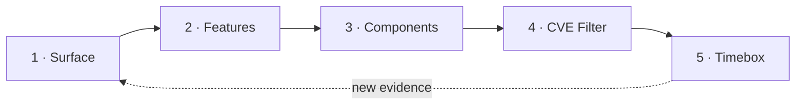

# Web Methodology

## Goal
Turn a web service into a foothold without blindly searching for exploits or getting trapped in weak hypotheses.

Use the five passes as a default loop — return to an earlier pass whenever new evidence reveals another hostname, endpoint, component or authenticated feature.



## Open this for
- Any HTTP or HTTPS service
- Common ports such as 80, 443, 8000, 8080, 8443 and 8888
- Any unknown service that responds like a web application

---

# Pass 1 — Surface Discovery

## Goal
Identify every reachable web surface before focusing on one application path.

```bash
whatweb -a3 http://$IP
curl -sI http://$IP
feroxbuster \
  -u http://$IP \
  -w /usr/share/wordlists/seclists/Discovery/Web-Content/raft-medium-directories.txt \
  -x php,html,txt,bak,zip \
  -t 50
curl -s http://$IP/robots.txt
curl -s http://$IP/sitemap.xml
```

Record: hostnames · virtual hosts · directories · files · parameters · API endpoints · alternate web ports · TLS certificate names · redirect destinations · login/registration pages.

## Hostname rule
When a page redirects to a hostname, or the source code references one, add it to `/etc/hosts` and request the application again.

```bash
echo "$IP name.pg" | sudo tee -a /etc/hosts
whatweb -a3 http://name.pg
feroxbuster -u http://name.pg -w /usr/share/wordlists/seclists/Discovery/Web-Content/raft-medium-directories.txt
```

For name-based virtual hosts → [[vhost_fuzzing]].

## Static asset rule
Deprioritise normal fonts, images and stylesheets — but inspect asset paths, filenames, comments, source maps and version strings when they reveal CMS plugins, themes, frameworks, JavaScript routes, API endpoints, internal paths, usernames or product versions.

Do not treat directory brute forcing as the whole of web enumeration.

---

# Pass 2 — Feature Mapping

## Goal
Understand what the application does with user-controlled input. Footholds are often hidden inside application behaviour rather than scanner output.

For every feature that accepts input, ask:

```text
Is the input reflected?          Does the server write a file?
Is it stored?                    Does the server execute a system utility?
Is it used in a database query?  Does the server render a template?
Does the server fetch a URL?     Does the feature require authentication?
Does the server read a file?     Does behaviour change when one value changes?
```

Map features such as: login · registration · password reset · search · contact form · file upload · image processing · preview · template editor · theme editor · plugin manager · import/export · monitoring · diagnostics · admin dashboard · webmail · API endpoints.

## Feature-to-hypothesis router

| Observed behaviour | Possible hypothesis | Next note |
|---|---|---|
| Input is reflected into HTML or JavaScript | Output-encoding issue, HTML injection or XSS | [[injection]] |
| Server evaluates expressions inside input | SSTI | [[injection]] |
| User input changes DB-backed results, errors or response behaviour | SQL injection | [[sqli]] |
| Application reads a user-controlled path or filename | LFI or path traversal | [[lfi_rfi]] |
| Server fetches a user-controlled URL | SSRF | [[injection]] |
| Server passes input to utilities such as `ping` or `nslookup` | Command injection | [[injection]] |
| Application accepts a file | Upload-validation weakness or file-processing issue | [[file_upload]] |
| Admin editor writes executable server-side files | Possible code execution | [[cms]] |
| Login or management panel exists | Defaults, reuse, enumeration or justified brute force | [[default_creds_logins]] |

> [!warning] These are hypotheses, not conclusions
> Confirm the actual server-side behaviour before selecting an exploit class. A DB-backed page is not automatically SQLi; an admin editor is not automatically a webshell.

---

# Pass 3 — Component Inventory

## Goal
Know exactly what product or component you are researching.

| Component | Version | Evidence | Access required | Status |
|---|--:|---|---|---|
| CMS core | Exact / probable / unknown | Scanner, file, source | Public | Pending |
| Plugin or theme | Exact / probable / unknown | Endpoint, source, asset | Public or authenticated | Pending |
| Framework | Exact / probable / unknown | Headers, errors, files | Public | Pending |
| Web server | Exact / probable / unknown | Nmap, headers | Public | Pending |

## Common version locations
```text
WordPress -> /readme.html, HTML generator meta, asset ?ver= params, plugin readme, LFI/source
Drupal    -> /CHANGELOG.txt, /core/CHANGELOG.txt, composer files, module metadata
Joomla    -> /administrator/manifests/files/joomla.xml, language XML, extension manifests
```

## Research rule
You may research a confirmed product before finding an exact version. Do **not** run or adapt a public exploit until you have identified: the correct product/component, the affected version range, the required endpoint/feature, the required auth level, the required role, and the expected success signal.

When the version is uncertain, treat the CVE as a hypothesis and collect more evidence before execution.

---

# Pass 4 — CVE Prerequisite Filter

Before running any public exploit, read the exploit description **and** source. Tick every box:

- [ ] The product and component match the target
- [ ] The target version is affected or plausibly affected
- [ ] The required endpoint exists
- [ ] The required plugin, module or feature is enabled
- [ ] The required authentication level is available
- [ ] The required account role is available
- [ ] The exploit hostname and path are correct
- [ ] The exploit uses the correct HTTP method
- [ ] Required objects (a post, page or uploaded file) exist
- [ ] The expected success signal is known
- [ ] The failure signal is known
- [ ] A clear stop condition is defined

> [!important] A matching version number is not enough
> The full prerequisite chain must match:
> `Product → Component → Version range → Endpoint → Feature → Authentication → Role → Configuration → Success signal`
> If one required prerequisite is missing, stop and reassess.

This filter is the web-specific face of the generic [[public_exploit_research]] workflow (evidence table, source-order research, PoC review, stop condition) — the same discipline applies to services, installed apps, and LPE candidates.

---

# Pass 5 — Timebox the Hypothesis

A service may deserve significant time. A weak hypothesis does not. Spend roughly **10–15 minutes** on one hypothesis.

**Continue only when:**
- New evidence appears
- The prerequisite chain becomes stronger
- The behaviour becomes more consistent
- You are one clear step from confirmation

**Stop when:**
- Required prerequisites are missing
- The PoC does not match the environment
- Repeated attempts provide no new information
- You are changing several variables at once
- The hypothesis depends mainly on assumptions
- You cannot explain why the exploit should work

When stuck → [[99_STUCK_RESET]].

---

# Routing

## Login page found → [[default_creds_logins]]
Order: (1) product defaults → (2) previously discovered credentials → (3) username enumeration → (4) small targeted wordlist → (5) brute force only when justified.

Generate a site-specific wordlist:
```bash
cewl -d 4 -m 5 http://$IP/path -w words.txt
```

Username sources: author names · article bylines · email addresses · registration behaviour · login-error differences · source comments · API responses · public profiles · application metadata.

Do not assume the web administrator is also a system user. Enumerate all discovered identities and test only plausible service combinations.

## DB-backed behaviour → [[sqli]]
Identify the database type before following a DBMS-specific path (MySQL/MariaDB, PostgreSQL, MSSQL, SQLite, Oracle). Do not assume `information_schema` or `@@version` is universal.

## Non-SQL login logic → [[auth_bypass]]
`strcmp()` array trick, PHP type juggling and magic-hash comparisons when a login isn't SQL-injectable.

## CMS identified → [[cms]]
Flow: identify CMS → enumerate version → enumerate plugins/modules/themes → identify public + authenticated functionality → validate CVE prerequisites → inspect admin file-edit/upload capabilities.

## Application server or management panel → [[web_apps_panels]]
Tomcat · Jenkins · phpMyAdmin · Webmin · JBoss · Grafana · Adminer · Gitea.

## Code execution or upload primitive confirmed → [[00_FOOTHOLD]]

## After foothold — inspect application files and configuration
```bash
find /var/www /opt -type f \( -iname '*config*' -o -iname '.env' -o -iname '*.bak' -o -iname '*.zip' -o -iname '*.sql' \) 2>/dev/null
grep -RniE 'password|passwd|secret|token|database|db_user|db_pass' /var/www /opt 2>/dev/null
```
Then open [[08_interesting_files]].

---

# Lessons From Practice Boxes

> [!tip] InsanityHosting — server-side behaviour first
> **Transferable rule:** determine what every interactive feature does server-side before choosing a vulnerability class.
> **Seen on:** a monitoring feature accepted an IP and caused server-side processing — the lesson was *not* "monitoring pages are SQL injectable."

> [!tip] Blogger — exploit objects & endpoints
> **Transferable rule:** check endpoint and object prerequisites before executing a PoC.
> **Seen on:** a public exploit required a real application object (`?p=27`) and a reachable endpoint.

> [!tip] BBSCute — the full prerequisite chain
> **Transferable rule:** a matching product version is insufficient when hostname, account or role prerequisites are missing.
> **Seen on:** the correct virtual host and an authenticated (registered) application state were both required.

> [!tip] GlasgowSmile — validate the version range
> **Transferable rule:** validate the affected version range before adapting or debugging a PoC.
> **Seen on:** several exploits were attempted against versions that did not match the 3.7.3 target.

> [!tip] Funbox — identities are separate sets
> **Transferable rule:** treat application users and operating-system users as separate identity sets until proven otherwise.
> **Seen on:** the WordPress administrator was not the useful system identity; the SSH account was a different user.

---

> [!important] Helpline
> Surface before exploits. Behaviour before vulnerability class. Component before CVE. Prerequisites before PoC. Evidence before persistence. **Timebox the hypothesis, not the service.**
